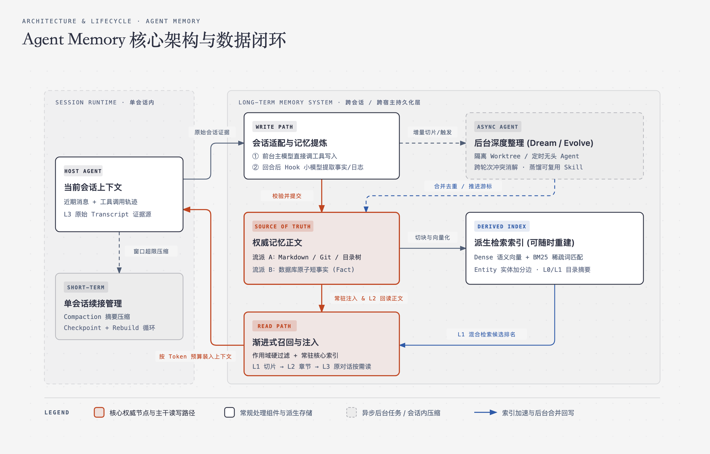
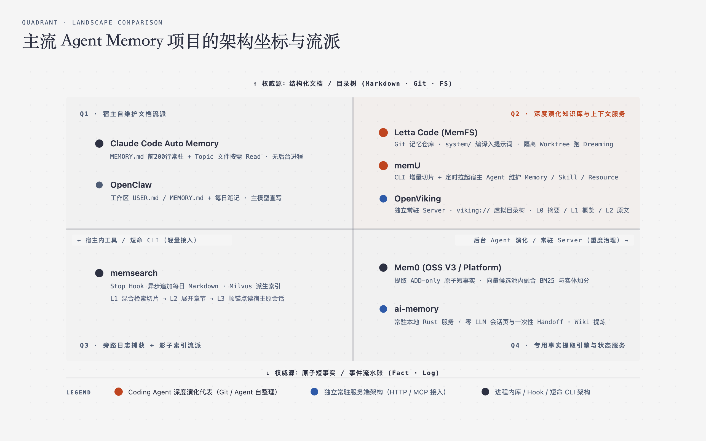

> 本文结合当前主流 Agent 记忆系统与工具（[Claude Code](/blogs/claude-code-memory/)、Letta Code、Mem0、memsearch、[memU](/blogs/memu/)、[OpenViking](/blogs/openviking/)、ai-memory、mimocode 及会话适配与可靠提交）的真实源码与工程实现整理。重点讲清跨会话记忆的核心链路、关键设计取舍与主流架构流派。

## TL;DR（面试一分钟全景回答）

Agent Memory 不是简单地“给大模型外挂一个向量数据库搜聊天记录”，而是一套**把单次会话中的原始经历提炼为可复用知识，并在后续会话中按 Token 预算精准送回上下文的持久化系统**。一套完整的记忆系统包含四条核心设计原则：

1. **边界清晰**：单会话内的上下文压缩（Compaction / Checkpoint）负责“当前长任务不断片”，跨会话的长期记忆负责“换窗口、换天、换工具后不用重讲背景”，前者的会话日志和检查点是后者的证据输入。
2. **权威正文与派生索引分离**：必须明确唯一的数据权威源——聊天与个性化应用常以**数据库里的原子短事实（Fact）**为权威源（如 Mem0），而编程与复杂任务 Agent 普遍以**本地或 Git 管理的 Markdown 文档/目录树**为权威源（如 Claude Code、Letta Code、memsearch、memU），向量（Embedding）和全文检索（BM25）只是随时可删、可重建的派生加速索引。
3. **分层异步提炼与可靠提交**：写入分为“前台主模型顺手直写”、“回合结束 Hook 调小模型异步记摘要”和“后台独立子 Agent 定期合并重写（Dream / Self-Evolve）”三种深度；跨存储落盘时必须遵循**权威正文先提交、成功后才推进消费游标（Cursor）**的顺序。
4. **混合检索与渐进式披露（Progressive Disclosure）**：召回时先按用户/项目作用域硬过滤，再用“语义向量 + BM25 关键词 + 实体/目录信号”混合排序；注入上下文时采用**常驻核心索引 + 按需分层下钻（索引/摘要 → 完整章节 → 原始对话日志）**，用最少的 Token 拿到最准的上下文。

---

## 1. 系统边界与整体架构：Agent Memory 到底在管什么？

> **本章核心（面试速答）**：设计 Agent Memory 前要先划清三条边界：① **单会话上下文管理 vs 跨会话长期记忆**（前者防窗口溢出，后者做跨期知识复用）；② **记忆的四种内容类型**（用户偏好 User、项目事实与决策 Project/Fact、情景经历与交接 Episode/Handoff、可复用操作流程 Skill/Procedure）；③ **三种实际运行形态**（宿主进程内直写/内嵌库、短命 CLI + 生命周期 Hook/定时任务、独立常驻 Server）。不要把代码里的模块分层直接当成独立部署的微服务。

### 1.1 单会话续接 vs 跨会话长期记忆

很多初学者会把“怎么让一个长达几百轮的会话不爆上下文窗口”和“长期记忆系统”混为一谈。实际上，这两者解决的是不同时间尺度的问题：

- **单会话上下文管理（Session Context Management）**：生命周期绑定在当前会话（Conversation / Thread）内。当消息快撑满物理上下文窗口时，系统通过 **Compaction（摘要压缩）** 把早期消息压成一段总结，或者像 **mimocode** 那样在窗口达到 20%、40%、60% 时由旁路 `checkpoint-writer` 提早提取包含“当前意图、任务树、下一步动作、已改文件”的 `checkpoint.md`，等窗口满时执行 **Rebuild** 重新组装上下文，形成无界会话循环（Cycle）。
- **跨会话长期记忆（Long-Term Memory）**：生命周期跨越多个会话，甚至跨越不同 Agent 工具（例如上午用 Claude Code 排查，下午在同一目录打开 Codex 继续改）。它关注的是：哪些结论在当前任务结束后依然成立？下次开启全新窗口时怎样找回来？当旧事实过期时怎样替换？

两者的衔接关系非常直接：**单会话的原始对话轨迹（Transcript）、工具调用结果和 Checkpoint，是长期记忆系统的原始证据（Evidence）**。只有其中具备跨会话复用价值的部分，才会被提炼并晋升为长期记忆。



### 1.2 长期记忆保存的四类核心内容

如果把所有长期记忆都当成同一种文本块，后续的提取、加载和过期淘汰都会非常混乱。观察主流系统的目录或 Schema 设计（如 Claude Code 的四种 frontmatter `type`、Letta Code 与 memU 的目录划分、OpenViking 的三类上下文），长期记忆在实际工程中主要分为四类，：

1. **用户画像与反馈偏好（User / Profile / Feedback）**：用户的角色、技术栈偏好（如“用 pnpm 不用 npm”）、沟通风格以及对 Agent 行为的明确纠正（如“跑集成测试前必须连本地 Redis”）。这类信息跨项目或项目内长期有效，变更频率低，适合高优先级保留。
2. **项目事实与架构决策（Project Fact / Decision）**：代码库表面看不出来的背景知识——为什么认证模块放弃了某方案、正在推进的重构边界、外部看板或文档系统的地址（Reference）。
3. **情景经历与会话交接（Episode / Daily Journal / Handoff）**：按时间顺序记录“某天某次会话干了什么、遇到了什么报错、停在了哪一步”（如 memsearch 的 `memory/YYYY-MM-DD.md`、ai-memory 的 `sessions/<id>.md` 与一次性 Handoff 交接记录）。它保留了任务的时间线脉络，也是后续提炼规律的中间原料。
4. **程序性记忆与技能（Procedure / Skill）**：解决“下次遇到同类任务具体怎么做”的可复用工作流（通常遵循 Agent Skills 规范写成 `SKILL.md`）。普通记忆回答“知道什么”，Skill 回答“怎样一步步执行”。

### 1.3 三种实际运行形态：看清进程边界

在阅读开源项目或自己做架构设计时，首先要问**记忆逻辑到底运行在哪个进程里**，而不是只看底层用了 SQLite 还是 PostgreSQL：

- **形态一：宿主进程内工具或内嵌库（无独立进程）**。最典型的代表是 **Claude Code Auto Memory** 和 **Mem0 的 Python SDK 模式**。Claude Code 根本没有后台记忆守护进程，CLI 只是在会话启动时把 `~/.claude/projects/<项目>/memory/MEMORY.md` 的前 200 行塞进上下文，并给主模型配好普通的文件读写工具（Read/Write/Edit），记忆的提取、写入和按需读取全在主模型每轮正常推理的工具调用中完成。Mem0 的 `Memory()` 实例也是直接跑在你的 Python 业务进程内，同步或异步调用配置好的 LLM 与向量库。
- **形态二：短命 CLI + 宿主生命周期 Hook / 系统定时任务**。以 **memsearch** 和 **memU（本地模式）** 为代表。它们平时没有常驻服务进程：当宿主触发 `SessionStart`、`Stop` 等生命周期 Hook，或者模型调用检索命令时，才临时拉起一次 CLI 子进程，查完或写完立刻退出。哪怕需要后台定期整理（如 memU），也是由操作系统的 `cron` / `launchd` 定时拉起一次无头（headless）宿主 Agent，执行 `prepare → 编辑文件 → commit` 后退出。
- **形态三：独立常驻服务端（Client-Server 架构）**。以 **OpenViking（`openviking-server`）**、**ai-memory（`ai-memory serve`）** 和 **Mem0 自托管 FastAPI Server** 为代表。机器或集群上常驻一个独立的 HTTP / MCP 服务进程，统一持有底层数据库和文件系统的写入权，并在服务内部维护异步任务队列（负责文档解析、向量化、L0/L1 摘要生成和后台记忆合并）。各个 Agent 插件、CLI 和 Web 面板都只是访问该服务的客户端。这种形态天然避免了多 Agent 并发写坏本地文件锁的问题（例如 memsearch 在使用本地单文件 Milvus Lite 时，就因为文件锁限制无法同时常驻 `watch` 进程和执行按需 `search`，必须切到 Milvus Server 模式才能实时监听）。

---

## 2. 写入链路：一次对话如何变成可靠的长期记忆？

> **本章核心（面试速答）**：写入链路需要依次解决三个工程问题：① **怎么接原始会话**（不建沉重的中央会话副本库，用薄适配层做增量读取、清洗敏感信息并保留原始日志指针 `raw_ref`）；② **谁在什么时候提炼**（前台主模型顺手写、回合后 Hook 调小模型异步记摘要、后台定时拉起子 Agent 跨轮次深度整理，三者分别权衡零延迟与高整合度）；③ **怎么保证多步落盘的可靠性**（遵循“权威正文先提交 → 派生索引可异步重试 → 提交成功后才推进消费游标 cursor”，并在并发整理时用 Git Worktree 或单写者队列隔离）。

沿着一次真实任务的发生顺序，当用户和 Agent 完成一轮或多轮交互后，原始对话要经历**捕获适配、内容提炼、可靠提交**三步才能变成长期记忆。

### 2.1 会话捕获与薄适配：为什么不必建“统一会话数据库”？

一个跨工具的记忆系统往往要面对五花八门的宿主日志格式：Claude Code、Codex 和 Pi 把会话存成结构各异的 JSONL 文件，而 OpenCode 等工具则把会话存在 SQLite 表里。

遇到这种情况，不需要把所有宿主的聊天记录实时同步、复制到一个庞大的“中央会话数据库”里。更轻巧、可靠的做法是保留宿主原生日志作为原始证据的唯一权威源，在记忆系统入口做一层**薄适配（Thin Adapter）**：

1. **确定程序边界**：模型虽然能直接读懂 JSON 文本，但很难低成本判断“上次成功处理到了第几行”、“哪条工具调用其实执行失败了并被后续重试推翻”、“哪些内容只是系统心跳噪声”。薄适配层负责解析宿主游标（行号、字节偏移或事件 ID）、过滤噪声、把记录归类为 `MESSAGE / TOOL / OTHER`，并对密钥、Token 等敏感文本做入库前的正则清洗与体积截断（如 ai-memory 在 Hook 边界强制清洗并限制单条提示不超过 16KiB）。
2. **生成临时增量切片并保留原文指针（`raw_ref`）**：例如 **memU** 在后台整理时，只读取上次游标之后的新增记录，在临时工作区生成本次待处理的 `<idx>.jsonl` 切片，处理完即清理；**memsearch** 则只在生成的 Markdown 摘要末尾留下一行 HTML 注释锚点（记录 `session_id`、`turn` 和原 transcript 文件路径），需要核对细节时再按路径回读宿主原文件。

### 2.2 谁在什么时候判断“什么值得记”？（三种提取机制的取舍）

拿到当前回合或当前会话的输入后，究竟由谁来决定提炼出什么内容？主流系统演化出了三种不同深度的机制，很多成熟项目会组合使用：

| 提取机制 | 触发时机与执行者 | 核心优势 | 局限与代价 | 典型代表 |
| --- | --- | --- | --- | --- |
| **1. 热路径主模型直写** | 对话进行中，由当前主 Agent 自己判断并调用文件/记忆工具写入 | 拥有最完整的当前任务语境；无需额外部署提取模型或后台进程 | 主模型忙于改代码时容易漏记；占用当前回合的推理耗时与 Token | Claude Code Auto Memory、Letta Code 前台 `memory` 工具 |
| **2. 回合/会话结束旁路提取** | `Stop` / `SessionEnd` Hook 或业务代码异步调用轻量 LLM（或确定性规则） | 不阻塞前台交互；保证每一轮或每次会话都稳定留下记录 | 单轮视角局部，容易攒下零散流水账；小模型可能误解复杂上下文 | Mem0 `add()`、memsearch `Stop` Hook、ai-memory 会话页与 Handoff |
| **3. 后台 Agent 深度反思（Dream / Evolve）** | 达到步数/压缩事件或定时任务触发，拉起独立子 Agent 阅读近期日志与旧记忆库 | 能通读多轮历史，执行跨文件的语义合并、冲突覆盖与 Skill 蒸馏 | 链路最长；需要严密的并发隔离（如 Git Worktree）与游标恢复机制 | Letta Code Dreaming、memU `prepare/commit`、mimocode Dream & Distill |

具体来看这三种机制在真实项目里是如何配合的：

- 在 **Mem0** 的旁路提取中，如果用户上一句说“我在对比东京和大阪”，下一句说“我更喜欢后者”，单看第二句根本提取不出有效事实。因此 Mem0 在调用提取 LLM 前，会先从本地 SQLite 取出该作用域**最近 10 条原始消息**补足指代语境，并从主向量库检索一批**相似旧记忆**一并喂给提取提示词，从而提炼出独立完整的短事实“用户更喜欢大阪”。
- 在 **memsearch** 中，每次宿主回答结束触发 `Stop` hook 时，脚本会立刻返回 `{}` 避免卡住终端，同时在后台分离（detached）出一个子进程，调用禁用了 hook 的轻量模型（如 `claude -p` 或 `codex exec --ephemeral`）把刚结束这一轮提炼成 2～10 条要点，追加到当天的 `.memsearch/memory/YYYY-MM-DD.md` 中；如果模型调用失败，还会优雅降级为直接写入“用户问题 + 截断后的回答”，确保关键经历不丢失。
- 单轮追加解决了“记下来”的问题，但时间一长就会产生大量碎片和过时结论。为此，**Letta Code** 设计了 **Dreaming（后台反思）**：当会话发生上下文压缩或累计达到一定步数后，后台会启动一个临时的 reflection subagent，把尚未反思的对话切片和当前记忆交给它，让它对记忆文件做筛选、合并与重写。**memU** 则更进一步，它不在自己的 `MemoryService` 里调小模型做提取，而是通过 `prepare` 生成整理任务，定时唤醒宿主的无头 Agent，让最懂业务语境的宿主 Agent 自己去对已有 Markdown 执行 `no-op`、局部补丁修改或新建文件。**mimocode** 则把这种后台整理按周期拆成两档：每 7 天跑一次 **Dream**（合并去重、清理失效文件引用），每 30 天跑一次 **Distill**（从历史会话中识别重复工作流，固化为可复用的 `SKILL.md` 或 SOP）。

### 2.3 可靠提交、并发隔离与消费游标边界

后台异步提取和跨存储写入很容易遇到进程崩溃、网络超时或并发冲突。要把写入链路做可靠，工程上需要守住三条底线：

第一，**“写后确认”与游标推进边界**。当系统增量扫描会话日志时，绝不能在刚读出日志或任务刚入队时就把消费游标（Cursor）往前推。以 **memU** 为例，它的 `prepare` 阶段只把新游标写进临时的 `pending manifest`；只有当 Agent 完成编辑、CLI 在 `commit` 阶段算完所有 Embedding 并确认后端存储写入成功后，才把 `pending` 游标提升为正式游标。如果中途失败，下次运行仍能从旧游标安全重试。同时，“完成处理”针对的是**固定输入范围**而非“必须产生新记忆”——如果一段对话全是闲聊或旧记忆已覆盖，Agent 判定为 `no-op`（无变更）同样属于成功处理，应当正常推进游标，防止死循环重跑。

第二，**跨存储无总事务时的主次顺序**。几乎没有开源记忆系统会在 Markdown、向量数据库和 SQLite 之间搞沉重的分布式两阶段提交。正确做法是**先确保唯一权威正文落盘，把索引和辅助状态视为可补偿、可重建的下游**。比如 **Mem0** 在 `add()` 时先批量算好向量写入主向量库，随后再依次写 SQLite 历史、Entity Store 和近期消息（若实体抽取失败只打 warning，不回滚主记忆）；**memsearch** 在单文件更新时如果删掉旧切片后调用 Embedding 失败，本地 Markdown 原文毫发无损，下次重跑 `index` 就能修复索引。

第三，**前台使用与后台整理的并发隔离**。如果后台 Dreaming 子 Agent 正在大刀阔斧地重写记忆文件，而前台用户同时在和主 Agent 聊天读写记忆，工作区就会撞车。**Letta Code** 的解法非常漂亮：MemFS 本身是一个 Git 仓库，且系统编译提示词时**只读取已提交的 Git `HEAD`**（忽略工作区未 commit 的文件）；当后台启动 Dreaming 时，系统基于当前 `HEAD` 创建一个独立的 `letta/reflection/*` 分支和 **`git worktree`**，让子 Agent 在完全隔离的目录里修改并 commit，最后检查主仓库干净时再 merge 回主分支，若发生冲突则直接放弃本轮反思、保留对话游标等下次重试。而在 SQLite 存储上，**ai-memory** 则采用**单写者线程队列 + 多读连接池**来消除并发写锁冲突。

---

## 3. 存储与演进：权威正文、派生索引与新旧冲突消解

> **本章核心（面试速答）**：存储层的第一原则是**“权威正文（Source of Truth）与派生索引（Derived Index）严格分离”**。当前主流方案分为两大流派：一派以**数据库里的原子短事实（Fact）**为权威正文（如 Mem0），粒度细、易按元数据过滤，适合对话与用户画像；另一派以**本地或 Git 管理的 Markdown 文档/目录树**为权威正文、将向量和全文索引作为影子缓存（如 Claude Code、Letta Code、memsearch、memU、OpenViking），适合编程 Agent 与复杂知识。处理“记忆过期与新旧冲突”时，工程上主要采用 **ADD-only + 定期整文件重写/显式删除** 或 **Agent 原地补丁覆盖 + Git 版本管理**。

### 3.1 权威正文的两大流派：原子事实 vs 结构化文档

为什么不同 Agent Memory 项目的存储长相差别这么大？因为它们对“一条记忆的最小权威单位是什么”做出了截然不同的选择：

| 对比维度 | 流派 A：原子短事实库（Atomic Facts） | 流派 B：结构化 Markdown / 目录树（Files & Trees） |
| --- | --- | --- |
| **权威数据源** | 向量数据库或关系表中的单句短事实记录 | 本地磁盘、Git 仓库或虚拟文件系统中的 `.md` 文档 |
| **典型内容形态** | `"用户居住在上海"`、`"用户偏好深色模式"` | `MEMORY.md`、`system/persona.md`、`PROJECT.md`、`SKILL.md` |
| **主要优势** | 粒度极细，可只召回单条相关事实，不浪费 Token；天然适合多租户字段过滤与独立删除 | 人类肉眼可读可改；天然支持 Git diff/回滚/分支；能完整保留架构脉络与多步操作流程（Skill） |
| **主要代价** | 拆碎后丢失长篇上下文逻辑；对开发者是黑盒；提取边界完全依赖 LLM | 单文件变大后不能全量塞进上下文，必须配合目录索引、分块检索或分层摘要按需读取 |
| **代表系统** | **Mem0** | **Claude Code、Letta Code、memsearch、memU、OpenViking、ai-memory** |

以 **Mem0（OSS V3）** 为例，它内部同时用了主向量集合、实体集合（Entity Store）和 SQLite 三个存储，但**只有主向量集合里的短事实 payload 是权威正文**；Entity Store 只是记录“某个实体词关联了哪些 memory ID”用来在搜索时给候选加分（不是独立的知识图谱），SQLite 则只存变更审计历史和最近 10 条原始消息。

反观编程 Agent 领域，几乎清一色选择了 **Markdown 文件作为唯一权威源**。原因很简单：工程师在写代码时，最需要记住的是项目构建规范、模块边界、排障步骤（Skill）和未完待续的任务状态。这些内容本身就是带结构的文档，如果强行拆成几十条孤立的单句塞进向量库，不仅检索回来时支离破碎，而且一旦模型记错了，开发者都没法直接打开编辑器删改一行。像 **memsearch** 和 **ai-memory** 虽然都建了向量和全文索引，但它们都把 Markdown（或 Git Wiki）奉为唯一真相——索引库随时可以删掉重扫，但绝不允许把向量库里的切片当成主数据。

### 3.2 记忆更新与新旧冲突：当“北京”变成“上海”时怎么办？

长期记忆最难的地方不是“存进去”，而是当客观事实发生变化（例如用户从北京搬到了上海，或者项目包管理器从 npm 换成了 pnpm）时，怎样避免旧记忆继续误导 Agent。

许多理论文章喜欢设计一套包含半衰期、重要度、波动率的复杂数学衰减公式，但哪怕给旧记忆乘以 `0.8` 的时间衰减系数，“用户住在北京”和“用户住在上海”在语义上依然高度相似，照样会一起被Top-K 召回。在真实开源项目中，解决新旧冲突靠的是以下三种确定性工程机制：

1. **追加写入（ADD-only）+ 显式维护或后台定期整文件重写**：
   - 在 **Mem0** 早期的 V2 版本中，曾尝试让 LLM 在每次 `add()` 时直接输出 `ADD / UPDATE / DELETE` 指令去自动覆盖或删掉旧记忆；但实践发现小模型在单轮对话里自动删改旧记忆极易误删。因此在 **Mem0 OSS V3** 中，自动提取管线改为了纯粹的 **ADD-only**（只生成新增事实，并按文本 MD5 做字面精确去重），把冲突消解交给应用层的显式 `update(memory_id)` / `delete(memory_id)` API，或在提示词中附上每条事实的时间戳由推理模型判断最新状态。
   - **memsearch** 的日常捕获也是纯粹往每日日志里追加；为了得到冲突消解后的最新状态，它通过可选的后台维护任务（`project_review` / `user_profile`）定期读取最近最多 12 个日志文件，让模型综合判断后**整文件替换** `PROJECT.md` 和 `USER.md`。（注：它的 `memsearch compact` 命令只是把已有切片再汇总成一段新摘要追加到当天日志，并不会删除旧文件或旧切片。）
2. **Agent 原地编辑（In-place Edit / Patch）+ Git 版本历史**：
   - 在 **Claude Code**、**Letta Code** 和 **memU** 中，记忆本身就是分类好的几个 Markdown 文件。当状态变化时，Agent 会先读取对应的主题文件（如 `project_build.md` 或 `system/project.md`），直接调用 `Edit` 或 `memory_apply_patch` 把里面的 `npm` 改成 `pnpm`。当前文件中永远只保留最新生效的结论，而被替换掉的历史版本则天然保存在 Git commit 记录中，既不会在召回时产生新旧冲突，又能随时审计回滚。
3. **分层淘汰与人工确认门禁（Gate）**：
   - 并非所有记忆都需要永久保留。**ai-memory** 将记忆区分对待：记录单次对话流水账的会话页（`sessions/<id>.md`）属于情景记忆，会随时间和未命中次数变冷并从 Wiki 撤下归档；而决策页（`decisions/`）、陷阱页（`gotchas/`）和规则页则不参与时间衰减。
   - 对于会影响 Agent 后续执行行为的程序性记忆（Skill），**memsearch** 设置了严格的安全边界：后台从日志里蒸馏出的 `SKILL.md` 只保存在 `.memsearch/skill-candidates/` 候选目录中，默认是惰性的（inert），必须由用户或 Agent 显式执行安装命令，才会复制到宿主的技能目录中生效，防止一次错误的排查经历被自动固化成永久行为规则。

---

## 4. 召回与注入：如何在有限 Token 预算下精准用起记忆？

> **本章核心（面试速答）**：把所有搜出来的记忆片段无脑塞进 System Prompt，既费钱又会稀释当前指令的注意力。现代 Agent Memory 的标准召回范式是 **“常驻核心索引 + 多路混合检索 + 渐进式披露（Progressive Disclosure）”**：① 把极少量核心身份和目录索引固定放在提示词开头；② 检索时先做作用域（`user_id / project_id`）硬过滤，再融合 Dense 向量语义、BM25 关键词（抓函数名/错误码）和实体/目录信号重排；③ 按成本从低到高分层暴露（目录索引/L0摘要 → L1切片/概览 → L2完整章节 → L3原始会话日志），让 Agent 像查字典一样按需深挖。

当用户提出一个新问题时，记忆系统要把相关知识送回模型上下文，通常会走完以下三个层次：

### 4.1 常驻预载（Always-in-Prompt）与预算红线

有些记忆是不需要靠“搜索”触发的——比如用户的全局红线规则、当前项目的核心约定，或者“当前到底有哪些记忆文件可读”的目录地图。如果连地图都要靠模型猜关键词去搜，模型往往根本想不到去查。

因此，几乎所有文件型记忆系统都会在会话启动或每轮编译提示词时，划出一小块固定预算做**常驻预载**，同时严格限制体积：

- **Claude Code** 在每次会话启动时，除了加载手写的 `CLAUDE.md`，还会自动读取项目记忆入口 `MEMORY.md` 的**前 200 行或 25KB**（先到先得）注入上下文。`MEMORY.md` 里只写“一行一条”的简短索引，具体细节放在独立的 topic 文件（如 `feedback_testing.md`）中不预载。当模型写入时，CLI 会主动检测 `MEMORY.md` 长度，接近上限就提醒模型精简合并，超限则直接报错要求重写索引。
- **Letta Code** 在编译系统提示词时，只把 `system/` 目录下的核心文件（如 `persona.md`、`human.md`）正文放进 `<self>` 和 `<memory>` 标签；其余所有 `reference/` 和 `skills/` 文件只把目录树结构和一句话 `description` 放进 `<external_projection>`。
- **ai-memory** 则在切换工具开启新会话时，通过 `SessionStart` 钩子把上一轮结束时留下的**一次性交接记录（Handoff）**注入新窗口（通过 CAS 原子比较并设置状态，领走一次即标记为已接受，防止重复注入），让接手的 Agent 立刻知道刚才停在哪一步。

### 4.2 多路混合检索：为什么只有向量相似度不够？

当需要从大量历史记录中按需召回时，单纯依赖 Embedding 向量检索有两个明显短板：一是向量对代码里的精确符号（函数名、报错码、文件路径、配置项键名）非常迟钝；二是向量相似度无法保证权限边界与实体聚焦。

因此，主流检索管线都遵循**“先硬过滤，再多路混合召回重排”**的设计：

1. **第一步永远是作用域硬过滤（Scope Filtering）**。无论是 Mem0 的 `user_id / agent_id / run_id`（组合时取交集，绝不自动回退到更宽范围），还是 memsearch / Claude Code 按项目 Git 仓库路径派生的隔离空间，都必须在向量检索阶段作为前置过滤条件。在生产服务端，作用域标识必须由后端根据认证身份注入，不能信任客户端传参。
2. **Dense 语义向量 + BM25 关键词 + 实体/图信号融合**：
   - 在 **Mem0（OSS V3）** 中，`search()` 先用查询向量从主库取出 `max(top_k × 4, 60)` 个语义候选（语义阈值 `threshold` 在此步过滤），随后**在候选池内部**叠加 BM25 关键词得分，并用本地规则抽取查询中的实体词去 Entity Store 查找关联的 memory ID，给予最高 `0.5` 的实体加分，最后动态归一化（若开启了 Reranker 则再做一次精排）。注意它的 BM25 和实体信号只负责在语义候选池内重排，不能把未进池的记录捞出来。
   - 在 **memsearch** 中，Milvus 同时运行两路独立检索：一路是 Dense 向量余弦相似度（找意思相近的描述），另一路是 Milvus 原生 BM25 稀疏向量（精确抓错误码和标识符），最后用 **RRF（Reciprocal Rank Fusion）** 算法融合两路排名，使精确术语与语义改写都能直接进入候选结果。
   - 在 **ai-memory** 中，查询甚至优先跑全文检索、页面头部声明的专有名词匹配和 Wiki 页面间的链接图扩展，将本地向量作为第四路补充信号合并排序，并为规则、决策、步骤页赋予比普通会话流水账略高的权威系数。

### 4.3 渐进式披露（Progressive Disclosure）：三种分层下钻模式

检索命中后，如果直接把命中的几篇完整长文档或整段历史对话塞进上下文，瞬间就会吃掉几万 Token。为此，**渐进式披露（先看低成本摘要/切片，不够再按需展开完整内容或回溯证据）** 成为了当前 Agent Memory 最核心的架构共识。真实项目中主要有三种落地模式：

```text
模式 A（索引 → 主题文件，如 Claude Code / Letta Code / memU）：
  常驻 MEMORY.md 索引或目录树 (几百 Token)
  ──[模型判断需要]──→ 调用 Read 读取目标 topic.md 或 SKILL.md 全文

模式 B（切片 → 章节 → 原对话，如 memsearch）：
  L1: memsearch search   ──→ 返回混合检索命中的 Top-K Markdown 切片 (Chunk)
  L2: memsearch expand   ──→ 传入切片哈希，回读本地源 Markdown 展开完整标题章节 (Section)
  L3: memsearch transcript ─→ 顺着章节内的 HTML 锚点，调用宿主解析器读取原始 JSONL/SQLite 对话

模式 C（虚拟目录树 + L0/L1/L2 语义分层，如 OpenViking）：
  viking:// 虚拟目录树定位检索范围
  ──→ L0 Abstract（一句话摘要，快速判断相关性）
  ──→ L1 Overview（结构与核心要点概览，决定是否深入）
  ──→ L2 Content（原始完整文档或记忆正文，真正执行任务时按预算加载）
```

这三种模式的共同精髓在于：**把“发现记忆在哪”和“把完整内容读进上下文”拆成两步**。特别是模式 B（memsearch）和模式 C（OpenViking），不仅省下了大量无关 Token，还打通了从“高层结论”一路回溯到“原始对话证据（L3 Transcript）”的证据链——当摘要写得模棱两可、Agent 需要确认当时报错的具体堆栈或某行代码 diff 时，随时可以顺着锚点下钻到底层原始日志。

---

## 5. 主流 Agent Memory 项目全景对比与选型指南

> **本章核心（面试速答）**：评估或选型任何一套 Agent Memory 方案，不需要背它的类名和配置项，只需沿着上述主线问四个问题：**① 权威正文是什么粒度、存在哪？② 谁在什么时候负责提取和消解冲突？③ 怎样召回并控制 Token 开销？④ 记忆核心运行在什么进程里？**

### 5.1 主流项目架构坐标与横向对比

把当前主流的开源项目放到“权威记忆形态 × 运行与维护深度”的坐标系中，可以一眼看清各自的流派定位：



下表用同一套工程标尺横向拉通对比这七个代表性系统（外加单会话与分层结合的 mimocode）：

| 系统 / 项目 | 权威正文（Source of Truth） | 派生索引 | 谁在何时提取与维护记忆 | 核心召回与注入方式 | 实际运行形态 |
| --- | --- | --- | --- | --- | --- |
| **[Claude Code](/blogs/claude-code-memory/)** | 本地 `CLAUDE.md` + `MEMORY.md` 索引 + 独立 topic `.md` 文件 | 无（纯文件与行号上限） | 对话进行中，由主模型自己调 Write/Edit 写入并维护索引（200行/25KB上限） | 启动时全量加载 `CLAUDE.md` 与 `MEMORY.md` 前200行；按需 `Read` 主题文件 | 宿主 CLI 进程内文件工具，**无后台线程/数据库** |
| **Letta Code** | Agent 专属的 Git 仓库（**MemFS**）：`system/`、`reference/`、`skills/` | 可选插件（默认无向量，靠目录树与文本搜索） | 前台调 `memory` 工具直写并 `git commit`；后台按压缩/步数在隔离 **`git worktree`** 跑 Dreaming 子 Agent 合并 | 每轮从 Git `HEAD` 编译 `system/*` 正文与其余目录树进提示词；按需读文件 | 本地 CLI + Local 或 Letta Cloud 远端 Git 同步 |
| **Mem0 (OSS V3)** | 主向量库（Vector Store）中的**可独立检索短事实（Fact）** | 同后端的 Entity Store（实体加分）+ SQLite（历史与近10条消息） | 宿主调用 `add()` 时，结合近期消息与相似旧记忆由 LLM 提取 **ADD-only** 事实；冲突靠显式 `update/delete` | 宿主回答前调 `search()`：作用域硬过滤 → 语义候选池内融合 BM25 与实体加分 | 进程内 Python/TS 库、自托管 FastAPI Server 或云平台 |
| **memsearch** | 项目 `.memsearch/` 下的每日日志、`PROJECT.md`、`USER.md`、Skill 候选 | **Milvus**（Dense 向量 + BM25 稀疏向量），可随时从 Markdown 重建 | `Stop` hook 分离后台进程调小模型追加 2～10 条每日摘要；可选后台任务整文件重写 `PROJECT/USER` | **L1** 混合检索（RRF）拿切片 → **L2** `expand` 回读 Markdown 章节 → **L3** 顺锚点读宿主原对话 | 短命 CLI / 库 + 宿主 Hook（Server 后端下可选常驻 `watch`） |
| **[memU](/blogs/memu/)** | 后端存储中的 Memory、Skill、Resource Markdown 文档 | 文档切分出的细粒度 Segment 向量索引 | OS 定时任务拉起无头宿主 Agent：`prepare` 增量切片 → **宿主 Agent 亲自编辑合并文档** → `commit` 算向量并推进游标 | Agent 调 `retrieve` CLI 搜索 segment，将命中的完整文件写到本地缓存后按需打开 | 短命 CLI + 定时拉起的无头宿主 Agent（或连 Cloud） |
| **[OpenViking](/blogs/openviking/)** | `viking://` 虚拟文件系统下的 Resource、Memory、Skill 正文 | 派生向量索引 + 异步生成的 **L0（摘要）/ L1（概览）** 目录级 sidecar | 插件同步归档会话消息；服务端后台队列异步压缩会话、提取候选并与现有记忆合并 | 结合目录树路径与查询意图逐层检索，按 Token 预算按需加载 **L0 → L1 → L2（原文）** | **独立常驻 HTTP/MCP Server** + 内部异步任务队列 |
| **ai-memory** | 本地数据目录 Git 仓库中的 Wiki Markdown 页面 | SQLite FTS 全文索引 + 页面链接图 + 进程内本地向量（会话与交接状态权威在 SQLite） | 生命周期 Hook 实时清洗截断事件；会话结束时**零 LLM 规则生成会话页与一次性 Handoff**；后台可选 LLM 提炼决策页 | 新会话开头自动领取并注入一次 Handoff；对话中通过 MCP 四路混合查询 Wiki 页 | **本地/团队常驻 Rust 服务（`ai-memory serve`）**，单写者队列 |
| **mimocode** | 四层结构：`checkpoint.md` → 项目 `MEMORY.md` → 全局记忆 → SQLite 原文 History | 无复杂向量，靠结构化分层与 History 工具回溯 | 单会话内多阈值由 `checkpoint-writer` 提早提取并按 ~65K 预算 **Rebuild**；跨会话每 7 天 **Dream** 去重、每 30 天 **Distill** 提炼 Skill | Rebuild 时按固定槽位预算组装分层提示词 + 暴露可按需读取的文件路径索引 | 宿主 Runtime 内置旁路 subagent 与周期性维护任务 |

### 5.2 如果在面试或实际工程中让你设计一套 Agent Memory，怎么选型与演进？

不要一上来就画包含图数据库、消息队列和十几个微服务的架构图。根据业务场景和团队阶段，最务实的选型与演进路径可以分为三步：

1. **第一阶段（MVP / 单一 Coding Agent 或个人助手）：学 Claude Code，用“索引 Markdown + 主题文件按需读”起步**
   - **做法**：不引入任何向量数据库和后台常驻服务。在工作区或用户目录下维护一份受行数限制（如 200 行内）的 `MEMORY.md` 作为常驻目录索引，具体知识按主题存成独立的 `.md` 文件（配合 Git 做版本控制）。给主模型提供标准的文件读写/编辑工具，并在系统提示词中规定何时更新索引、何时按需读取主题文件。
   - **为什么有效**：零基础设施运维成本，100% 人类可读可改，没有新旧事实并存的黑盒污染问题，已经能解决 80% 的项目规范、用户偏好和排障笔记复用需求。

2. **第二阶段（跨工具共享 / 历史记录变多，单靠目录树装不下）：学 memsearch / Mem0，引入“旁路异步捕获 + 混合检索 + 渐进式展开”**
   - **如果是面向开发者的多 Agent 协同场景（学 memsearch / ai-memory）**：继续保持本地 Markdown 为唯一权威源，在宿主 `Stop / SessionEnd` 钩子中异步追加带原始会话锚点的每日摘要（以及跨工具接力所需的一次性 Handoff）；旁路引入 SQLite FTS5 或轻量向量库（Dense + BM25 混合检索）作为可随时重建的派生索引，并提供 `search（看切片）→ expand（看章节）→ transcript（看原对话）` 的三层渐进读取工具。
   - **如果是面向 C 端或多租户 SaaS 的对话业务场景（学 Mem0）**：以数据库中的原子短事实为主存储，回答前按服务端校验的 `user_id` 执行语义 + BM25 + 实体加分检索，回答后异步调用提取模型结合近期消息补充事实，并为会变化的状态属性提供显式覆盖或时间戳过滤。

3. **第三阶段（长期运行后日志膨胀、碎片冲突增多，或走向多 Agent 平台治理）：学 Letta Code / memU / OpenViking，引入“后台隔离反思（Dream）与分层上下文服务”**
   - **解决长期碎片与冲突（学 Letta Code / memU）**：不要在每次前台写入时做全库扫描合并，而是维护增量消费游标（遵循“权威写入成功后才推进游标”的写后确认原则），在满足步数阈值或定时空闲窗口时，拉起后台反思子 Agent，在隔离的 `git worktree` 或临时工作区中通读近期日志，合并更新项目状态文档并蒸馏可复用的 `SKILL.md`。
   - **走向多租户与跨应用平台治理（学 OpenViking）**：当多个 Agent 需要共享庞大的外部文档（Resource）、用户记忆（Memory）与技能（Skill）时，再将记忆内核独立为常驻服务端，用统一的虚拟目录树（如 `viking://`）管理权限隔离，并通过异步队列生成 L0（摘要）→ L1（概览）→ L2（原文）分层结构。
