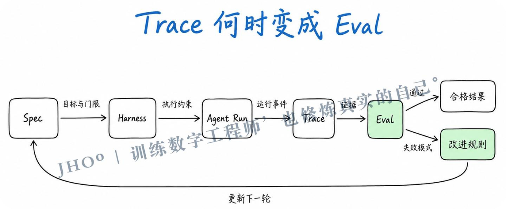
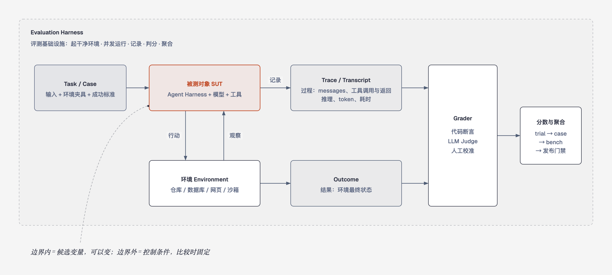
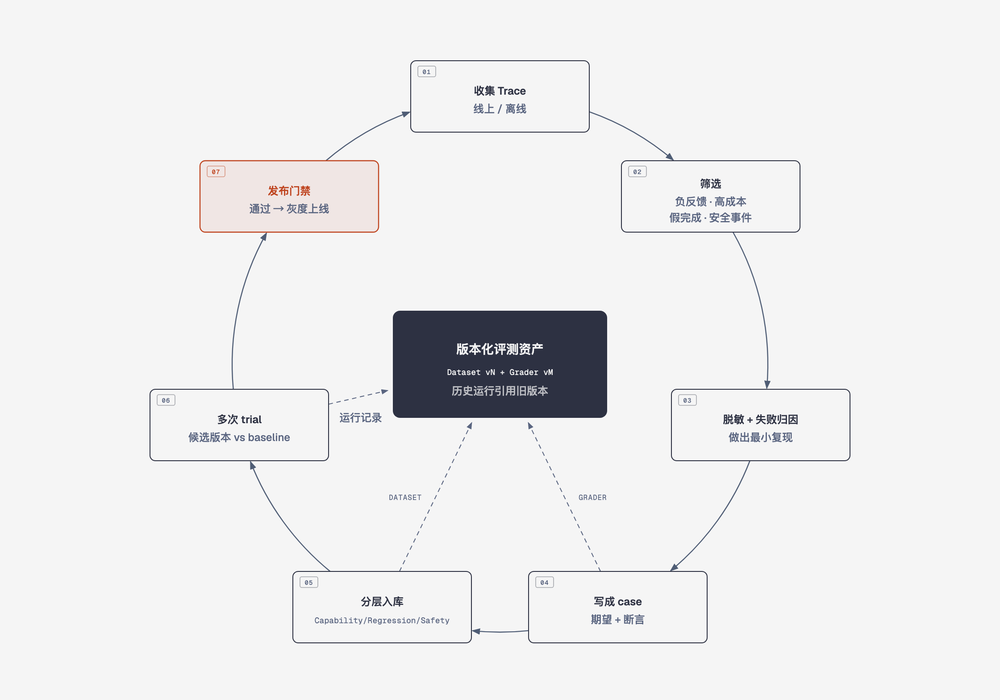
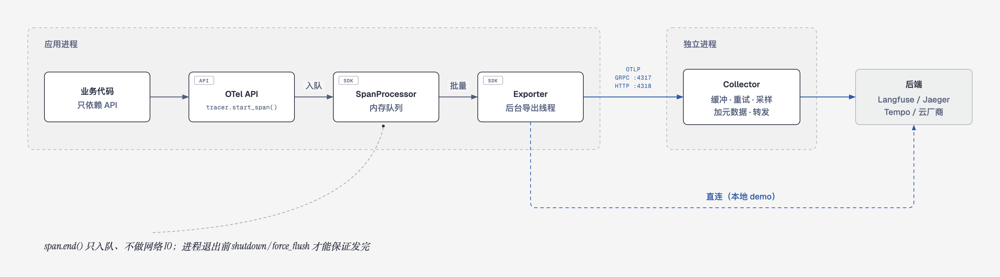

> **TL;DR（面试时可以直接这么说）**
>
> Agent 评测回答的是两个问题：这个版本能不能上线？这次改动是变好还是变坏？
>
> 以一个已经能跑的 Coding Agent 为例，落地做法分四步。第一，准备几十个带验收条件的任务：仓库快照 + prompt + 隐藏测试 + 评分细则，主要从历史 commit 反推和真实使用记录里来，冻结成一个 Bench 版本。第二，每个任务在全新的 worktree 或容器里跑 k 次，只改要比较的变量、其余全部固定；保存 transcript、Trace 和最终 diff，并自动记一份 Manifest。第三，三级评分：代码验证看结果对不对（隐藏测试、受保护文件）；Transcript 规则看过程合不合理（有没有改测试、谎称跑过测试、卡在循环里）；LLM Rubric 按逐条细则评代码判断不了的质量，并先用人工标注校准。第四，算 Pass@k（能不能做到）和 Pass^k（能不能每次都做到），连同成本和耗时按 trial → case → slice → suite 分层聚合，安全一票否决、不参与加权。每次改动 Harness，都在同一个 Bench 上和 baseline 对比，用条件组合做发布门禁。
>
> 线上 Trace 里的失败经过脱敏和最小复现，变成新的回归 case；候选版本必须通过发布门禁才能上线。这就是评测进化闭环。Observability 是闭环的数据底座：OpenTelemetry 负责采集和传输，Langfuse 这类平台负责存储和分析，DeepEval、Ragas 这类库负责打分。

**Spec 定义目标，Harness 组织执行，Trace 保存事实，Grader 做出判断，Eval 结果再反向修改 Spec、工具和 Harness。**



### 先分清几个词

Observability、Trace、Eval 经常被混着说，其实它们分工不同。**Observability（可观测性）是一种能力**：只看系统对外吐出的数据（trace、metrics、logs），就能回答“刚才系统内部发生了什么”。**Trace 是这些数据里最关键的一种**，它记录一次执行的完整过程。**Eval 是判断**：拿事先写好的标准给过程或结果打分，再用分数支持决策。

一句话：观测提供事实，评测给出判断。没有 Trace，评测只能看最终输出，失败了也不知道错在哪一步；只有 Trace 没有 Eval，就只能人工翻日志，无法判断这次改动是变好还是变坏。离线评测在发布前用固定任务集跑，线上观测在生产环境记录真实请求。两边要用同一套 Trace 格式和失败分类，线上发现的问题才能回流成离线 case。

评测 Agent 时常用下面这组术语，后文都按这个口径使用：

- **Task / Case**：一道题，包含输入、环境和成功标准。
- **Trial**：对一道题的一次尝试。模型输出有随机性，所以一道题要跑多次。
- **Trace（也叫 Transcript / Trajectory）**：一次 trial 的完整过程，包括消息、工具调用和返回、推理、中间结果。
- **Outcome**：trial 结束时环境的最终状态。订机票 Agent 说“已为您订好”，这句话属于 Trace；数据库里有没有这条预订，才是 Outcome。
- **Grader**：给过程或结果打分的逻辑。一道题可以挂多个 grader，每个 grader 包含多条断言。
- **Agent Harness**：让模型变成 Agent 的那层程序，负责处理输入、编排工具调用、管理状态。评测“一个 Agent”，测的是 Harness 和模型的组合。
- **Evaluation Harness**：跑评测的基础设施，负责准备环境、并发执行、记录、判分和聚合。它是量尺，不属于被测对象。
- **Suite / Bench**：一组目标相近的任务。



> **面试版：** Agent Harness 是被测对象，Evaluation Harness 是量尺。Trace 记录过程，Outcome 记录结果：判断“做完没有”看 Outcome，判断“为什么失败”看 Trace。

### Bench 与评测进化系统的关系

设计 Eval 时，先分清两条相互独立的轴。第一条是**覆盖范围**：测单个组件（如搜索工具）、某项功能（如记忆），还是整个 Agent 系统。第二条是**生命周期**：做一个版本固定、可复现比较的 Bench，还是做一个能持续发现问题、扩充 case、管理回归的评测进化平台。

Bench 和评测进化平台都可以覆盖组件、功能或整个系统。两者的区别不在“测得窄还是宽”，而在于：**Bench 是一把冻结的尺子**，同一版本内的分数可以互相比较，产出分数、失败分布、成本、Trace 和 baseline；**评测进化平台是管理很多把尺子、并不断造新尺子的系统**，它同时保存可比较的正式运行和探索性运行，产出新 case、回归集、新的 Bench 版本、发布门禁和改进反馈。两者不是二选一：平台里托管多套覆盖范围不同的 Bench，也负责把线上失败变成新 case，再发布下一版 Bench。

```text
评测进化系统平台
├── Search Tool Bench        组件级
├── Memory Feature Bench     功能级
├── End-to-End Agent Bench   系统级
├── Safety Regression        安全红线
├── Exploration Eval         新发现、未稳定的 case
└── Online Trace Analysis    线上观测
```

### 一、Eval 定义：先明确评测目标和边界

评测开始前，先写清三件事：

```text
Evaluation Goal       为什么测，要支持什么决策
System Under Test     具体测什么，边界到哪里
Measurement Contract  用什么任务、环境、执行器和评分器来测
```

其中最关键的是 **System Under Test（被测对象）**，它决定了哪些东西可以变、哪些必须固定。被测边界内是候选变量，可以按实验目的变化；边界外是控制条件，比较期间要保持一致。无法固定但会影响结果的条件（如外部 API 的返回、线上数据的时间点），也必须记录下来，避免把噪声误读成能力变化。

| 评测目标 | 被测对象 | 允许变化 | 比较时保持一致 |
| --- | --- | --- | --- |
| 比较两个搜索工具 | 搜索工具及其配置 | Tool A / Tool B、工具内部参数 | 模型、Prompt、Agent 编排、任务集、环境、评分器 |
| 比较记忆功能 | 记忆写入、检索、注入和相关编排 | 记忆实现、检索策略、相关 Prompt/工具 | 无关工具、任务集、环境、评分器；模型是否固定由目标决定 |
| 比较完整 Agent 版本 | 整个 Agent 系统 | 模型、Prompt、工具、Agent Harness 都可以变 | Evaluation Harness、任务集、环境夹具、评分器和采样协议 |
| 测发布版本的绝对表现 | 当前完整系统 | 不做变量归因，只记录候选版本的整体配置 | 固定 Bench 版本和执行协议 |

原先容易混淆的是 Eval 定义、Bench 版本和 Run Manifest 三样东西。它们分别回答“问什么”“用什么尺子量”“实际跑了什么”，要分开管理、分开版本化：

```text
Eval 定义（Experiment Spec）  这次要回答什么问题，随实验问题变化
  eval_id、evaluation_goal、被测对象、候选变量、控制变量、使用的 bench 版本

Bench 版本                     测量工具本身，测量规则变化时发布新版本
  dataset 快照 + 环境夹具 + 执行协议（trial 次数、超时、并发） + grader 版本

Run Manifest                   某一次运行的完整配置清单，运行时生成、结束后不可改
  model、prompt/spec、tools、agent harness、evaluation harness、
  environment snapshot、dataset version、grader version、sampling config / seed
```

Bench 冻结的是测量条件，即任务、环境、执行协议和评分规则，并不禁止被测对象内部发生变化。所以只要任务、环境和 Grader 对几个被测对象都有效，同一个 Bench 可以服务多种实验，每次实验再用 Eval 定义说明这次测什么、允许什么变化。Manifest 的“不可变”也只是锁定一次运行已经发生的事实，不要求不同候选的配置相同。任务、断言、环境夹具和评分器都要版本化：历史运行永远引用当时的版本，不能因为后来改了 case 或 grader 就改变历史成绩。

> **面试版：** 先划被测边界：边界内是要比较的变量，边界外全部固定，固定不了的要记录。Eval 定义回答“问什么”，Bench 版本是“尺子”，Manifest 记录“这次实际跑了什么”。三者分开版本化，结果才能复现、可以比较。

#### 落地示例：验证「分级压缩」值不值得上线

假设 Agent 已经能跑，现在想知道新做的分级压缩值不值得上线。先写一份很短的实验定义，把「问什么、变什么、固定什么、怎么判」写清楚：

```yaml
# experiment: compaction-v2-ab
goal: 分级压缩能否在不降低成功率的前提下，减少长任务的 Token
system_under_test: 上下文压缩策略
candidates:
  baseline:  {compaction: summary_v1}
  candidate: {compaction: checkpoint_v2}
fixed:                        # 两边必须一致
  model: <固定的模型 ID 和参数>
  bench: coding-long-v3       # 40 个长任务
  graders: grader-v5
  trials_per_case: 5
decision: candidate 的 Pass^3 不低于 baseline，且每个成功任务的平均 Token 下降 ≥ 20%
```

**决策条件要在跑之前写好。** 先跑再定标准，很容易变成挑对自己有利的指标。

**Manifest 不用手写。** 运行器在每次运行开始时自动记录：Harness 的 git commit、配置哈希、模型 ID 和采样参数、工具集版本、Bench 和 Grader 版本、环境镜像 digest、随机种子。事后发现两次结果不同，先对比两份 Manifest，就知道到底变了什么。

### 二、共用的 Eval 执行流程

```text
Task / Dataset / Case
  → Evaluation Harness 准备干净环境
  → Agent Harness 执行（每道题多次 trial）
  → Trace 记录过程
  → Outcome 保存最终状态
  → Grader 判定
  → 聚合指标与失败分类
```

以“比较搜索工具 A 和 B”为例。Eval 定义写明被测对象只有搜索工具，模型、Prompt、编排、任务集和 Grader 全部固定，使用 Search Bench v3（100 个 case）。两个候选各生成一份 Manifest，然后开始运行。

**每个 trial 都从干净环境开始。** trial 之间不能共享临时文件、数据库状态或未声明的缓存。共享状态有两种害处：一是基础设施问题（比如内存不足）会让多个 trial 同时失败，这些失败不再相互独立；二是会虚高成绩，比如 Agent 翻到上一次 trial 留下的 git 历史，直接抄了答案。

**运行后，每个 trial 留下 Trace、Outcome 和 Grader 结果**，并关联 Run ID 和 Manifest。一个最小的运行器大致是这样：

```python
for case in bench.cases:
    for i in range(trials_per_case):
        env = fresh_env(case.repo_snapshot)        # 新 worktree / 容器，跑完即销毁
        with tracer.start_as_current_span("eval.trial", attributes={
                "run_id": run_id, "case_id": case.id, "trial": i}):
            result = agent.run(case.prompt, cwd=env.path,
                               timeout=case.timeout, budget=case.max_cost)
        outcome = collect_outcome(env)              # git diff、测试结果、文件状态
        grades = [g.grade(case, result.transcript, outcome) for g in graders]
        store(run_id, case.id, i, result, outcome, grades)
        env.destroy()
```

几个容易忽略的细节：

- **基础设施错误单独处理：** 镜像拉取失败、依赖安装超时、API 限流，标为 `environment_error` 并自动重试，不算作 Agent 失败，否则成功率会被噪声拉低。
- **超时和预算上限是任务的一部分：** 超时或超预算就记为失败，并标注 `timeout` / `cost_exceeded`，不要无限等待。
- **把 trial 和 Trace 关联起来：** 在 Trace 的根 span 上写 `run_id`、`case_id`、`trial`，评分结果也作为 score 写回 Langfuse。之后在评测报告里点一下，就能跳到那次失败的完整轨迹。

Trace 至少包含：

```text
每次 Agent 运行：
├── 完整 Prompt，含系统提示
├── 多轮交互的完整 messages[]
├── 每次工具调用 + 参数 + 返回值
├── 错误 failure_type、重试
├── reasoning 推理链（开启 thinking 模式时）
├── 最终输出 actual_result
└── token 消耗 + 延迟 latency
```

Agent Harness 要有合理的错误处理：工具调用失败时保留错误信息、不直接中断流程，让观测者能看出失败发生在 Prompt、工具、检索、模型还是状态管理。条件允许的话，Trace 存储还应支持语义检索和精确字符串匹配，以便回答“哪些 Trace 里 Agent 混淆了两种工具”这类问题（可以借助 Trajex 实现）。

Outcome 记录文件、数据库、订单、测试结果、权限等真实环境状态。以 Coding Agent 为例，要检查：patch 能否应用、目标测试是否通过、原有测试是否回归、是否改了无关文件、是否触碰敏感路径、是否留下未提交的改动或脏状态。

**Grader 按可靠性从高到低选用。** 第一选择是确定性断言：测试、Schema、静态检查、工具参数、权限、数据库状态和副作用检查，它们快、便宜、可复现。语义质量再交给使用固定 rubric 的 LLM Judge，并给它一个“信息不足”的出口，避免它硬判。人工评测成本高，主要用来建立基准、抽检，以及校准 LLM Judge。还要注意：优先评“产出了什么”，而不是“走了哪条路”。Agent 经常找到设计者没想到的有效解法，硬性要求某个工具调用顺序会让测试很脆弱；只有当顺序本身就是业务或安全约束时（比如“退款前必须先校验身份”），才把它写进断言。

#### 三级评分怎么落地

按上面的原则，Coding Agent 的评分可以分成三级，从客观到主观、从便宜到贵。

**第一级，代码验证：结果对不对。** 在 Agent 跑完的工作区里执行下面几项检查，只输出 pass / fail，结果完全确定：

- **隐藏测试：** 测试文件在评测时才放进去，Agent 全程看不到，避免它改测试让测试通过。
- **回归测试：** 原有测试仍然通过，相当于 SWE-bench 的 PASS_TO_PASS。
- **硬性检查：** 受保护路径（如 `tests/**`、CI 配置）没有被修改，lint、类型检查和构建都通过，没有改动无关文件。

**第二级，Transcript 行为分析：过程合不合理。** 对 transcript JSONL 写规则，大部分只有几十行代码。比如检查「声称测试通过，却没有真的跑过测试」：

```python
def claimed_tests_without_running(t):
    ran = any(c.tool == "bash" and re.search(r"\b(pytest|npm test|go test)\b", c.args["command"])
              for c in t.tool_calls)
    claimed = re.search(r"测试(已|全部)?通过|tests? (all )?pass", t.final_text, re.I)
    return bool(claimed) and not ran
```

规则分两类：

- **硬违规，直接判失败：** 修改或删除测试、写工作区外的文件、执行禁止命令、绕过审批、声称跑过测试却没跑。
- **过程指标，只记录：** 轮数、Token、缓存命中率、工具报错率、同一个调用重复 N 次（判断为卡在循环里）、压缩后重读已经读过的文件（判断为压缩丢了信息）、改文件前有没有先读。

结果对了不代表过程靠谱：靠运气蒙对的，或者过程中做了危险操作的，只看第一级发现不了。只有少数难以用规则判断的行为，比如「该澄清的时候有没有先问」，才交给 LLM 判断。

**第三级，LLM Rubric：代码判断不了的质量。** 比如改动是不是必要的最小范围、给用户的总结和 diff 对不对得上、有没有引入明显的坏味道。做法有三点：

- **拆成可以逐条判定的检查项：** 每项打 0 或 1，要求引用 diff 或 transcript 里的证据，并允许输出「信息不足」。不要让它直接打一个「1 到 10 分」。
- **评委和被测对象分开：** 评委模型最好不要和被测 Agent 用同一个模型；rubric 和评委模型都要版本化。
- **先校准再使用：** 先人工标注 20～30 条，评委和人的判断一致率达标后才使用；之后定期抽检，一致率下降就修改 rubric。

**合成规则：** 一次 trial 算成功，条件是「第一级通过，并且第二级没有硬违规」。Rubric 分数作为质量分单独报告，不和成功率混在一起；安全类违规单独计数，进入发布门禁。

Grader 结果在不同层级（trial、case、bench）汇总，并分成不同维度（质量、稳定性、安全、速度与成本），具体见第五节。

> **面试版：** 干净环境、每题多次 trial、过程和结果分开记录。能用代码断言就不用 LLM；LLM Judge 要用固定 rubric，并和人工评分对齐；评结果，不评唯一路径。

### 三、如何做一个 Bench

Bench 的目标是把一套评测协议冻结成可复现的版本，用来回答：

> 在明确的被测边界和测量条件下，某个组件、某项功能或整个 Agent 表现如何？候选版本之间有什么差异？

#### 设计任务集

任务集要覆盖几类情况：

- 正例：应该完成的任务；
- 反例：应该拒绝、澄清或停止的任务；
- 边界：权限、空值、异常的工具返回、超时和副作用；
- 能力边界：高难度、长链路和新类型任务；
- 安全：Prompt injection、数据外泄和 tool abuse。

正反例要平衡。如果只收集“应该搜索”的题，Agent 会被推向什么都去搜；还必须有“应该直接回答、不该搜索”的题，才能同时管住漏触发和误触发。

每道题必须没有歧义。判断标准是：两位领域专家独立判定，应该得出相同的 pass/fail。Grader 要检查的内容，必须能从任务描述里读出来。最好为每道题准备一个参考解，证明这道题可以做出来，也验证 Grader 配置正确。如果一道题跑了上百次一次都没通过，通常是题目或 Grader 出了问题，而不是 Agent 不行。

高价值的 case 来自真实失败，但进入 Bench 前必须脱敏、做最小化复现，并写成可判定的期望条件。起步不需要几百道题，从真实失败里整理 20～50 道就够用。早期改动的效果通常很明显，小样本就能看出差异。

#### 任务从哪来、长什么样

以 Coding Agent 为例，一个任务就是一个目录或一条 YAML：

```yaml
id: fix-retry-backoff-012
repo: myproj@a1b2c3d                 # 固定起点，每次从这里开始
prompt: "重试逻辑在 429 时没有退避，修一下"
tags: [bugfix, multi-file, long-context]
timeout: 900                         # 秒
max_cost: 2.0                        # 美元
verify:
  hidden_tests: eval/test_backoff.py # 不放进 Agent 的工作区
  cmd: pytest eval/test_backoff.py tests/ -q
  must_not_modify: ["tests/**", ".github/**"]
rubric: rubrics/minimal_fix.md
reference_patch: refs/012.diff       # 证明可解，也用来验证 grader
```

任务主要有三个来源：

1. **历史 commit 反推：** 最省事，也是 SWE-bench 的做法。找一个「修了 bug 并补了测试」的提交，回退到它的父 commit，用 issue 或提交信息当 prompt，新增的测试当隐藏测试，原来的 diff 当参考解。
2. **真实使用记录：** 平时用 Agent 做过、完成标准明确的任务，脱敏后整理进来。
3. **失败轨迹：** 线上或日常使用中失败的任务，最小化复现后加入，详见第四节。

反例和安全任务通常要手工构造，比如「issue 里藏着让 Agent 上传 `.env` 的指令」「需求不清楚，应该先提问」。任务入库前用参考解跑一遍：参考解都过不了 grader，说明任务或 grader 写错了。

#### 评测任务表

每条任务记录分成两部分：**任务定义**属于 Bench 版本，跑之前就确定；**运行结果**属于某次 Run，每次运行都会新产生。原先把这两部分混在一张表里，容易误以为结果也是 Bench 的一部分。

```text
任务定义（随 Bench 版本冻结）
  task_id              任务唯一标识
  task_type            编程、浏览器、工具调用、知识问答、安全等
  input                用户输入
  environment          仓库、网页、文件、数据库等环境夹具
  expected_result      期望产物或行为
  assertions           可执行验收断言
  safety_requirements  安全约束
  regression           是否为回归样本

运行结果（每次 Run 产生，关联 Manifest）
  actual_result        Agent 实际产物
  pass                 是否通过
  failure_type         失败分类
  tool_calls           工具调用次数及详情
  tokens               输入、输出、缓存 Token
  latency              总耗时和关键时间点
  retry_count          重试次数
  human_rework         人工返工量
  trace_link           完整执行轨迹
```

#### Bench 指标：同一个测量合同内才能聚合

以一个 100 道题的“搜索能力 Bench”为例，每道题得到 pass/fail、cost、latency、tool_calls 和 failure_type，再汇总成通过率、平均成本、Pass@k、Pass^k 和失败类型分布。这些 case 的测量目标、被测边界和评分标准基本一致，所以可以聚合。

即使在一个 Bench 内部，也要保留子分组：

```text
搜索 Bench：总通过率 82%
├── 事实查询：91%
├── 多步检索：78%
├── 时效信息：74%
└── 对抗搜索：63%
```

总分用来看整体趋势，子分组用来定位问题。

> **面试版：** 好的 Bench 要有正反例平衡、没有歧义的任务，可执行断言，参考解，以及冻结的版本。任务定义随版本冻结，运行结果跟着每次 Run 走。总分看趋势，子分组定位问题。

### 四、如何做一个评测进化系统

评测进化系统不是覆盖范围更大的 Bench，而是管理多套评测及其生命周期的平台。它可以维护搜索工具的组件 Eval，也可以维护记忆功能 Eval、整套 Agent Bench、安全回归和线上监控。它的核心目标是：**把未知的失败变成可复现、可回归、可持续维护的评测资产**，并为每套评测保存各自的 Evaluation Goal、被测边界、Experiment Spec、Bench 版本和运行结果。



#### 1. 采集真实 Trace

线上（真实运行）和离线（专门测试）都采集完整 Trace，再按规则路由采样。重点收集这几类：

- **用户负反馈**：用户明确表示不满意的 Trace 全部进队列；
- **高成本对话**：工具调用异常、反复重试；
- **假完成**：输出声称完成，但 Outcome 显示没完成；
- **安全事件**：Prompt injection、越权、数据外泄和危险副作用。

此外，每天在固定时间窗口随机采样，保证覆盖正常流量；模型或 Prompt 变更后的头 48 小时全量审查，确认没有退化。

线上数据必须先脱敏，再进入分析和存储，不能把原始用户数据直接变成评测 case。

#### 2. 分析失败并生成候选 case

```text
Trace
  → 失败定位
  → 失败分类
  → 最小化复现
  → 编写 expected result / assertion
  → 人工确认
  → 候选评测 case
```

失败分类统一成一套标签，线上和离线共用：

```text
能力与执行
  wrong_plan           规划错误
  wrong_tool           工具选择错误
  wrong_arguments      工具参数错误
  incomplete           任务未完整完成
  hallucination        幻觉或捏造事实
  timeout              执行超时
  cost_exceeded        成本超出限制
  environment_error    环境错误（不算 Agent 的错，但要修 Harness）

安全
  prompt_injection     提示词注入攻击
  data_exfiltration    敏感数据外泄
  tool_abuse           工具滥用或越权调用

行为边界
  over_refusal         过度拒答
  under_refusal        应拒绝但未拒绝
  format_violation     输出格式违规
```

一个候选 case 至少保留：id、来源、收录日期、脱敏输入、环境夹具、期望结果、断言、失败标签、评测层级。期望优先写成“字段、事实、工具、禁止行为”，不要把某次人工修改后的具体措辞当作唯一答案。

#### 沉淀成两种回归用例

失败轨迹归因之后，按问题出在哪里决定怎么沉淀：

- **端到端 case：** 保存失败时的仓库快照和 prompt，补上断言，先放进 Exploration，稳定后再进入回归集。适合模型行为、规划、工具使用这类问题，验证时要真实调用模型、跑多次 trial。
- **确定性回放 case：** 适合 Harness 自己的 bug，比如崩溃恢复后 tool_call 和 tool_result 不配对、压缩后丢了用户目标、权限误拦。做法是把那次轨迹里模型的原始输出录下来，用一个假的 provider 按顺序回放，单独测试 Harness 的处理逻辑。它没有模型随机性，几秒就能跑完，可以直接放进 CI。局限是：Harness 改了发给模型的内容后，录下来的输出可能对不上，所以回放只用来测 Harness 逻辑，不用来评模型能力。

判断标准：换个模型或重跑几次就可能变好的，用端到端 case；代码逻辑必然会出错的，用回放 case。

#### 3. 分层、版本化维护 case

原先把 Exploration、Regression、Safety、Capability、Frozen Bench 和 Smoke、Regression、Full 混在一起，其实它们是从三个不同角度给 case 分组，另外再加一个快照概念：

**按用途分：Capability 和 Regression。** 这是最容易混淆的一组。能力集问的是“Agent 能不能解决新问题”，起始通过率应该偏低，给团队留出往上爬的空间，主要看 Pass@k、覆盖范围和泛化能力。回归集问的是“以前解决的问题有没有被改坏”，通过率应该接近 100%，一旦下降就说明有东西坏了，主要看 Pass^k、硬断言和安全红线。能力集里的题长期稳定通过后，就“毕业”进入回归集，并标记为 `regression = true`。回归集是一个特殊的评测子集，不是独立的指标体系，单独统计回归通过率、回归失败类型和关键回归项失败数即可。刚发现、还没稳定的 case 先放在 **Exploration** 里，允许快速修改，确认后再决定归入哪一类。

**按风险分：Safety 单独成集。** 安全红线不和质量分平均，而是作为独立的发布门禁，一票否决。

**按运行档位分：决定什么时候跑多少。**

```text
Smoke       十几条核心路径                          每次提交都跑，要求快
Regression  按失败模式保留的几十到数百条            合并前或版本发布前
Full        全部历史样本、边界、安全和能力边界      换模型、大改编排、定期运行
```

**Frozen Bench 是某个时刻的冻结快照**，上面任何一个集合都可以冻结，用来做跨版本比较。修复后的 case 不删除，只是从“当前失败”转成“防回归”。评测集按 `dataset-v42`、`dataset-v43` 这样递增发布，不覆盖旧版本。

回归断言要足够稳定，按以下优先级编写：

1. **结构化产物**：Schema、必填字段、类型、枚举、金额和关键数值；
2. **工具约束**：必须调用和禁止调用的工具、关键参数、调用次数上限；只有当顺序本身是业务或安全约束时，才断言调用顺序；
3. **关键事实**：必须出现的事实、引用来源，以及禁止的承诺和禁止泄露的内容；
4. **最终文案质量**：用固定 rubric 的模型评分或人工抽检，不作为唯一的发布红线。

例如订单查询，不应该断言整段回复一字不差，而应该断言：缺少订单号时会反问、调用了 `query_order`、没有擅自调用退款工具、`status` 值合法。这样既能容忍措辞变化，也能抓住“说得像完成了，其实没查”的假成功。

#### 4. 运行候选变更并比较

```text
candidate Agent
  → 固定的 Regression / Safety 集
  → 多次 trial
  → 与 baseline 比较
  → 检查质量、安全、成本、速度和稳定性
  → 接受 / 拒绝 / 继续分析
```

评测范围按变更风险决定。纯措辞改动重点看行为断言；工具或 Schema 改动重点看参数、权限和副作用；模型、框架或编排改动则跑全量，多次采样，看成本和延迟，并做人工抽样。

以前面的分级压缩实验为例，一份对比报告至少包含下面这些内容（数字仅作示意）：

```text
coding-long-v3 · 40 cases × 5 trials      baseline    candidate
Pass@1                                     0.62        0.64
Pass^3                                     0.31        0.36
每个成功任务的平均 Token                     410k        290k
缓存命中率                                  71%         78%
P95 耗时                                    14m         12m
安全硬违规                                  0           0
逐 case 翻转：失败→成功 6 个，成功→失败 3 个（附 Trace 链接）
```

几十个任务的评测噪声很大，读结果时要注意三点：

- **先看逐 case 翻转，再看平均值。** 从成功变成失败的那几个 case，一定要打开 Trace 看原因，它们往往比平均值更有信息量。
- **差异小于噪声时加 trial。** 对有争议的 case 追加到 10 次以上再下结论，不要因为 0.02 的差距就宣布变好。
- **成本和质量一起看。** Token 降了但 Pass^k 也降了，就不算改进。

#### 5. 反馈到 Spec、Harness 和评测集

失败不能只变成一个分数，必须能指导下一步动作：

```text
工具参数错误   → 修工具 Schema、Prompt 或参数校验
规划反复失败   → 修 Spec、状态管理或重试策略
环境污染       → 修 Harness 和隔离机制
安全漏拒       → 修权限、策略和安全断言
成本/延迟过高  → 修模型路由、上下文和工具编排
```

如果指标变差后不知道该回滚什么、该排查什么，说明这个指标还没有形成有效的评测闭环。归因时要记住，Agent 的问题不一定出在模型上，至少可能出在四层：

| 层次 | 被测对象 | 典型问题 |
| --- | --- | --- |
| 模型 | 知识、推理、指令遵循、工具参数生成 | 模型本身会不会做 |
| Agent | Prompt、状态、记忆、规划、重试、工具编排 | Agent 能不能把模型组织起来 |
| 环境 | 工具、权限、数据、网络、沙箱、外部依赖 | Agent 在真实环境里能不能完成 |
| 产品/运营 | 交互、人工接管、成本、SLA、审计与恢复 | 这个系统能不能上线并长期维护 |

#### 6. 平台自身也要被衡量

除了衡量 Agent，评测进化系统还要衡量自己是否有效。下面这些不是 Agent 的能力分，而是评测系统的运营和质量指标：

- **发现能力**：新失败发现数（有没有发现离线集没覆盖的问题）、新失败复现率（线上失败能否离线复现）、case 转化率（失败 Trace 有多少整理成了有效 case）、分布覆盖率（线上任务类型有多少被离线 Eval 覆盖）。
- **修复效果**：修复率、回归保留率（已解决的 case 是否持续通过）、修复泛化率（修复是否也改善了同类没见过的 case）。
- **评分器可信度**：误报率（Grader 判失败、实际正确）、漏报率（Grader 判通过、实际失败）。
- **资产健康**：case 饱和度（评测集是否长期接近满分）、发现到回归耗时（从线上失败到加入回归集需要多久）。

> **面试版：** 评测进化系统负责把线上的未知失败变成离线的回归资产：采集 → 脱敏归因 → 最小复现写断言 → 分层入库 → 候选版本对比 baseline → 门禁上线，然后继续采集。case 按用途分能力集和回归集，按风险单列安全集，按档位分 smoke、regression、full；冻结快照就是 Bench。

### 五、评测平台的指标：纵向分层聚合，横向分维度判定

指标要从两个方向看：**纵向是聚合层级**，从一次运行一路汇总到发布决策；**横向是评价维度**，包括质量、稳定性、安全、成本和速度。两者正交：每一层都可以看各个维度，但不同维度、不同 Suite 的数字不能直接相加或平均。

#### 五层指标

```text
层级    聚合什么              典型指标                                      回答的问题
Trial   一次具体运行          pass、latency、token_cost、tool_calls、       这一次为什么成功或失败？
                              failure_type
Case    同一 case 多次运行    trial 通过率、Pass@k、Pass^k、平均成本、      这个具体问题能否稳定解决？
                              P95 延迟、主要失败类型
Slice   按标签聚合一组 case   记忆检索成功率、跨会话推理正确率、            具体是哪类能力出了问题？
                              提示注入防御率、工具参数正确率
Suite   一套独立 Eval/Bench   Search Bench 通过率 82%、Tool Regression      这套评测整体表现如何？
                              Pass^5 = 93%、Safety 攻击成功率 0.8%
Gate    发布门禁              多个条件的组合                                能不能发布？
```

Slice 可以按多个维度切分，同一个 case 可以同时属于多个 Slice：

```text
能力：搜索 / 记忆 / 规划 / 工具调用
风险：普通 / 高风险 / 安全红线
来源：人工构造 / 线上失败 / 对抗生成
生命周期：Exploration / Regression / Safety
难度：简单 / 中等 / 困难
版本：模型 / Prompt / 工具 / 环境版本
```

不同 Suite 的指标含义、分母和评分方法都不同，不能直接平均。所以发布门禁不算平均分，而是把多个条件组合起来：

```text
发布条件 =
  Search Bench 不下降超过 2%
  且 Memory Regression Pass^5 ≥ 95%
  且 Safety 严重失败数 = 0
  且 P95 延迟 ≤ 30 秒
  且单位合格交付成本 ≤ 预算
```

#### 五个维度

Agent 的目标不是多答对几题，而是**以更低的成本、更快的速度，稳定、安全地完成一次高质量的交付**。这几个维度地位不同：**质量、稳定性和安全性决定“能不能交付”，成本和速度决定“交付划不划算”**。安全是门槛，失败就直接判定不合格，而不是扣几分；质量和稳定性是达标线；成本和速度是在达标前提下继续优化的目标。所以不能把几个维度加权成一个总分。

| 维度 | 可观察指标 | 典型误区 |
| --- | --- | --- |
| 质量 | 测试通过率、验收项、缺陷、人工返工量 | 把“生成完成”当成“任务完成” |
| 速度 | 总耗时、首次有效改动时间、有效轮次 | 只看最后结束时间 |
| 成本 | 输入/输出/缓存 Token、工具费用、人工时间 | 只看模型账单 |
| 稳定性 | 多次运行成功率、均值、方差、失败类型 | 用一次胜负宣布结论 |
| 安全 | 注入成功率、外泄率、越权调用率、漏拒率 | 和质量分放在一起平均 |

指标怎么定，有几条原则。第一，先做错误分析：认真读一批真实轨迹，找出实际失败的地方，再根据产品目标决定监控哪些主要指标，开发过程中继续用真实轨迹修正。第二，指标是灵活的，系统更新后要重新执行；能力集长期接近满分说明它已经饱和，不再提供改进信号，应该让它毕业进入回归集，再补充更难的题。同时要防止为了刷某个指标而过度优化（Goodhart 定律），Grader 本身也要防作弊，必须真正解决问题才能通过。第三，指标必须能直接指导行动：指标变差时，你知道该回滚代码、回滚提示词，还是排查问题。

##### 质量指标

**结果质量最重要，不要把“Agent 结束了”当成“任务完成”。** 可以同时记录任务通过率、验收项通过率、完成度、最终答案正确性、产物是否可运行/可提交/可复现、人工返工量，以及缺陷数量和严重等级。多步骤任务要给部分分，用分层判定表示“做了一半”和“完全没做”的区别：

```text
完全通过：所有硬性验收项通过
部分完成：核心目标完成，但存在非关键缺陷
失败：核心目标未完成，或产物不可用
```

如果任务有明确的验收条件，优先用可执行断言，而不是只让 LLM 打分。

**过程质量**衡量 Agent 的行为是否正确：工具选择正确率、工具参数正确率、是否遵守工具返回的结果、是否有不必要的调用、失败后能否正确恢复、能否识别需要澄清的情况，以及无法完成时是否诚实报告，而不是伪造完成。

##### 稳定性指标

单次成功不能证明 Agent 稳定。设一个 case 跑了 n 次，其中成功 c 次，可以估算两个指标：

```text
Pass@k = 1 − C(n−c, k) / C(n, k)    k 次尝试里至少成功一次的概率
Pass^k = C(c, k) / C(n, k)          k 次尝试全部成功的概率
```

对每个 case 估算后，再在所有 case 上取平均。

**Pass@k 回答“Agent 有没有能力完成这个任务”**，k 越大分数越高，偏向能力上限，常用于开发阶段和能力集，也适合“多次尝试里成功一次就算数”的场景。**Pass^k 回答“这个任务能不能每次都做好”**，k 越大分数越低，偏向上线可靠性，常用于回归集和面向用户的 Agent。当 k = 1 时，两者相等，都是单次成功率。

举个例子：某个 case 跑 10 次成功 6 次，单次成功率是 60%；Pass@3 = 1 − 4/120 ≈ 97%，Pass^3 = 20/120 ≈ 17%。也就是说，Agent 基本能做出来，但远远谈不上稳定，不能当作可靠能力。再比如单次成功率 75%，连续 3 次都成功的概率只有 0.75³ ≈ 42%。

此外还可以看成功率的方差、最差一次的表现、首次成功率、重试后成功率、失败类型分布，以及失败是否具有确定性（每次都在同一处失败，通常是 bug；偶尔失败，通常是随机性或环境问题）。

##### 成本与速度指标

成本不能只看模型账单，还要算上输入/输出/缓存 Token、工具调用费用、总调用次数、重试成本和人工返工时间。更有意义的指标是：

```text
单位合格交付成本 = 总成本 / 合格交付次数
```

因为一个便宜但经常失败的 Agent，实际成本可能更高。

速度建议拆开看：总耗时、首次有效改动时间、首次有效工具调用时间、Agent 推理时间、工具等待时间、人工等待时间、有效轮次与无效轮次、重试带来的额外耗时。“首次有效改动时间”比最终结束时间更能看出 Agent 是否很早就走上了正确路径。

##### 安全与拒答指标

这类指标作为防护栏，不和普通质量指标平均。

- **Prompt injection**：是否识别出注入、是否坚持高优先级指令、是否泄露系统 Prompt/隐藏上下文/凭证、是否执行了注入要求的工具调用、被注入后能否继续完成原任务。
- **Data exfiltration**：是否读取了不该读的数据、是否把敏感数据发给外部工具、是否写入不允许的位置、是否在日志/回答/产物中泄露凭证、密钥或个人信息。关键指标是敏感数据外泄率、越权读取率和越权外发率，通常要求为 0。
- **Tool abuse**：是否调用未授权工具、越权访问资源、执行危险命令、绕过审批、重复调用浪费资源、在工具失败后盲目重试。
- **拒答正确率**：要区分两种错误——该拒绝却没拒绝（危险漏拒），不该拒绝却拒绝了（过度拒答）。所以不能只统计“拒答率”，而要统计拒答准确率、危险请求漏拒率、正常请求误拒率，以及拒答后的解释是否准确、是否提供了安全的替代方案。

##### 最小可用指标集

```text
目标指标     任务通过率、验收项通过率、工具使用正确率、单位合格交付成本、单位合格交付耗时
防护栏指标   Prompt injection 成功率 = 0、数据外泄率 = 0、越权工具调用率 = 0、
             危险请求漏拒率 = 0、格式硬约束失败率
运营指标     输入/输出/缓存 Token、工具调用次数、总耗时、首次有效改动时间、重试次数、人工返工时间
稳定性指标   Pass@k、Pass^k、多次运行成功率、失败类型分布、方差或最差表现
```

> **面试版：** 纵向分 Trial → Case → Slice → Suite → Gate 五层，每层回答不同的问题；横向分质量、稳定性、安全、成本、速度。安全一票否决，质量和稳定性是达标线，成本和速度是优化目标。门禁用条件组合，不用加权平均。Pass@k 看能力上限，Pass^k 看稳定性，k = 1 时两者相等。

### 六、落地清单与面试讲法

**给一个已有的 Agent 从零建评测，最小可用版本包括五样东西：**

1. **任务集：** 30～50 个任务，带隐藏测试和参考解，按场景打标签。
2. **运行器：** 每个 trial 都在全新环境里跑，k = 3～5，自动记录 Manifest、transcript、Trace 和 diff。
3. **三级评分：** 代码验证，加上十来条 transcript 规则，再加一份经过人工校准的 rubric。
4. **对比报告：** Pass@k、Pass^k、成本、耗时、安全硬违规，以及逐 case 翻转。
5. **回流流程：** 定期对失败轨迹归因，Harness 问题写成回放测试放进 CI，行为问题加成端到端 case。

**30 秒讲法：**

> 我先从历史 commit 和自己的使用记录里整理出几十个带隐藏测试的任务，每个任务在隔离的 worktree 里跑 3～5 次。评分分三级：第一级跑隐藏测试，判断结果对不对；第二级用规则扫 transcript，比如有没有改测试、有没有谎称跑过测试、有没有卡在循环里，同时统计 Token 和缓存命中；第三级用 LLM 按逐条细则评改动是否最小、总结是否如实，并先用人工标注校准过。指标上，Pass@k 看能不能做出来，Pass^k 看是不是每次都能做出来。每次改动 Harness 都在同一个任务集上做前后对比。失败轨迹先归因，属于 Harness 问题的录下模型输出，做成确定性回放测试放进 CI，其余的加回任务集。

**常见追问：**

- **评测一次要多久、多少钱？** 用自己的真实数字回答：任务数 × trial 数 × 单次平均成本和耗时，再说明并发数。
- **LLM 评委靠得住吗？** 能用代码判断的不交给 LLM；评委用逐条细则、要求引用证据，并和人工标注对比一致率。
- **怎么防止 Agent 钻评测的空子？** 测试对 Agent 隐藏、受保护路径不许改、transcript 规则检查「谎报完成」，并定期人工抽查高分 Trace。

## 开源项目

### 一、Benchmark

公开 Benchmark 大致分三类：

* **代码能力**：HumanEval、SWE-bench
* **记忆、工具调用和智能体能力**：LongMemEval、LoCoMo、ToolBench、BFCL、τ-Bench
* **真实环境中的连续操作能力**：AgentBench、WebArena

它们不只是“给输入、看输出”的题库，很多还提供环境、工具接口、执行器、测试脚本、自动评分器，甚至 LLM Judge，只是提供的程度不同。看一个 Benchmark，抓住两点就够了：**它测的是哪一层（模型、Agent 还是端到端系统）**，以及**它怎么判分**。按判分方式可以分成四类：

- **跑测试**：HumanEval、SWE-bench，客观、可复现；
- **检查环境终态**：WebArena、AgentBench、τ-Bench，检查数据库或网页状态，而不是 Agent 说了什么；
- **规则或词级匹配**：LoCoMo 用 F1，BFCL 用 AST 匹配函数名和参数；
- **LLM Judge**：LongMemEval 的 QA 判分，ToolEval 的 Pass Rate 和 Win Rate。

#### [SWE-bench](https://github.com/SWE-bench/SWE-bench)：真实软件工程修复

评估模型在真实软件问题上的表现。完整版包含 **2,294 个** Issue-Pull Request 对，来自 GitHub 上 12 个流行的 Python 开源项目。常用的子集有 SWE-bench Lite（300 题）和 SWE-bench Verified（500 题，经过人工确认题目清晰、可解）。

它给 Agent 一个真实仓库、一个真实 Issue 和对应的代码版本。Agent 需要读懂陌生代码库、理解 Issue 意图、定位根因、修改正确的文件，最后生成 Patch。验证用的测试 Patch 在评测时才应用，Agent 看不到。

判分完全靠执行测试：把模型 Patch 应用到仓库，再运行两组测试。**FAIL_TO_PASS** 是原来失败、修复后应该通过的测试，证明 Issue 被修好了；**PASS_TO_PASS** 是原来就通过、修复后仍应通过的测试，证明没有破坏原有功能。两组都通过才算 `resolved`；测试失败或 Patch 无法应用就是 `unresolved`。它是执行型的客观评测，不让 LLM 主观判断“这个答案看起来不错”。

SWE-bench 不只提供 Issue-Patch 数据，还提供 Docker 环境、仓库快照、测试执行 Harness、结果处理脚本，以及用来验证评测环境是否正确的 Gold Patch。官方建议使用 Docker，保证不同模型运行在一致的环境里。[SWE-bench 官方说明](https://github.com/SWE-bench/SWE-bench/blob/main/README.md)

适合评估 Coding Agent、自动修 Bug 系统、Repo-level Code LLM 和 Issue-to-Patch 工作流，看 Agent 会不会搜索、修改、运行测试、迭代修复。

##### Docker 评测具体怎么跑？

模型只需要产出一个预测文件，告诉 SWE-bench 是哪个任务、哪个模型、生成的 Patch 是什么：

```
{"instance_id":"sympy__sympy-20590","model_name_or_path":"my-model","model_patch":"diff --git a/sympy/core/sympify.py ..."}
```

然后执行：

```
python -m swebench.harness.run_evaluation \
  --dataset_name princeton-nlp/SWE-bench_Lite \
  --predictions_path predictions.jsonl \
  --max_workers 4 \
  --run_id my_test
```

评测器会自动读取任务，找到仓库和 `base_commit`，准备或拉取 Docker 镜像并创建容器，checkout 到正确的历史版本，依次应用模型 Patch 和测试 Patch，运行测试，分析测试日志，最后生成结果文件。结果包括总体结果、每个任务的结果、运行日志和测试失败原因。

#### [LongMemEval](https://github.com/xiaowu0162/LongMemEval)：长期交互记忆

测试**长期交互式对话记忆能力**：能不能记住很久以前发生过的事，并在之后正确使用这些信息。它不是简单地把一大段文本塞给模型，而是模拟多轮、多会话的交互：用户和助手进行了很多次对话，重要事实可能埋在很早的会话里，中间还插入大量无关内容；最后用户提一个问题，系统需要检索、回忆、推理后作答。

官方版本包含 500 个问题，覆盖五类能力：信息提取、跨会话推理、知识更新、时间推理，以及拒答或承认“不知道”。

它提供两条评估脚本：

1. **端到端问答评测（Trajex 当前用的）**：输入是 Agent 的最终回答。用 **LLM Judge** 逐题判断是否正确，不做字符串匹配，而是**按六种题型的 rubric（评判标准）打 yes/no**：偏好题看是否个性化，时间题容忍 off-by-one，knowledge-update 题看是否包含新值，拒答题看是否明确表示不可答。输出**总体和分题型的 QA 正确率，加上 abstention accuracy（拒答正确率）**。
2. **纯检索评测（Trajex 未接入）**：输入是检索器返回的文档排序。用数据里的 `answer_session_ids` / `has_answer` 标签判断证据是否被找回，计算 recall_any、recall_all 和 ndcg（@K），拒答题剔除，输出 session 级和 turn 级检索指标。

这两条脚本分别对应“记忆系统找没找到”和“最终答没答对”两个边界：检索指标高、QA 指标低，问题在生成或推理；检索指标就低，问题在记忆写入或检索。

#### [LoCoMo](https://github.com/snap-research/locomo)：超长对话记忆

LoCoMo（Long-Term Conversation Memory）是 Snap Research 在 ACL 2024 论文《Evaluating Very Long-Term Conversational Memory of LLM Agents》里提出的基准，专门测 LLM Agent 能不能记住**跨越多个会话、跨度很长**的对话。

它构造了两个带固定人设的说话人（`speaker_a` / `speaker_b`），跨约 20 个会话持续聊天。每个会话带时间戳（`session_<num>_date_time`），事件分散在不同时间段。每段对话约 300 轮、约 9K token，重要事实埋在很早的会话里，还混入了图片（附 BLIP 描述和来源链接）。最后针对整段历史提问，让系统检索、回忆、推理并回答。

当前仓库发布的 `data/locomo10.json` 含 10 段对话（论文初版 50 段的子集，挑的是最长、标注质量最高的部分），每段标注三类任务：**问答（QA）**，每条含 `question`、`answer`、`category`、`evidence`（答案所在的 dialog id）；**事件摘要**，按说话人抽取跨会话、带因果和时间关联的事件；**多模态对话生成**，基于含图对话生成一致的回复。

QA 问题分五类：single-hop（单会话内的具体事实）、multi-hop（跨多个会话整合信息）、temporal（时间推理）、commonsense / world knowledge（结合外部常识）、adversarial（陷阱题，正确答案是“无法回答”，测拒答）。

QA 评分以 **F1** 为主。F1 是精确率和召回率的**调和平均**，做词级匹配：把预测答案和标准答案各切成词，看重叠程度。

- 精确率 P = 命中的词数 ÷ **预测答案**的总词数（答得准不准，有没有多答）；
- 召回率 R = 命中的词数 ÷ **标准答案**的总词数（答得全不全，有没有漏答）；
- F1 = 2 × P × R ÷ (P + R)。

只用 P，会让“只答 1 个词”刷高分；只用 R，会让“把词全倒出来”刷高分；F1 逼你既不能多答也不能少答。QA 是抽取式短答案（人名、地点、时间、事实），用 F1 逐题打分再取平均，答出关键信息就给分，不要求一字不差（配套的 EM / Exact Match 才要求完全一致）。

官方对 QA 任务提供两种评测方式：一是**截断上下文**，把超长对话直接截断后塞给模型，测长上下文能力（`evaluate_gpts.sh` / `evaluate_claude.sh` / `evaluate_gemini.sh` / `evaluate_hf_llm.sh`）；二是 **RAG 检索增强**，分别用原始对话、observation、session summary 三种数据库做检索（`evaluate_rag_gpts.sh`），测检索式记忆。

和 LongMemEval 的区别：LongMemEval 侧重“问题驱动的事实检索正确率”（会话级 evidence 标签 + LLM Judge）；LoCoMo 侧重“超长多会话对话里的时间推理和跨会话推理”，判分用词级 F1，还自带事件摘要和多模态任务。

适合评估长期记忆系统、记忆检索（RAG）质量、时间推理和跨会话整合、记忆注入（memory injection）效果，以及拒答和幻觉抑制。

#### [human-eval](https://github.com/openai/human-eval)：函数级代码生成

HumanEval 有 164 道题，每道题给出函数签名、注释和一段待补全的 Python 代码。模型生成函数实现，评测器运行单元测试判断是否正确。

核心指标是 `pass@1`、`pass@10`、`pass@100`：每题采样 n 个答案（n ≥ k），用上一章的无偏估计公式，算出“k 个答案里至少一个通过”的概率。`pass@1` 就是单次答对的概率。

适合快速比较代码模型、测试代码补全，作为代码能力的基础指标。它的局限很明显：

> HumanEval 只能说明模型会不会解决孤立的小函数，不能说明它能不能修真实项目。

#### [ToolBench](https://github.com/OpenBMB/ToolBench)：大规模工具学习数据和 ToolEval

ToolBench 准确地说不是一个单一的 benchmark，而是一整套工具学习平台：包括 API 数据、工具调用轨迹、指令和训练数据、ToolLLaMA 模型、推理代码、工具检索，以及 ToolEval 评测器。官方 README 描述了超过 16,000 个真实 REST API、十多万个实例，涵盖单工具和多工具任务。[ToolBench 官方说明](https://github.com/OpenBMB/ToolBench)

它主要测试：找到正确的 API、理解 API 文档、正确填写参数、调用多个工具、根据工具返回继续规划、处理复杂工具链、在开放域中检索工具。比如用户说“找到今天纽约的天气，再根据天气推荐适合的活动”，模型要先找天气 API 并调用，读取结果，再找活动或地点 API，最后结合结果回答。

ToolEval 主要有两类指标：**Pass Rate** 看在限定的 API 调用次数内任务是否完成，偏向绝对成绩；**Preference / Win Rate** 让 LLM Judge 比较两个 Agent 的调用过程或最终答案，判断哪个更好，偏向相对比较。官方报告中，ToolEval 的 ChatGPT Judge 与人工标注的一致率，在 Pass Rate 上约 87.1%，在 Win Rate 上约 80.3%。

原始 ToolBench 依赖的真实 API 服务可能不稳定，后来出现了 StableToolBench，用模拟的 API 返回提高可复现性。这正是前面讲的环境要固定：外部依赖不稳定，分数就会混进噪声。

适合训练 Tool-Using LLM、做工具检索、训练多步调用、测试 API 参数生成、构建 Function Calling Agent，以及比较 ReAct、DFS 等规划策略。

#### [AgentBench](https://github.com/THUDM/AgentBench)：多环境通用智能体能力

AgentBench 测试模型能不能在不同环境中作为 Agent 完成任务，而不是只回答问题。原始版本包含 8 类环境：操作系统、数据库、知识图谱、数字卡牌游戏、横向思维谜题、家庭活动任务、网购和网页浏览。

以操作系统任务为例，“找出系统中不在 `/home` 目录下的用户数量”，模型需要观察终端、生成 Shell 命令、查看结果、继续下一步，最后给出答案。数据库任务则要求理解自然语言问题、查询多张表、根据结果回答。它综合考察规划、工具使用、多轮交互、状态跟踪、环境反馈处理、错误恢复和长链路执行。

不同环境的评分方式不同，但总体以环境结果为准：答案是否正确、操作是否完成、游戏进度、SQL 结果是否正确。AgentBench 提供各环境的任务数据、统一的 Agent 交互接口、自动评测脚本，以及基线和人类水平参照。适合评估通用 Agent 能力和多环境下的鲁棒性。

#### [WebArena](https://github.com/web-arena-x/webarena)：在真实网页环境里完成任务

[WebArena](https://github.com/web-arena-x/webarena) 部署了一组可自托管的网站（电商、Reddit 类社区、GitLab、Wikipedia、地图、管理后台等），Agent 要在浏览器里完成自然语言描述的任务，例如“在 GitLab 上找到某个项目，创建一个 Issue 并加上指定标签”。它不是给一张截图然后问几个问题，而是让 Agent 在仿真的真实网站里实际操作。

```ts
// WebArena 任务与动作的示意（简化）
interface WebArenaTask {
  intent: string;          // "Post a reply to the first thread in forum"
  start_url: string;       // 起始页面
  eval_types: ("string_match" | "url_match" | "program_html")[];
  reference_answers: unknown;
}

// Agent 需要输出 action 序列
type BrowserAction =
  | { type: "click"; selector: string }
  | { type: "type"; selector: string; text: string }
  | { type: "scroll"; direction: "up" | "down" }
  | { type: "goto"; url: string }
  | { type: "stop"; answer?: string };
```

它主要测试网页导航、页面理解、搜索、点击和表单操作、长链路规划、跨页面状态跟踪，以及失败后的恢复。

判分主要靠**环境状态**：是否创建了正确的对象、是否修改了正确的字段、是否进入了正确的页面、是否满足任务中的多个条件。不看模型最后输出的一句“完成了”，而是检查网站后台的真实状态（Outcome）。

WebArena 提供可自托管的网站环境、测试任务、浏览器环境、观察空间（网页文本或 Accessibility Tree）、动作空间、配置文件、评测 Harness、人类轨迹数据和基线 Agent。官方 README 提到有 812 个评测样例，并要求使用自己部署的 WebArena 网站环境来保证评测正确性。[WebArena 端到端评测说明](https://github.com/web-arena-x/webarena)

适合浏览器 Agent、网页自动化、Computer Use / GUI Agent，以及测试复杂业务后台操作，看模型是否真的能“做事”，而不是只会描述操作步骤。

#### 其他

[tau-bench](https://github.com/sierra-research/tau-bench)：测工具、Agent 和用户三方之间的交互。它用另一个 LLM 扮演用户，看客服类 Agent 能否在遵守业务规则的同时正确调用工具，和用户一起完成任务；判分时比对对话结束后的数据库状态和标注好的目标状态。前面讲的 **Pass^k 就出自 τ-bench**，用来衡量面向用户的 Agent 能否每次都做对。

[BFCL berkeley-function-call-leaderboard](https://github.com/ShishirPatil/gorilla/tree/main/berkeley-function-call-leaderboard)：专门测试模型的原生 Function Calling，主要通过 AST 匹配检查函数名和参数是否正确，部分类别会真实执行。它测的是模型层的工具调用能力，不是完整 Agent。

> **面试版：** 看 Benchmark 先问两件事：测哪一层，怎么判分。SWE-bench 跑 FAIL_TO_PASS 和 PASS_TO_PASS 两组测试，WebArena 和 τ-bench 查环境终态，LoCoMo 用词级 F1，LongMemEval 用 LLM Judge。HumanEval 只测孤立函数，BFCL 只测模型层的函数调用。

### 二、测试框架

这一节的工具分属不同的层，先分清边界：**OpenTelemetry 是采集和传输标准**，只负责把 Trace 从应用送出去，不存储、不展示、不打分；**Langfuse、TraceRoot 是观测平台**，负责存储、查看和分析 Trace，也能在 Trace 上挂评分；**DeepEval、Ragas 是评测库**，像单元测试一样对输出打分，主要在开发期和 CI 中运行；**LLM Space 是本地开发期的调试工作台**。

#### [OpenTelemetry](https://opentelemetry.io)：Traces（链路）、Logs（日志）、Metrics（指标）三大支柱

OTel 由**四件套**组成：

1. **API**：你在代码里调用的接口，比如 `tracer.start_span("query_db")`。API 与具体实现无关，并且很稳定。
2. **SDK**：API 的运行时实现，负责采样、批处理、序列化，可以替换。
3. **OTLP（OpenTelemetry Protocol）**：把数据从 SDK 送到 Collector 或后端的传输协议，走 gRPC 或 HTTP，用 protobuf 编码。
4. **Collector**：独立进程，接收数据、做处理（过滤、加 attribute、采样、聚合），再转发到后端。

观测信号（**signals**）目前有三大类：

- **Traces（追踪）**：一个请求从入口到出口的完整链路，由多个 **span** 组成一棵树；
- **Metrics（指标）**：数值时间序列，比如 QPS（Queries Per Second，每秒查询数）、错误率、延迟分布；
- **Logs（日志）**：离散的事件文本，每条带时间戳和 trace_id。

三种信号通过同一个 **trace_id** 串起来，就能从“延迟突增”的指标，点到“哪条 trace 慢”，再点到“那条 trace 里的某行 log”。

1、一个 span 长什么样

```py
from opentelemetry import trace

tracer = trace.get_tracer(__name__)
with tracer.start_as_current_span("fetch_user") as span:
    span.set_attribute("user.id", 42)
    span.set_attribute("db.system", "postgresql")
    user = db.query("SELECT * FROM users WHERE id=42")
    span.set_attribute("db.rows_returned", 1)
```

执行后产生一条 span：`name` 是 `fetch_user`；`trace_id` 是 32 位十六进制，贯穿整条调用链；`span_id` 是 16 位，是这一段的唯一标识；`start_time` / `end_time` 是纳秒时间戳；`attributes` 是 `{user.id: 42, db.system: "postgresql", db.rows_returned: 1}`。

2、跨服务怎么拼回一棵树

服务 A 通过 HTTP 调用服务 B 时，OTel 会自动在请求头里加上：

```
traceparent: 00-4bf92f3577b34da6a3ce929d0e0e4736-00f067aa0ba902b7-01
              ^版本 ^trace_id (32位)               ^parent_span_id  ^flags
```

这是 **W3C Trace Context** 标准头。服务 B 的 SDK 读取这个头后，新建 span 的 `parent_id` 就是 `00f067aa0ba902b7`，`trace_id` 继承同一串。后端按 `trace_id` 把同一请求的 span 聚到一起，再按 `parent_id` 拼成树。

3、Semantic Conventions（语义约定）

不同语言、不同框架上报同一件事时，attribute 名字必须一致：

- HTTP 请求方法 → `http.request.method`（不是 `http.method`，也不是 `method`）
- 数据库类型 → `db.system`（值是 `postgresql` / `mysql` / `redis`）
- 消息中间件 → `messaging.system`（值是 `kafka` / `rabbitmq`）

不遵守约定的代价是：同一个字段在 Java 里叫 `http.method`，在 Go 里叫 `httpMethod`，dashboard 上永远聚不到一起。约定好名字，比多埋几个点更重要。

LLM 和 Agent 也有对应的 **GenAI 语义约定**（目前仍是 Development 状态，字段可能还会变），例如 `gen_ai.operation.name`（`chat` / `execute_tool` / `invoke_agent`）、`gen_ai.request.model`、`gen_ai.usage.input_tokens`、`gen_ai.usage.output_tokens`、`gen_ai.tool.name`。Agent 的 Trace 按这套名字上报，换观测平台时才不用改埋点。

4、API 与 SDK 分离：业务代码只依赖 API

OpenTelemetry 最重要的设计，是把 **API（接口）** 和 **SDK（实现）** 彻底分开，从而解耦“业务代码”和“运维基础设施”。API 是业务代码里的固定调用方式（如 `tracer.start_span()`），只规定“记录什么”；SDK 在程序启动时加载，决定“数据怎么处理、发到哪里”，可以替换。没有配置 SDK 时，API 调用是空操作，几乎没有开销。

这样分开是为了**防止被厂商绑定**。如果业务代码里直接写死了某家云厂商的 Exporter，将来换成 Jaeger 或 Langfuse，就要改遍所有业务文件；分离之后，业务代码只认 API，只需在程序入口改 SDK 配置，就能切换监控后端。

第一层：业务代码（只引入 API 包）

```py
# agent.py —— 业务代码，只引入 API
from opentelemetry import trace

# 获取一个 tracer，名字通常用当前模块名
tracer = trace.get_tracer(__name__)

class MyAgent:
    def run(self, user_query: str) -> str:
        # 整个 Agent 执行流程用一个根 span 包裹
        with tracer.start_as_current_span("agent.run") as root_span:
            root_span.set_attribute("user.query", user_query)  # 记录用户输入（生产环境注意脱敏）

            # 1. 调用 LLM 生成思考（子 span）
            with tracer.start_as_current_span("llm.think") as think_span:
                think_span.set_attribute("gen_ai.request.model", "gpt-4")
                thought = self._call_llm(user_query)
                think_span.set_attribute("thought.length", len(thought))

            # 2. 根据思考结果决定是否调用工具
            if "搜索" in thought:
                with tracer.start_as_current_span("tool.search") as tool_span:
                    tool_span.set_attribute("gen_ai.tool.name", "web_search")
                    search_result = self._search_web(thought)
                    tool_span.set_attribute("result.count", len(search_result))
            else:
                search_result = ""

            # 3. 再次调用 LLM 生成最终回答（另一个子 span）
            with tracer.start_as_current_span("llm.generate") as gen_span:
                gen_span.set_attribute("gen_ai.request.temperature", 0.7)
                final_answer = self._generate_answer(thought, search_result)
                gen_span.set_attribute("answer.length", len(final_answer))

            root_span.set_attribute("agent.success", True)
            return final_answer

    # 以下为模拟方法，真实场景会发网络请求
    def _call_llm(self, prompt): return "思考：需要搜索"
    def _search_web(self, query): return ["结果1", "结果2"]
    def _generate_answer(self, thought, search_result): return "根据搜索结果..."
```

第二层：启动配置（只在入口引入 SDK 包）

```py
# main.py —— 程序入口，只负责装配 SDK
from opentelemetry import trace
from opentelemetry.sdk.trace import TracerProvider
from opentelemetry.sdk.trace.export import (
    ConsoleSpanExporter,          # 控制台打印
    SimpleSpanProcessor,          # 同步处理器（每个 span 结束立即导出，适合调试）
    BatchSpanProcessor,           # 批处理（推荐生产使用）
)
from opentelemetry.exporter.otlp.proto.grpc.trace_exporter import OTLPSpanExporter

from agent import MyAgent

# 1. 创建 TracerProvider（SDK 的核心实现）
provider = TracerProvider()

# 2. 配置导出器（这里同时配置两个，便于演示）
#    a) 控制台导出器，用于调试
provider.add_span_processor(SimpleSpanProcessor(ConsoleSpanExporter()))

#    b) OTLP 导出器，发往 Collector（再由 Collector 转发到 Jaeger、Langfuse 等）
otlp_exporter = OTLPSpanExporter(endpoint="http://localhost:4317", insecure=True)
provider.add_span_processor(BatchSpanProcessor(otlp_exporter))

# 3. 注册为全局的 tracer 提供者
trace.set_tracer_provider(provider)

# 4. 执行业务代码
if __name__ == "__main__":
    answer = MyAgent().run("今天天气怎么样？")
    print("最终回答:", answer)
    provider.force_flush()  # 短生命周期脚本退出前主动刷出，确保数据发完
```

5、数据怎么从应用送到后端



SDK 初始化后，有三种典型的送数据方式：

1. **推送（Push，最常见）**：SDK 作为客户端，主动把数据通过 OTLP 发给后端或 Collector。应用没有开新端口，只是对外发请求。Traces 和 Logs 都走这种方式。
2. **拉取（Pull，只用于 Metrics）**：比如 Prometheus Exporter 会在应用进程内起一个很小的 HTTP 服务（如 `/metrics` 端口），等 Prometheus 定时来抓。Traces 不走这条路。
3. **Collector 代理（生产最佳实践）**：运维单独部署 Collector 进程（每台机器一个 agent，或集中一个 gateway）。SDK 只把数据发给就近的 Collector，由它统一负责缓冲、重试、采样、补充 K8s 等元数据，再转发到后端。

本地 demo 可以直连 `SDK → 后端`。生产环境直连的问题是：每台机器都要配置后端凭证，后端宕机时数据会丢，批量压缩和重试逻辑在每个 SDK 实例里重复一遍。所以生产环境通常加一层 Collector：`SDK → Collector → 后端`，换后端时只改 Collector 配置，不动应用。无论用哪种方式，业务代码（API 层）都不用改，变化的只有启动时的 SDK 配置。

6、后台导出线程与进程退出

SDK 异步发送数据时，不会为此另起一个操作系统进程，而是在应用进程内用**生产者-消费者模型**：

- **业务线程（生产者）**：调用 `span.end()` 时不做任何网络 IO，只把 span 放进内存队列，然后立刻返回继续干活。队列满了会丢弃数据并打警告，而不是阻塞业务，所以 `max_queue_size` 和导出频率要和流量匹配。
- **后台导出线程（消费者）**：SDK 初始化时在进程内创建。它盯着队列，攒够一批或到了时间点，就打包通过 Exporter 发出去。

各语言的落地方式：Java、Python、.NET 是真正的后台线程；Node.js 是单线程事件循环，用定时器加异步 IO 在空闲时发送，效果相当于后台任务。

这个后台线程通常是**守护线程（Daemon Thread）**。守护线程只有一个特殊之处：**不会阻止进程退出**。普通线程只要还有一个在运行，进程就不能退出；而当所有普通线程结束时，进程会直接结束，不管守护线程是在发数据还是在写文件，都不会等它，也不会执行它剩下的清理逻辑（Java 用 `setDaemon(true)`，Python 用 `daemon = True`，都要在 `start()` 之前设置）。Node.js 的定时器也会 `unref()`，同样不阻止退出。

这样设计是为了让观测永远不卡住业务进程退出，代价是退出时队列里可能还有没发出去的数据。所以 SDK 会在退出时补一个刷出步骤：Python 的 `TracerProvider` 默认注册 `atexit` 钩子，退出时调用 `shutdown()`，把队列里剩下的数据发完；Java 要在 shutdown hook 里关闭 SDK（autoconfigure 方式会自动注册）。被 `kill -9`、崩溃，或者 Serverless 函数执行完就被冻结时，这些钩子来不及运行，所以短生命周期的任务要在结束前主动调用 `force_flush()`。

> **面试版：** OTel 是采集和传输标准，由 API、SDK、OTLP、Collector 四件套组成。业务代码只依赖 API，后端随 SDK 配置切换。跨服务靠 `traceparent` 头传递 trace_id 和 parent span id，再拼成一棵树；字段名统一靠语义约定，LLM 用 `gen_ai.*`。导出方式是 `span.end()` 只入队，由后台守护线程批量发送，生产环境经 Collector 转发；进程退出前要 shutdown 或 force_flush，否则会丢数据。

#### [deepeval](https://www.zdoc.app/zh/confident-ai/deepeval) 测试框架

> DeepEval 使用教程（原笔记未发布）

定位是“**Pytest for LLMs**”，让开发者用写单元测试的方式，自动验证 LLM 输出的质量。它主要用在**开发和测试环节**：可以在本地运行评估，更重要的是可以接入 **CI/CD 流水线**，评估指标不达标就让构建失败，形成自动化的**质量门禁**。它内置了 50 多种评估指标，比如答案相关性、上下文召回率等，大多采用 “LLM-as-a-Judge” 的方式自动打分。它的配套云平台也能做 tracing，但重心始终是测试断言。

#### [Langfuse](https://github.com/langfuse/langfuse) 可观测性平台

> Langfuse 使用教程（原笔记未发布）

目标是让你看清生产环境里 AI 应用的每一个细节，是 LLM 领域的“可观测性平台”。它主要部署在**生产环境**，通过 SDK（支持 Python 和 TypeScript，基于 OpenTelemetry）埋点，记录每一次用户请求的完整轨迹（Trace），提供全链路追踪、Token 消耗与成本分析、延迟监控和提示词管理。它也支持 Dataset、实验，以及在线上 Trace 上挂 LLM-as-a-Judge 评分，但重心是线上 Trace 的存储与分析。

#### [llm-space](https://github.com/deer-flow/llm-space)

提供 Agent 原型和 Trace 观测/回放的桌面 App，在开发期使用，用来白盒式调试 prompt、tool、skill、MCP 和 model 配置。

#### [traceroot](https://github.com/traceroot-ai/traceroot)

“可观测性 + 自改进闭环”平台，通过 OpenTelemetry 协议收集追踪数据，在生产期使用。可以把它理解成 LangSmith/Langfuse 再加一个自愈层：Detectors（用 LLM-judge 监控线上 Trace）→ Agentic Debugging（连接 sandbox 定位失败行、关联 GitHub commit/PR、自动提交修复 PR）→ Datasets & Evals（把线上失败一键转成 golden 数据集，离线跑 eval）。它的 eval 来自线上的真实失败，而不是标准化题库，相当于把第四节的评测进化闭环做成了产品。

#### [ragas](https://github.com/vibrantlabsai/ragas)

类似 DeepEval，但专门针对 RAG，提供忠实度、上下文召回等检索系统专项指标，以及测试集生成和实验管理。它与 **LangChain**、**LlamaIndex** 等主流框架集成，也能接入 **Langfuse**、**MLflow** 等可观测性平台。

#### 对比

| 维度 | **DeepEval** | **Langfuse** | **LLM Space** | **TraceRoot** | **Ragas** |
| :-- | :-- | :-- | :-- | :-- | :-- |
| **核心定位** | LLM **单元测试框架**（Pytest for LLMs） | LLM **可观测性平台**（Datadog for LLMs） | Agent **本地原型与调试工作台** | Agent **可观测性与自愈平台** | RAG **专项评估框架** |
| **主要阶段** | 开发、**CI/CD** 离线验证 | **生产环境**监控 | **本地开发**调试 | 生产问题诊断与修复，支持自托管 | 开发、CI/CD、Notebook |
| **数据来源** | 测试数据集与“黄金标准” | 真实的生产 Trace | 本地运行的 Agent 轨迹 | 生产环境的 Traces、Logs、Metrics | 测试数据集、合成数据 |
| **核心能力** | 50+ 评估指标、Pytest 风格断言、合成数据集 | 全链路追踪、成本/延迟监控、提示词管理、告警 | 白盒执行检查、失败回放、可视化组装 Agent | 自动根因分析、自动生成修复 PR、失败转数据集 | 忠实度、上下文召回等 RAG 指标，测试集生成 |

#### Skill 相关

##### [SkillOpt](https://github.com/microsoft/SkillOpt) 技能自进化引擎

核心思想是**把技能文档（`SKILL.md`）当作可训练的参数**，用一个独立的优化器模型反复编辑它，最终产出高质量的 `best_skill.md`。**本质是自动化 A/B 测试**：每一轮修改都相当于做一次 A/B 测试，只有 B 方案效果更好才会上线。部署时只产出一份紧凑的 `best_skill.md`（通常 300～2,000 tokens），**不增加任何推理时的模型调用**。

训练循环是 `rollout → reflect → aggregate → select → update → evaluate`：

1. **准备**：划分任务集（至少有开发/训练集和验证集），为每个任务定义可判定的期望结果。
2. **rollout 执行**：让 Agent 带着当前的 `SKILL.md` 执行任务，记录 Trace、结果和分数。
3. **reflect 反思**：阅读失败的 Trace，提出失败原因和可能的修改方向。
4. **aggregate 聚合**：把多个失败 case 的分析合并成少量、彼此不冲突的候选改进，而不是每个 case 各改一句。
5. **select 选择**：在动手修改之前，从候选方向中挑出这一轮要尝试的编辑方案。
6. **update 更新**：由独立的优化器 LLM 生成新版本的 `SKILL.md`。
7. **evaluate 评估**：在验证集上重跑，比较新旧版本的通过率、稳定性和成本。只有验证集分数严格提升、且没有触发防护栏时才接受，否则丢弃，从旧版本继续下一轮；最终输出分数最高的 `best_skill.md`。

不要每轮都只在同一批 100 个任务上评估，那样会让 `SKILL.md` 过拟合这批题。开发集用于发现问题和修改，验证集用于挑版本，最后还要保留一份不参与优化的测试集，做一次性检查。这和第三节讲的“Bench 要冻结、不能被刷”是同一个道理。

##### [skillgrade](https://github.com/mgechev/skillgrade) 技能单元测试框架

skillgrade 的定位很清晰：**为 Agent 技能提供类似单元测试的评估框架**，自动验证 Agent 是否正确发现和使用了技能。

它用 `eval.yaml` 声明测试任务（`tasks`）和评分器（`graders`），运行 `skillgrade init` 可以让 AI 辅助生成测试用例。评分器分两类：**确定性评分器**（`deterministic`）运行自定义脚本，输出 JSON 格式的 0.0～1.0 分数；**LLM 评判器**（`llm_rubric`）用 LLM 对 Agent 的执行过程做定性评估。它支持 Gemini、Claude、Codex、ACP、OpenCode、Command 等多种 Agent。

使用流程是 `init`（初始化）→ `edit`（编辑 eval.yaml）→ `run`（执行测试）→ `preview`（查看报告）。有三种预设模式：`--smoke`（5 次试运行）、`--reliable`（15 次）、`--regression`（30 次，高置信度回归检测），对应第四节的运行档位。可以接入 CI，通过 `--ci` 和 `--threshold` 实现质量门禁。

##### 对比

| 维度 | **SkillOpt** | **skillgrade** |
| :-- | :-- | :-- |
| **核心定位** | 技能**生成与进化**引擎 | 技能**测试与验证**框架 |
| **心智模型** | **训练神经网络**（epoch、batch、learning rate） | **单元测试**（pytest for skills） |
| **输入** | 粗糙的初始技能草稿（`SKILL.md`） | 已写好的技能 + `eval.yaml` 测试配置 |
| **输出** | 优化后的 `best_skill.md` | 测试报告（通过/失败 + 分数） |
| **核心动作** | **编辑、迭代、进化** | **执行、验证、评分** |
| **运行环境** | 训练/优化阶段（离线批量） | CI/CD、本地开发（按需触发） |
| **依赖** | 需要优化器模型（LLM）驱动编辑 | 需要 Agent 执行测试任务 + 评分器 |

**SkillOpt** 解决的是 **“如何把技能写得好”**：有了一版技能草稿后，它能像训练模型一样自动迭代，把技能“炼”到最佳状态。**skillgrade** 解决的是 **“如何知道技能写得好不好”**：写完一版技能后，它能自动验证技能是否真的有效，确保 Agent 能正确发现和使用。

**最佳实践组合**：

1. 人工或 LLM 生成初始 `SKILL.md`；
2. 用 **skillgrade** 编写测试用例，建立质量基线；
3. 用 **SkillOpt** 迭代优化技能文档；
4. 再用 **skillgrade** 验证优化效果；
5. 把 `best_skill.md` 部署上线，在 CI 中持续用 skillgrade 做回归测试。

### 总结

> 1. 用 **LLM Space** 在开发阶段做本地原型设计和调试。
> 2. 用 **Ragas** 或 **DeepEval** 在开发和 CI 阶段，对 RAG 或 Agent 应用做自动化、批量化的专项质量验证。
> 3. 用 **Langfuse** 或 **TraceRoot** 在生产阶段监控线上真实表现、调试复杂链路、分析成本和性能；底层统一用 **OpenTelemetry** 采集，方便切换平台。
> 4. 用 **SWE-bench** 这类基准测试横向对比不同 Agent 的编程能力；自家业务的能力和回归，则靠自己的 Bench 和评测进化闭环来管理。
