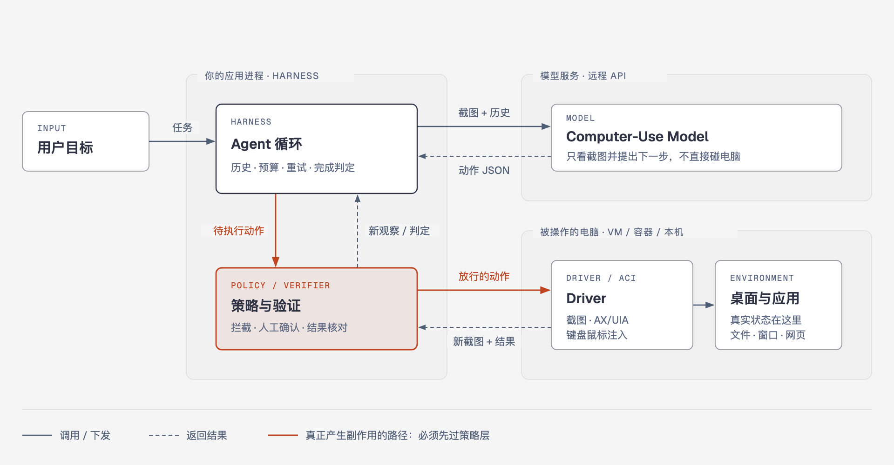
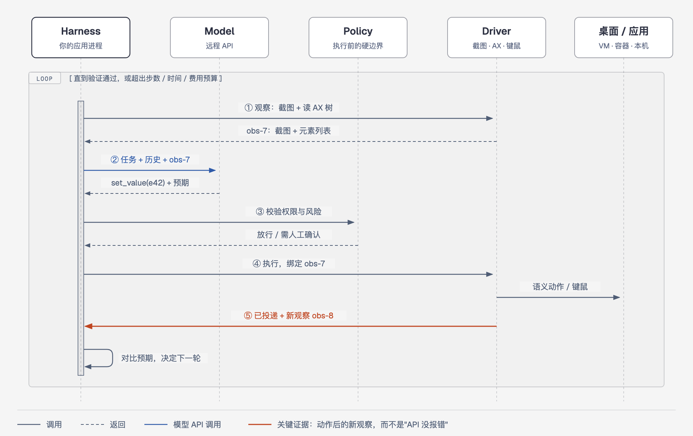
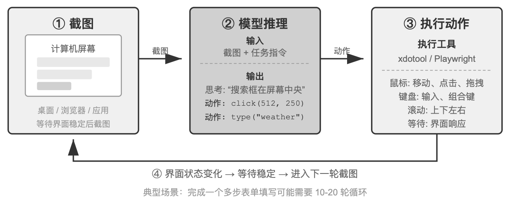
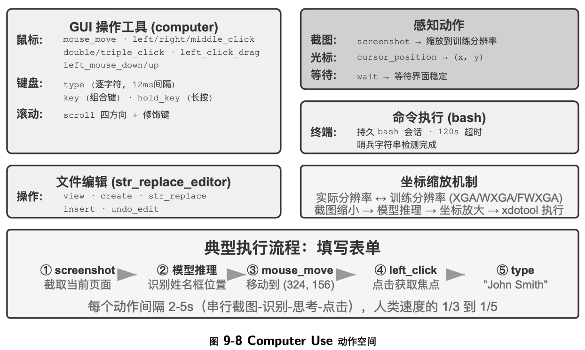
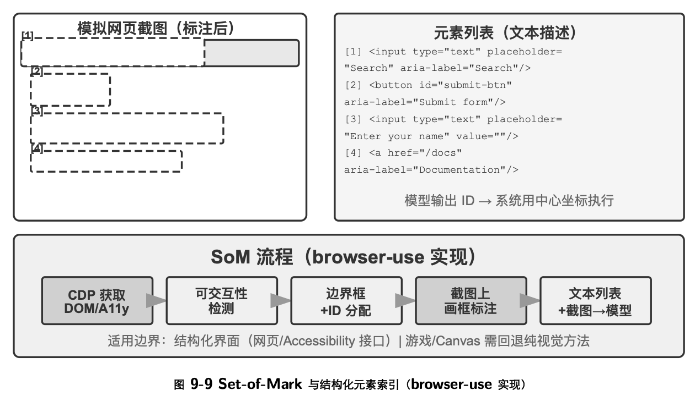
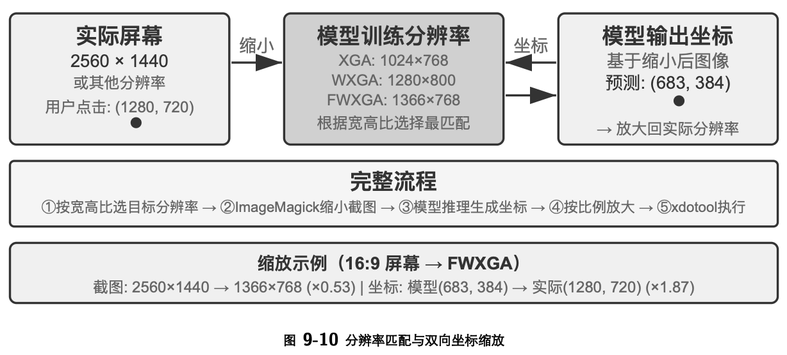

> 目标：先建立对 Computer Use 的整体认识，再理解一个可开发、可调试、可上线的 CUA 是怎样运行的。
>
> 本文讨论的是"让模型操作真实图形界面"的通用机制。浏览器自动化只是其中一个分支；桌面 CUA 还要面对操作系统权限、窗口、DPI、多显示器、输入法、远程桌面和安全隔离。项目实现按文末列出的提交核对，官方 API 形态按 2026-11 的文档核对。

## TL;DR（面试先说这一段）

CUA 是一个让模型通过图形界面操作电脑的闭环系统，不只是一个"会看图点击的模型"。它反复执行四步：**截图并读取界面结构（Observe）→ 模型根据任务和历史决定下一步动作（Decide）→ 运行时校验后交给 Driver 用无障碍接口或键鼠执行（Act）→ 重新观察，确认预期变化真的出现（Verify）**。Anthropic、OpenAI、Gemini 的官方 Computer Use 都是同一个分工：**模型只提出动作，客户端负责执行、权限和验证**。工程难点集中在四处：把"点保存按钮"变成准确目标的 Grounding；截图坐标到屏幕坐标的换算；界面变化后旧元素和旧坐标失效；以及在虚拟机、网络、凭据和工具层建立真正的安全边界，而不是靠提示词约束模型。

## 1. 整体架构：一个闭环系统，而不是一个模型

### 1.1 先把几个角色分开

"让 AI 用电脑"听起来像一件事，实际由几个职责不同的部分完成。**Computer Use** 是能力本身：读取电脑界面，并通过鼠标、键盘或语义 UI 操作去改变它。**Computer-Use Model** 是能看懂截图、定位控件并预测下一步动作的模型。**Computer-Use Agent（CUA）** 是围绕模型运行的完整闭环，包括任务规划、观察、动作执行、状态管理、失败恢复、权限控制和结果验证。

模型不能直接碰到电脑，所以需要一层把系统能力封装成模型可调用的工具：截图、读取可访问性树、移动鼠标、按键、窗口控制。这一层叫 **Driver**，学术上也叫 **ACI（Agent-Computer Interface）**。Driver 实际操作的桌面、浏览器、应用、文件和网络所处的运行环境叫 **Environment / Sandbox**。还有一个贯穿全文的问题：模型说"点击保存按钮"，程序要知道具体点哪个元素、哪个像素。把语义目标转换为元素引用或具体坐标的过程叫 **Grounding（落点定位）**。

所以一个鼠标点击工具不是 CUA，一个能输出坐标的视觉模型也不是完整的 CUA。

```text
用户任务
  ↓
Agent / Harness：规划、调用模型、维护历史、处理失败
  ↓
Computer-Use Model：理解当前界面，决定下一步
  ↓
Driver / ACI：截图、AX/UIA/AT-SPI、鼠标、键盘、窗口控制
  ↓
Environment：本机桌面、虚拟机、容器、远程桌面或浏览器
  ↓
新的界面状态，再进入下一轮
```

### 1.2 实际运行形态：谁在哪个进程里

模块分层不等于独立服务。按主流实现，CUA 运行时通常是三块：

- **Harness 是你自己的应用进程**。它可以是 CLI、Web 服务或桌面 App，由用户启动，在任务期间常驻。Agent 循环、历史、预算、策略检查和结果验证都在这个进程里执行。
- **模型是远程 API**。它只接收截图和文字，返回结构化动作。Anthropic、OpenAI、Gemini 的官方文档都明确说明，动作由客户端执行，模型不直接连接环境。
- **Driver 和被操作的环境在一起**。在 Anthropic quickstart 里，Xvfb 虚拟桌面、xdotool 键鼠工具和 Agent 循环都跑在同一个 Docker 容器里；在 open-codex-computer-use 里，Driver 是外部 Agent 通过 stdio 启动的 MCP 进程，真正持有系统权限的是一个常驻 GUI App；在 Cua、E2B 里，环境是一台远程沙箱，Driver 通过 SDK 或内置服务远程调用。



这张图想说明一件事：**真正产生副作用的路径（橙色）必须先经过策略层，而策略层在你的进程里，不在模型里**。模型只是一个"建议下一步"的远程函数。

### 1.3 和 Browser Use、RPA 的关系

三者的区别在于"看什么"和"怎么动"。**Browser Use** 观察 DOM、可访问性树、截图和 CDP 事件，用 locator、DOM 事件或键鼠操作网页。网页结构丰富，定位和等待更稳定，但它只覆盖浏览器，遇到 Canvas 或网页里的远程桌面仍要靠视觉定位。**桌面 Computer Use** 观察全屏或窗口截图、操作系统可访问性树和窗口信息，用系统键鼠或 AX/UIA/AT-SPI 动作。它能跨原生应用、浏览器和系统设置，代价是环境差异大，坐标和焦点脆弱，风险更高。**传统 RPA** 依赖固定 selector、录制的步骤和规则，确定性强、成本低、容易审计，但页面或流程一变就要人工维护，也不擅长开放任务。

工程上不应强行"全靠看图点击"。稳定性排序通常是：**业务 API / 专用工具 > 结构化元素操作 > 浏览器 locator > 视觉坐标操作**。CUA 最适合补上没有 API、需要跨应用、或界面结构拿不到的部分。

> **面试速记**：Computer Use 是能力，Model 负责"想下一步"，CUA 是包住模型的整个闭环。模型在远端只出动作，Harness 在你的进程里管循环、权限和验证，Driver 在目标电脑上真正执行。Browser Use 是同一个闭环在浏览器里的特例：上层循环相同，区别在 Driver 能拿到 DOM 和 CDP。

## 2. 跟一次任务走一遍：Observe → Decide → Act → Verify

用一个具体任务串起整个流程：**"在记事本里写入会议摘要，保存为 `D:/workspace/notes/meeting-notes.txt`"**。

### 2.1 任务开始前：先把目标变成可执行约束

Harness 收到自然语言任务后，先把它变成程序能强制执行的约束：

```json
{
  "goal": "在记事本中写入会议摘要并保存到指定目录",
  "allowed_apps": ["Notepad"],
  "allowed_paths": ["D:/workspace/notes"],
  "forbidden_actions": ["send_message", "delete_file"],
  "requires_confirmation": ["overwrite_file"],
  "max_steps": 30
}
```

这份约束在模型之外执行。提示词只能引导模型，不能当权限边界用：模型可能误解，也可能被屏幕上的文字诱导。

### 2.2 一轮循环里发生了什么



假设现在是第 7 步，记事本里的"另存为"对话框刚刚打开。

**① Observe。** Harness 让 Driver 截图，并读取当前窗口的可访问性树，得到一份带版本号的观察 `obs-7`。观察不只是一张图：

```ts
type Observation = {
  id: string                     // obs-7，后续动作要绑定它
  screenshot: Uint8Array
  screenshotSize: { width: number; height: number }
  activeApp?: string
  activeWindow?: { title: string; bounds: Rect }
  cursor?: { x: number; y: number }
  accessibilityTree?: UIElement[]
  recentActionResult?: ActionResult
}
```

观察的粒度是个取舍。全屏截图信息完整，但多显示器、隐私和 token 成本更高。窗口截图范围小，坐标容易约束，但要确认窗口仍可见，截图 API 也没有返回黑屏。可访问性树能提供角色、名称、值、可执行 action 和边界，但 Electron、WebView、自绘控件可能给出很深、很少或错误的树。差分截图或局部裁剪能降低成本，但要保留足够上下文，才能判断弹窗和焦点变化。

**② Decide。** Harness 把任务、历史和 `obs-7` 发给模型。模型输出最好是严格 schema，而不是一段需要正则解析的文本：

```json
{
  "state": "保存对话框已打开，文件名输入框为空",
  "action": {
    "type": "set_value",
    "target": { "element_id": "e42" },
    "text": "meeting-notes.txt"
  },
  "expected_effect": "文件名输入框显示 meeting-notes.txt",
  "risk": "low"
}
```

`expected_effect` 很关键，它让后面的验证有明确对照。动作集合应小而明确：

```text
observe / click / double_click / right_click
type_text / set_value / key / hotkey
scroll / drag / move
wait / run_command / ask_user / done
```

**③ 策略校验，然后 Act。** Harness 先用 2.1 的约束检查这个动作：应用是否允许、路径是否越界、是否属于需要人工确认的类型。放行后交给 Driver 执行，并带上 `obs-7`：如果界面已经变了，`e42` 就是过期引用，Driver 应拒绝执行，不能盲点。

**④ Verify。** Driver 返回"已投递"的同时附上新观察 `obs-8`。Harness 对比 `expected_effect`：文件名框里确实是 `meeting-notes.txt` 吗？对上了就进入下一轮；没对上就按失败类型重试、换定位方式或停下。

把这四步写成代码：

```python
for step in range(MAX_STEPS):
    observation = computer.observe()
    decision = model.next_action(task, history, observation)

    if decision.kind == "done":
        return verify_goal(task, observation, history)

    policy.check(decision)
    result = computer.execute(decision.action, bound_to=observation.id)
    history.append(observation, decision, result)

raise StepLimitExceeded()
```

关键不是这个 `for` 循环，而是这几条约束：模型看到的坐标系必须和执行器一致；动作完成不等于任务成功；改变状态后必须重新观察，不能继续使用过期元素；必须有步数、时间、费用、作用域和权限上限；高风险动作必须在执行前确认，而不是执行后记录。

### 2.3 状态存在哪里

一次任务产生三类状态，要分清哪个是"真相"：

- **真实状态在环境里**：文件是否写进磁盘、对话框是否关闭，只有重新观察环境才知道。Agent 的历史只是对环境的记录，可能过期。
- **对话历史是模型的工作记忆**：Anthropic 和 Gemini 的做法是客户端每轮把完整 messages 发回去；OpenAI Responses API 可以用 `previous_response_id` 把历史留在服务端。截图非常占 token，Anthropic quickstart 默认只保留最近 N 张截图（`only_n_most_recent_images`），更早的截图从上下文里裁掉，只保留文字记录。
- **轨迹日志是调试和评测的依据**：每步截图、动作、执行路径、耗时和验证结果落盘。它不参与决策，但没有它就无法复现失败。

### 2.4 任务结束：模型说"完成"只是候选判断

模型返回 `done` 时，Harness 还要调用和任务相关的验证器：

- 保存文件：检查文件存在、路径和内容；
- 发送消息：发送前人工确认，发送后检查目标会话和消息状态；
- 表单提交：检查成功页、后端记录或确认编号；
- 设置修改：重新读取设置值；
- 浏览器任务：优先读取 URL、DOM 或网络结果。

没有验证器时，只能标记为"模型判断完成"，不能等同于真实成功。Agent 正常退出和业务目标达成，应该是两个不同的状态。

> **面试速记**：每轮先观察并给观察编号，模型输出带"预期效果"的结构化动作，策略层在执行前拦截，Driver 执行时绑定观察版本，执行后用新观察对照预期。真实状态只在环境里，历史会过期，截图要裁剪；"模型说完成"必须经过验证器。

## 3. Grounding：模型怎样找到要操作的位置

Grounding 要解决的是：模型理解了"该点保存"，程序怎样得到一个**可执行的目标**。主流有三条路线。

### 3.1 纯视觉坐标预测

模型直接根据截图输出 `(x, y)`，或者输出归一化坐标：

```text
"点击右上角保存按钮" + screenshot
                    ↓
              (x=842, y=116)
```

优点是任何能显示出来的控件都能尝试操作；缺点是容易受缩放、遮挡、动画、相似图标和分辨率影响。官方 Computer Use API 都走这条路：Anthropic 和 OpenAI 返回截图像素坐标，Gemini 返回 0–999 的归一化坐标，由客户端换算成实际分辨率。UI-TARS 这类原生 GUI 模型也是端到端直接输出坐标。





### 3.2 Set-of-Mark（SoM）/ 视觉解析器

先用目标检测、OCR 或 UI parser 找出候选区域，在图上编号；模型选择编号，执行器再取该区域中心或合适的落点。这样就把"开放式坐标回归"变成"从候选里选一个"，更准，也更好解释。

```text
原始截图 → UI parser / OCR → 带 1、2、3... 标记的截图
                                     ↓
                              模型选择 element 12
                                     ↓
                           bbox → click point
```

[OmniParser](https://github.com/microsoft/OmniParser) 是这类组件的代表：它把纯截图转换成图标、文本和区域描述。它不是完整 Agent，仍需外部模型、动作执行器、循环和安全策略。SoM 的弱点也很明确：检测漏项、区域重叠和旧标记仍会导致失败。



### 3.3 Accessibility Tree / UI Automation

操作系统本来就为读屏软件等辅助技术暴露了结构化元素：macOS 是 Accessibility API（AX），Windows 是 UI Automation（UIA），Linux 是 AT-SPI2，浏览器是 Accessibility Tree / DOM。模型可以看到类似内容：

```text
[e17] Button "Save" enabled=true bounds=(780,80,96,32)
[e18] TextField "File name" value="" focused=true
```

然后调用 `click(element_id=e17)` 或 `set_value(element_id=e18, ...)`。执行器应优先调用元素自身的语义 action（如 `AXPress`、UIA Invoke），而不是无条件点击边界中心。

结构化树有时比全屏截图节省输入，但并非必然：复杂 Electron/WebView 树也可能产生大量无意义节点，需要过滤、压平，并限制节点数和深度。



### 3.4 混合 Grounding 才是常用工程解

```text
可访问性元素可用？ ──是──> 语义 action / element target
        │否
        ↓
视觉 parser 能稳定检测？ ──是──> region / SoM → 坐标
        │否
        ↓
多模态模型直接预测坐标 → 执行后重新截图验证
```

不要把某一种 grounding 写死在 Agent 逻辑里。让 Driver 返回统一的目标引用，便于按环境和失败类型切换策略，并记录每次实际走了哪条路径。

执行层也有对应的三级降级。**语义动作**对可访问性元素执行 `AXPress`、UIA Invoke 或 AT-SPI action，不依赖中心点，较少受遮挡和动画影响。**应用定向输入**向目标进程或窗口发送事件，尽量不抢占前台。**全局物理输入**移动真实光标，发送鼠标和键盘事件。只有结构不可用时才退回坐标点击。执行器还要明确区分"已投递""被系统拒绝""目标已过期"，不能把"API 调用没有报错"当成界面已经改变。

> **面试速记（为什么不能只让模型看截图点击？）**：纯视觉覆盖面最广，但受缩放、遮挡、相似控件和坐标漂移影响。SoM 把坐标回归变成候选选择，可访问性树直接给出名称、角色、状态和语义 action。实际系统按"结构化元素 → SoM → 视觉坐标"降级，执行后都要重新观察验证。

## 4. 坐标系：桌面 CUA 最常见的实现坑

只要走了视觉坐标这条路，一次点击就可能经过五种坐标：

```text
模型归一化坐标
  → 返回截图的像素坐标
  → 窗口内容区局部坐标
  → OS 逻辑坐标（points / logical pixels）
  → 全局桌面物理坐标（可能含多显示器负原点）
```

举个例子：Gemini 输出 `(500, 500)` 表示 1000×1000 网格的中心。如果截图是 1280×800，先换算成截图像素：

```python
x_px = round(x_norm / 1000 * screenshot_width)    # 640
y_px = round(y_norm / 1000 * screenshot_height)   # 400
```

这还没有结束。如果这张截图是 Retina 屏上的窗口截图并被缩小了一半，要先放大回窗口尺寸，再加上窗口内容区在屏幕上的偏移，最后才是 OS 能接受的全局坐标。执行前还要处理：

- Retina / Windows DPI scaling；
- 截图在发送前或服务端是否被缩小。Anthropic quickstart 会先把截图缩到推荐分辨率再发给模型，执行时再把坐标按比例放大回去；
- 窗口阴影、标题栏和内容区偏移；
- 多显示器排列与负坐标；
- 远程桌面缩放、letterbox 和浏览器 device scale factor；
- 截图之后窗口是否移动或改变尺寸。

因此 Observation 必须携带图像尺寸、捕获区域和变换信息；Action 要记录使用了哪一版 Observation。界面变化后，旧元素 ID 和旧坐标都应作废。

> **面试速记（DPI 和多显示器怎么处理？）**：Observation 显式记录截图尺寸、捕获区域、缩放比例、窗口边界和显示器原点。模型坐标先映射到返回的截图，再经过"窗口局部 → OS 全局"的变换。执行前检查窗口版本，执行后用新 Observation 验证。

## 5. 两种主流 Agent 运行方式：固定动作协议 vs Code-Act

### 5.1 固定动作协议：每轮一步或少量动作

模型只能返回 `click`、`type`、`scroll` 等受控动作。运行时逐个校验并执行，再把新截图送回模型。权限边界清楚，轨迹容易审计，动作可以回放。代价是模型往返次数多，长任务慢，模型每轮都要重新理解状态。

Anthropic quickstart、Gemini Computer Use 示例和多数视觉 GUI Agent 都属于这一路线。官方 API 也在缓解"往返太多"：Anthropic 当前的 computer toolset 允许模型在一轮里返回一小串动作（batch action，例如"点击 → 输入 → 截图"），客户端按顺序执行，遇到第一个失败就停下，后续动作全部回报"未执行"；Gemini 也支持一轮返回多个 function call。这仍是固定动作协议，只是把一次往返的粒度放大了一些。

### 5.2 Code-Act：模型调用持久代码运行时

模型不只返回一个点击，而是调用 `exec_py` / `exec_js`，在持久 REPL 中运行一段代码：

```python
display(pyautogui.screenshot())
pyautogui.click(842, 116)
pyautogui.write("meeting-notes.txt")
display(pyautogui.screenshot())
```

[OpenAI CUA sample app](https://github.com/openai/openai-cua-sample-app) 的调用链是：

```text
Responses API
  → function_call(exec_py / exec_js)
  → 校验完整响应与参数
  → persistent worker 执行代码
  → 收集文本/图像输出 + 当前截图
  → function_call_output + previous_response_id
  → 下一轮，直到 final 或 max turns
```

JS 版本把 Playwright 的 `page/context/browser` 暴露给 REPL，Python 版本把 `pyautogui` 和 `display()` 暴露给桌面 REPL。两者共享运行控制台和回放数据，但操作能力不同。`previous_response_id` 维持模型对话，独立 worker 保留代码全局状态，达到轮次上限即判失败。Python 桌面版生成的代码以运行它的用户权限执行，所以官方样例也建议使用专用桌面环境。

Code-Act 能在一次调用里批量操作、写判断和循环，减少往返；代价是模型拿到了更强的代码执行权。代码沙箱、模块白名单、文件和网络限制、超时、进程回收和输出上限，都必须由运行时实现，不能只靠提示词。

两种方式可以混合：普通 UI 操作走固定 schema，批量读取、文件验证或浏览器 DOM 查询走受限代码工具。

> **面试速记（固定协议和 Code-Act 怎么选？）**：固定协议权限小、易审计，适合高风险和标准化动作；Code-Act 用一段代码批量操作，适合长任务，但等于把代码执行权交给模型，必须配套沙箱。生产系统按权限分层组合，batch action 是两者之间的折中。

## 6. 环境层：动作最终落在哪台"电脑"上

**本机桌面**能直接用已有应用和登录态，但 Agent 会和用户争夺键鼠，能看到敏感数据，并继承当前用户的全部权限。平台限制也各不相同：macOS 通常至少需要"辅助功能"和"屏幕录制"权限；Windows UIA 必须运行在交互式登录桌面中；Linux 在 Wayland 下的截图和输入注入常受 compositor/portal 限制，不能假设 X11 的方法仍然有效。

**容器化 Linux 桌面**的常见形态是 Xvfb/X11 + 轻量桌面 + VNC/noVNC + 浏览器 + Agent 服务，Anthropic quickstart 就是这种可以从浏览器查看的容器桌面。容器能隔离文件和进程，但不会自动解决网络、凭据和内核级风险，还要限制挂载目录、出站域名、系统调用、资源和凭据生命周期。

**虚拟机或云桌面**更适合执行不可信的 GUI 任务：可以用快照、一次性账户、独立文件系统和网络策略。代价是启动、镜像维护和资源成本更高。[Cua](https://github.com/trycua/cua) 把这层拆成 Driver、Sandbox、Fleet 和 Bench：它既可以为外部 Agent 提供 UI 工具，也可以管理本地或云端的隔离桌面。要注意，"提供 Computer Use 基础设施"和"内置某个 Agent 模型"不是一回事。

**远程桌面**用 VNC、RDP、WebRTC 或视频流把屏幕送给操作者或 Agent，再把输入事件送回桌面。这时延迟、压缩、分辨率协商和断线重连都会进入 Agent 的状态机，点击后的等待不能只写一个固定的 `sleep(2)`。

> **面试速记**：环境决定隔离强度和执行代价。本机方便但继承用户全部权限，容器隔离文件和进程，VM 提供完整的 OS 边界和快照回滚，远程桌面要把延迟和重连纳入状态机。生产或不可信任务默认用一次性 VM。

## 7. 主流项目分别实现了哪一层

### 7.1 总览

先记住一个对照：**官方 API 只提供模型和动作协议，开源项目各自补上其中一层**。

| 项目 | 主要层级 | 观察/动作路线 | 更适合学习什么 |
|---|---|---|---|
| [anthropics/anthropic-quickstarts](https://github.com/anthropics/anthropic-quickstarts/tree/main/computer-use-demo) | 固定动作 Agent demo + 容器桌面 | screenshot + computer/bash/editor tools | 标准 observe/action loop 和安全注意事项 |
| [google-gemini/computer-use-preview](https://github.com/google-gemini/computer-use-preview) | 浏览器 CUA reference | screenshot + function call；Playwright/Browserbase | 模型原生 computer-use 调用协议 |
| [openai/openai-cua-sample-app](https://github.com/openai/openai-cua-sample-app) | Agent Harness + Code-Act runtime | Playwright 或 PyAutoGUI；持久 JS/Python worker | Code-Act、工具回传、轮次预算、轨迹保存 |
| [e2b-dev/open-computer-use](https://github.com/e2b-dev/open-computer-use) | Agent + E2B 云 Linux 桌面 | 截图；视觉描述模型 + grounding 模型 + action 模型；键鼠/命令 | 最直观的多模型闭环和远程桌面接入 |
| [iFurySt/open-codex-computer-use](https://github.com/iFurySt/open-codex-computer-use) | 跨平台 Driver / MCP 工具层 | AX/UIA/AT-SPI + 窗口截图；语义 action 优先 | OS 原生可访问性、后台操作、统一工具协议 |
| [trycua/cua](https://github.com/trycua/cua) | Driver + Sandbox + Agent/评测基础设施 | screenshot + accessibility + SDK/MCP/CLI | 环境生命周期、跨平台驱动、规模化运行 |
| [microsoft/OmniParser](https://github.com/microsoft/OmniParser) | 视觉解析 / Grounding | screenshot → icon/text/region | SoM、OCR、视觉元素候选生成 |
| [bytedance/UI-TARS-desktop](https://github.com/bytedance/UI-TARS-desktop) | 端到端 GUI Agent 应用 | 视觉模型 + 键鼠，覆盖桌面/浏览器 | 本地 GUI Agent 产品形态 |
| [simular-ai/Agent-S](https://github.com/simular-ai/Agent-S) | Agent 框架 / 研究实现 | 截图、OS-specific ACI、规划与经验 | 分层规划、知识/经验、OS 适配 |
| [xlang-ai/OpenCUA](https://github.com/xlang-ai/OpenCUA) | 数据、模型、标注和评测栈 | GUI trajectory → 模型 → executable action | CUA 数据生产、训练、离线评测 |

### 7.2 官方 API：三家的共同协议

Anthropic、OpenAI、Gemini 的 Computer Use 本质上都是一种特殊的 tool use：

1. 请求里声明 computer 工具，附上任务和当前截图；
2. 模型返回一个或几个动作（点击坐标、输入文字、按键、滚动、截图）；
3. 客户端在自己的环境里执行，把新截图作为工具结果送回；
4. 重复，直到模型返回文字答案或客户端终止。

差异主要在细节。Anthropic 的工具执行在客户端完成，可以批量返回动作，并配合 bash 和文本编辑工具使用，服务端还会用分类器扫描截图里的提示注入。OpenAI 的 SDK 把循环封装成 `ComputerToolset`，应用只需实现 driver，以及 `before_action` 这样的执行前审批钩子；API 会返回需要确认的安全检查。Gemini 输出 1000×1000 的归一化坐标，动作附带说明意图的 `intent`，并可能带 `safety_decision: require_confirmation`，用户确认后要在结果里回传确认。三家的文档都把"人工确认"设计成客户端的职责，这正是 1.2 那张图里策略层要放在 Harness 的原因。

### 7.3 模块化 vs 端到端：两种模型分工

**模块化路线**把"想做什么"和"点哪里"拆给不同模型。e2b-dev/open-computer-use 的 `SandboxAgent` 是最清楚的例子：

```text
E2B Desktop screenshot
       ↓
vision_model：描述界面、任务进度和下一步
       ↓
action_model：选择 click/type/key/shell/stop 等工具
       ↓
若 click(query)
       ↓
grounding_model：query + screenshot → coordinate
       ↓
E2B Desktop mouse/keyboard → 新 screenshot
```

这适合教学，因为视觉理解、动作规划和落点定位的边界清楚，也能换上更强的 grounding 模型。但它是体量较小的实验实现，开发时还需补上强制步数上限、策略拦截、可靠的完成验证和生产级凭据隔离。Agent-S 也是"规划者 + 专门的 grounding 模型"的分工，再加上经验检索和分 OS 的 ACI。

**端到端路线**由一个原生 GUI 模型直接从截图输出思考和带坐标的动作，例如 UI-TARS，以及三家官方的 computer-use 模型。链路短、延迟低，但定位错误更难单独定位和替换。

### 7.4 open-codex-computer-use：它是 Driver，不是内置 Agent

该项目通过 MCP 暴露 9 个跨平台工具：

```text
list_apps / get_app_state / click / perform_secondary_action
scroll / drag / type_text / press_key / set_value
```

外部 Codex 或其他 MCP Agent 负责决定调用顺序，Driver 负责执行：macOS 使用 AX、窗口截图和输入事件；Windows 使用 UI Automation/Win32 路径；Linux 使用 AT-SPI2，坐标输入在 Wayland 下按 best-effort 处理。`get_app_state` 把可访问性结构和窗口截图组合成 Observation；以元素为目标的动作优先复用可访问性元数据，坐标动作使用返回截图的窗口局部坐标。

macOS 的进程形态值得参考：外部 MCP 走 stdio；CLI 通过 LaunchServices 启动已获得系统权限的 app bundle，再通过每用户的 Unix socket 通信。这样权限归属在 GUI App 上，而不是每次启动的临时 CLI 进程上。它实现了密码管理器 denylist 等防护，但这不等于通用 OS 沙箱；运行它仍会获得对应用户授权范围内的 GUI 能力。

### 7.5 OmniParser、Agent-S、OpenCUA 的互补关系

**OmniParser** 解决"截图里有哪些可操作区域"，不负责完整的任务循环。**Agent-S** 研究怎样规划长任务、使用经验，并通过不同 OS 的 ACI 执行动作。**OpenCUA** 覆盖怎样采集 GUI 轨迹、标注、训练模型并离线评估。三者分别偏 Grounding、Agent 策略、数据与评测，不能因为都带 Computer Use 就认为它们可以互相替代。

> **面试速记**：官方 API 只提供模型和动作协议，执行、权限和验证都在客户端。开源项目各补一层：OmniParser 补 Grounding，open-codex-computer-use 补 Driver，Cua/E2B 补环境，Agent-S 补规划，OpenCUA 补数据和评测。模型分工有两种：模块化（规划和定位拆开，好调试）和端到端（UI-TARS、官方模型，链路短）。

## 8. 可靠性：失败分类与排查顺序

可靠性的核心是**按失败类型处理，不能无限重复同一个坐标**。运行时至少要识别这些状态：

- `target_not_found`：目标不存在；
- `stale_observation`：窗口或元素已变化；
- `input_not_delivered`：事件发出了，但界面没变；
- `blocked_by_modal`：被弹窗或权限提示遮挡；
- `capture_unavailable`：截图黑屏、超时或权限丢失；
- `human_confirmation_required`：动作需要用户批准；
- `goal_not_verified`：模型声称完成，但验证器不通过。

**点击没有效果**时按顺序检查：点击用的是哪张截图、尺寸多大；截图到 OS 坐标的变换是否正确；目标窗口是否移动、被遮挡，或不在当前 Space/Desktop；是否有模态框拦截；语义 action 是否可用；输入 API 返回的是"投递成功"还是"目标状态改变"；新截图或 AX 树是否出现了预期变化。

**文本输入乱码、丢字或进入错误控件**，常见原因是焦点错误、输入法、Unicode 字符被错误拆分、应用不接受后台键盘事件，以及快捷键的平台差异。对可设置文本的元素优先用 `set_value`；必须模拟键盘时，输入后读取控件值验证，并正确处理组合字符和剪贴板权限。

**Agent 循环重复**时，检查是否每轮都给了模型同一张截图、动作结果有没有回传、历史被截断后是否丢失了尝试记录、完成条件是否只能由模型主观判断、有没有识别"连续 N 次 Observation 无变化"，以及过期的元素 ID 是否仍被接受。

**"在我机器上能跑"但换环境失败**，是因为桌面自动化有大量隐式依赖：OS 和桌面会话、权限、DPI、字体、主题、语言、应用版本、显示器布局、网络延迟。要把这些写进环境描述并纳入测试矩阵，不能只保存模型提示词。

> **面试速记**：失败要分类再处理：目标不存在、观察过期、输入没生效、被弹窗挡住、截图失败、需要确认、验证不通过，各有各的恢复方式。重试必须换策略，还要检测"连续几轮界面没变化"。

## 9. 安全边界

CUA 的风险来自三个事实：它能看到敏感信息，能做出高权限动作，而界面内容本身可能攻击 Agent（网页或文档里的文字就是潜在的提示注入）。

防护要分清各层能保证什么。**提示词规则**只影响模型的选择，不是强制边界。**工具策略**可以拒绝某类动作或目标，但仍运行在同一个 OS 用户权限内。**进程或容器隔离**限制文件、进程和部分系统资源。**虚拟机隔离**提供更完整的 OS 边界和可回滚状态。**网络与凭据策略**决定 Agent 能把数据发到哪里、以谁的身份行动。

落到实现上：

- 用专用 VM 或桌面账户，不和日常工作环境混用；
- 默认禁止密码管理器、密钥链、私人聊天和系统安全设置；
- 文件系统、剪贴板、摄像头、麦克风和网络分别授权；
- 域名 allowlist 和临时凭据；
- 发送、购买、删除、发布、授权等动作执行前确认；
- UI 中的所有文字都当作不可信输入；
- 随时可中断，异常退出时释放按键、鼠标和子进程。

对于不可逆或对外有副作用的动作，确认内容要具体到"将对谁、做什么、使用什么数据"，并在最终动作前展示，而不是笼统地问"是否继续"。注意批量动作的情况：一轮可能包含多步，确认要放在每个动作执行前，而不是每轮开始前。

> **面试速记（最重要的安全措施是什么？）**：独立的低权限环境、工具层强制策略、高风险动作执行前确认、网络和凭据隔离、提示注入防护、完整审计、可中断恢复。只写 system prompt 不构成安全控制；模型只能"建议"，放行权在 Harness。

## 10. 从零开发、评测与选型

### 10.1 分阶段开发

**第一阶段：可观测的最小闭环。** 只支持一个固定分辨率的桌面、一个应用和四个动作：`screenshot`、`click`、`type_text`、`key`。每步都保存记录：

```json
{
  "step": 7,
  "observation_id": "obs-007",
  "screenshot": "007-before.png",
  "action": { "type": "click", "x": 842, "y": 116 },
  "expected_effect": "Save dialog opens",
  "result": { "status": "dispatched" },
  "duration_ms": 184
}
```

先确保能重现失败，再增加复杂的规划。

**第二阶段：结构化 Grounding。** 接入当前 OS 的可访问性树，给元素分配只在当前 Observation 内有效的 ID。实现"语义 action 优先，坐标 fallback"，并记录实际走了哪条执行路径。

**第三阶段：可靠性状态机。** 实现第 8 章的失败分类、分类重试、无变化检测和预算。

**第四阶段：隔离与权限。** 实现第 9 章的环境隔离和执行前确认。

**第五阶段：评测集。** 每个任务至少记录：初始镜像、应用版本、分辨率、语言和缩放；任务描述和允许的副作用；成功判定器，而不是只看模型的最终回答；完成率、平均和分位步数、耗时、模型调用次数和输入量；错点、重复动作、恢复次数和人工接管次数。结果按 OS、应用、任务长度和 grounding 类型切片。屏幕环境会漂移，可重复的评测需要固定镜像、重置初始状态，并把模型版本、提示词、Driver 版本和随机参数写入 Run Manifest。

### 10.2 技术选型

- **只需要自动化网页**：优先 Playwright、Browser Use 或 CDP。网页结构拿得到时，不要先上全桌面截图点击。
- **需要操作本机原生应用**：优先 OS 可访问性驱动；需要给任意 Agent 暴露工具时，参考 open-codex-computer-use 的 MCP/Driver 形态。自绘界面再补视觉 Grounding。
- **需要运行不可信或批量任务**：优先一次性 VM 或云桌面、快照重置、网络 allowlist 和短期凭据。Cua、E2B 这类环境层比单独一个 PyAutoGUI 脚本更接近实际需求。
- **需要研究模型或 Grounding**：视觉解析看 OmniParser；端到端桌面模型和应用看 UI-TARS Desktop；Agent 规划看 Agent-S；数据和 benchmark 管线看 OpenCUA。

### 10.3 推荐学习顺序

1. 用 PyAutoGUI 或系统 API 完成 screenshot/click/type 的最小闭环。
2. 读 Anthropic quickstart 或 OpenAI sample 的 Agent loop，理解 observation、action 和 tool result。
3. 接入 AX/UIA/AT-SPI，理解语义元素和坐标 fallback。
4. 读 open-codex-computer-use，理解跨平台 Driver 与 MCP 的边界。
5. 用 E2B、Cua 或 VM 搭独立桌面，补上生命周期和权限策略。
6. 再研究 OmniParser、Agent-S、OpenCUA，分别深入 Grounding、规划和训练评测。

> **面试速记（怎样评估 CUA？）**：用可重置的环境和确定性的结果判定器，测端到端任务成功率，同时统计步数、时延、调用成本、无效动作、恢复和人工接管次数，按 OS、应用、任务长度和 grounding 路线切片。不要用模型最后一句"已完成"当标签。

## 11. 如何向面试官介绍 Computer Use 机制

30 秒版本就是开头的 TL;DR。下面是 2～3 分钟版本：

> 我会把 CUA 拆成五层。最下面是桌面环境，可以是本机、容器或 VM；上面是 Driver，负责截图、窗口、可访问性树和键鼠；再上面是 Grounding，把语义目标变成元素或坐标；模型根据当前 Observation 决定下一个动作；最外层的 Harness 负责循环、历史、权限、重试、人工确认和成功验证。三家官方 API 的分工都一样：模型只提出动作，执行和权限都在客户端。
>
> 运行时是 Observe、Decide、Act、Verify。动作后一定要重新观察，因为 GUI 是有状态的，而且会异步变化，元素引用和坐标很快就会过期。定位上通常先用 OS 可访问性树执行语义 action，拿不到结构时再用 OmniParser/Set-of-Mark 或多模态模型预测坐标。
>
> 浏览器 Agent 和桌面 Agent 的上层循环相同，但浏览器能利用 DOM、Playwright 和 CDP，桌面要处理 AX/UIA/AT-SPI、DPI、多显示器、焦点和系统权限。实现上有固定动作和 Code-Act 两种路线：前者易审计，后者让模型在持久的 PyAutoGUI/Playwright 运行时里批量执行，效率高，但需要更强的隔离。
>
> 上线时我不会把模型输出直接交给本机键鼠，而是在低权限 VM 中运行，限制应用、文件和网络，对发送、购买、删除等动作做执行前确认，并用文件、DOM 或后端状态验证真实结果。这样才能把一个能演示点击的模型，变成可调试、可评测、可控制的 Agent 系统。

面试追问时可以主动补充的实现细节：

- Observation 带截图尺寸和坐标变换元数据，Action 绑定 `observation_id`；
- 每次产生副作用后让旧的 element ID 失效；
- 执行路径按"语义 action → 应用定向输入 → 全局 HID"逐级 fallback；
- 连续无变化检测、分类重试，以及 max-step/time/cost 预算；
- 运行轨迹保存截图、动作、模型版本、环境版本和验证结果；
- Agent"正常退出"和业务"任务成功"使用不同的状态。

## 资料与版本边界

开源项目实现于 2026-09-15 按以下提交核对：

- e2b-dev/open-computer-use：[`610bac8`](https://github.com/e2b-dev/open-computer-use/commit/610bac85d242b2fdf43fbe36bce2348658a2d4c9)
- iFurySt/open-codex-computer-use：[`v0.3.5 / 386a260`](https://github.com/iFurySt/open-codex-computer-use/commit/386a260d1ab8b690adbbb27f7471595cf0c2b752)
- openai/openai-cua-sample-app：[`f2a3dc5`](https://github.com/openai/openai-cua-sample-app/commit/f2a3dc523ae406f9b704f9a420a05402a63b4522)
- anthropics/anthropic-quickstarts：[`3313e97`](https://github.com/anthropics/anthropic-quickstarts/commit/3313e9716fb5b977248bcd06cb0cc86a8c547b9b)
- trycua/cua：[`1c554ed`](https://github.com/trycua/cua/commit/1c554ede0c5a2ed535b63d9759b2c97b06e0bcd2)
- microsoft/OmniParser：[`3540212`](https://github.com/microsoft/OmniParser/commit/354021201345a96178360b28733573e27269f2de)
- bytedance/UI-TARS-desktop：[`c2ad42e`](https://github.com/bytedance/UI-TARS-desktop/commit/c2ad42e3eb9b27830db41a3e6f51ca7179d9b168)
- simular-ai/Agent-S：[`3aa272d`](https://github.com/simular-ai/Agent-S/commit/3aa272d23d2994c7bbde1acbbe0ef8e8d06b8693)
- xlang-ai/OpenCUA：[`dfc91ba`](https://github.com/xlang-ai/OpenCUA/commit/dfc91ba89f700d10f26ec50362d308571482ab8b)

官方 API 形态于 2026-11-03 按以下文档核对：[Claude Computer use tool](https://docs.claude.com/en/docs/agents-and-tools/tool-use/computer-use-tool)、[OpenAI Computer use](https://platform.openai.com/docs/guides/tools-computer-use)、[Gemini Computer Use](https://ai.google.dev/gemini-api/docs/computer-use)。

模型名称、工具 schema、平台支持和项目成熟度会持续变化。学习时优先抓住稳定的边界：**Model 决策，Harness 编排，Grounder 定位，Driver 执行，Environment 隔离，Verifier 判定结果**；具体 API 以对应版本的官方文档和源码为准。

本文的架构图与时序图按固定版式绘制，图中的边界（Model 决策、Harness 编排、Grounder 定位、Driver 执行、Environment 隔离、Verifier 判定）比具体实现更容易长期复用。
