> 本文面向第一次接触 DeerFlow、已经知道“大模型可以调用工具”但还不了解 Agent 工程的人。先建立项目全景，再沿一次真实请求理解 LangGraph、Gateway、Lead Agent、Middleware、Sandbox、Memory 与 Sub-Agent 如何协作。
>
> 源码基线：`e3df6ea4a81137520b4eb04d42d56cc5749e375a`（2026-09-06）。2026-11 对照官方 `backend/AGENTS.md`，“Agent 运行时内嵌在 Gateway、Nginx 把 `/api/langgraph/*` 重写到 Gateway 原生路由”这一核心结构未变。DeerFlow 仍在快速迭代，端点、配置项和中间件数量可能变化；本文优先解释较稳定的职责边界与数据流。
>
> 主要资料：[DeerFlow 官方文档](https://deerflow.tech/zh/docs)、[DeerFlow 官方仓库](https://github.com/bytedance/deer-flow)、[LangGraph 官方概览](https://docs.langchain.com/oss/python/langgraph/overview)、[社区教程](https://hawkli-1994.github.io/deerflow-book/chapters/01-introduction.html)。社区教程用于补充学习视角，具体实现以基线源码和官方文档为准。

> **TL;DR（面试口述版）**
>
> DeerFlow 2.x 是字节开源的 **Super Agent Harness**：建立在 LangGraph 之上，把长任务 Agent 需要的公共设施（上下文压缩、沙箱、子 Agent、技能、长期记忆、可恢复的线程状态、流式输出）预先接好，同时附带一套能直接部署的全栈应用。1.x 是写死的深度研究工作流，2.0 重写后“研究”只是一个 Skill。
>
> 运行形态上，默认只有一个 Agent 后端进程：Nginx 是唯一入口，页面给 Next.js，API 给 FastAPI Gateway；Agent 运行时（RunManager、run_agent、LangGraph graph、StreamBridge）**内嵌在 Gateway 里**，不再单独跑 LangGraph Server。
>
> Lead Agent 不是手写的业务流程图，而是用 LangChain 的 `create_agent()` 生成的通用“模型 ↔ 工具”循环，跑在 LangGraph 上。DeerFlow 自己的行为主要靠 **Middleware 链**包在每次模型和工具调用外面实现：建线程目录和沙箱、注入记忆和上传文件、压缩上下文、激活技能、限制子 Agent、把工具异常转成模型能处理的结果。
>
> 一次请求的主线是：前端 POST run → Gateway 鉴权、登记 run，立刻开 SSE，后台起 `run_agent()` → worker 从 checkpoint 恢复 thread、组装 graph → LangGraph 推进模型工具循环，工具落到 Sandbox、MCP 或子 Agent，每步写 checkpoint，增量经 StreamBridge 推给前端 → run 落终态，长期记忆**异步**入队更新。所以“HTTP 返回”≠“Agent 完成”，“看到最后一个 token”≠“记忆已更新”。

## 1. DeerFlow 是什么：一个 Harness，加一套应用

普通的“模型调工具”循环写起来很简单，但一旦任务变长，马上会遇到一串问题：对话变长后哪些历史保留、哪些压缩；工具能跑命令时文件和进程隔离在哪；任务太宽时怎样委派给上下文互相隔离的子 Agent；MCP、内置工具、Skill 很多时怎样不把所有描述都塞进上下文；页面刷新、进程失败或人工中断后怎样恢复；Web、IM、定时任务、Python 调用怎样复用同一个 Agent。DeerFlow 1.x 用一张写死的“搜索 → 总结 → 写报告”图做深度研究，回答不了这些问题。2.0 是一次不共享代码的重写，项目重新定义了自己的边界：**研究只是 Skill，运行长任务所需的公共基础设施才是核心。**

它给出的答案不是为每类任务各写一张固定图，而是一个有明确默认行为的运行环境：

```text
通用 Lead Agent
├─ LangGraph 提供有状态循环与 checkpoint
├─ Middleware 在每次模型/工具调用前后施加策略
├─ Tools 让模型执行真实动作
├─ Skills 按需注入专业工作方法
├─ Sandbox 隔离文件与命令执行
├─ Sub-Agent 隔离并行子任务
└─ Memory 保存跨会话事实
```

这就是 Harness 和普通 Framework 的差别：Framework 给零件，Harness 已经把常用零件接成一套可工作的运行时，但仍保留替换点。四方分工可以这样记：**模型**判断下一步、选工具、决定是否委派，不管 HTTP、数据库和进程；**LangGraph / `create_agent()`** 执行模型工具循环、维护图状态、checkpoint 和流式事件，不管产品页面和沙箱策略；**DeerFlow Harness** 负责把模型、工具、中间件、技能、记忆、沙箱、子 Agent 组装起来；**DeerFlow Application** 是 Gateway、Web UI、IM 渠道、持久化和部署，不重新实现图执行引擎。

代码上，这条边界是强制的单向依赖：`backend/app/*`（Gateway、IM 渠道等产品代码）可以导入 `backend/packages/harness/deerflow/*`，反过来禁止。所以 Harness 是一个可发布、可嵌入的包，既能被完整应用使用，也能被 `DeerFlowClient` 直接嵌进别的 Python 进程。

> **面试一句话：** DeerFlow 2.x 是 LangGraph 之上的 Agent Harness，把上下文压缩、沙箱、子 Agent、技能、记忆、可恢复线程这些长任务公共设施预先接好，深度研究只是其中一个 Skill；Harness 和 App 单向依赖，所以同一套 Agent 能被 Web、IM、定时任务和 Python 进程复用。

## 2. 运行形态：默认只有一个 Agent 后端进程



默认拓扑是三个常驻服务加一个可选服务。用户访问 `http://localhost:2026`，**Nginx 是唯一默认公开入口**：页面请求交给 Next.js 前端（`:3000`），API 请求交给 FastAPI Gateway（`:8001`），并关闭 SSE 缓冲以保留流式响应。Docker Compose 默认只把 Nginx 绑定到宿主机 `127.0.0.1`，`3000` 和 `8001` 是内部端口，不该直接暴露到公网。

关键在 Gateway：它同时承担应用 API 和 Agent 运行时，**没有独立的 LangGraph Server 进程**。Gateway 内部创建 `RunManager`、`StreamBridge`、checkpointer 和 store，直接调用 graph 的 `astream()`。前端用的仍是 LangGraph SDK，请求路径是 `/api/langgraph/*`，但这只是对 SDK 兼容的 URL 外观，Nginx 会把它重写到 Gateway 原生的 `/api/*`。社区教程里“LangGraph Server `:2024` + Gateway `:8001`”的图对应较早的形态，不能直接套到当前主分支。Provisioner（`:8002`）只在 Kubernetes 沙箱模式下启用，负责创建沙箱 Pod。

不经过 Web UI 的入口有几种，它们**复用同一个 Harness，但不一定是同一个进程**。IM 渠道（飞书、Slack、Telegram、Discord、钉钉、微信等）把外部消息适配成同一套 thread/run 请求，交给 Gateway 执行；定时任务由 Gateway 的调度器用内部认证发起普通 run，只是非交互。`DeerFlowClient` 则在调用者自己的 Python 进程里直接创建并执行 Agent，不需要 Gateway，状态由调用者提供的 checkpointer 持有。`uv run langgraph dev --allow-blocking` 会按 `backend/langgraph.json` 加载 `deerflow.agents:make_lead_agent`，启动独立的开发服务器和 LangGraph Studio，用于调试图和状态，不是默认生产拓扑。

> **面试一句话：** Nginx 是唯一入口，前端是 Next.js，Agent 运行时内嵌在 FastAPI Gateway 里，没有独立 LangGraph Server，`/api/langgraph/*` 只是兼容 SDK 的 URL，被重写到 Gateway；IM 和定时任务也走 Gateway，`DeerFlowClient` 则把同一个 Harness 嵌进调用方进程。

## 3. Lead Agent：LangGraph 管执行，DeerFlow 管组装和策略

### LangGraph 提供了什么

LangGraph 把有状态程序表示成图：`State` 是当前执行状态，`Node` 读状态、做事、返回状态更新，`Edge` 决定下一步执行哪个节点。最常见的 Agent 图是：

```text
START → model
          ├─ 没有 tool call → END
          └─ 有 tool call → tools → model → ...
```

这个循环不只是一个 `while`。LangGraph 还在节点边界处理状态合并、checkpoint、interrupt/resume、流式更新和执行元数据。DeerFlow 没有手写这张图，Lead Agent 最终调用的是 LangChain 的 `create_agent(model=..., tools=..., middleware=..., system_prompt=..., state_schema=...)`，它生成一个跑在 LangGraph 上的 compiled graph。也就是说 LangChain 提供预制的 Agent 循环和 middleware API，LangGraph 提供底层有状态运行时，DeerFlow 负责把自己的模型、工具、策略和状态装进去。所以“DeerFlow 基于 LangGraph”是对的，“DeerFlow 为每种任务手写了固定节点图”是错的，任务路径主要由模型根据 prompt、当前 state 和可见工具动态决定。



**ThreadState 是 DeerFlow 和 LangGraph 之间的状态契约。**它在基础的 `messages` 之外加了：本线程的执行环境和工作目录（`sandbox`、`thread_data`）、产物和上传文件（`artifacts`、`uploaded_files`）、当前计划和持续目标（`todos`、`goal`）、已读图片（`viewed_images`）、子 Agent 委派账本（`delegations`）、已激活 Skill 的引用而不是整份正文（`skill_context`）、压缩后的上下文（`summary_text`）。多个节点或 middleware 可能写同一字段，所以列表和字典字段用 reducer 定义合并方式，而不是简单覆盖。

**Checkpoint 让一次对话成为可恢复的 thread。**checkpointer 在图步骤之间保存状态快照，`thread_id` 是把多次 run 串成同一段对话的主键：Run 1 写出 checkpoint 1、2，Run 2 从最新 checkpoint 恢复继续写 3，之后还可以继续、取消、回滚或从历史点重放。DeerFlow 支持 memory、SQLite、PostgreSQL 等后端，并额外处理了完整 checkpoint 和 delta checkpoint 的兼容。

**Streaming 把图内部的变化送到界面。**worker 用 `agent.astream()` 订阅几种流：`messages-tuple` 是模型文本、tool call 和 tool result 的增量，`updates` 是每一步写了哪些 state 字段，`values` 是某一步后的完整 state 快照，`custom` 是 DeerFlow 自定义的进度和子 Agent 事件。`StreamBridge` 把它们转成 Gateway 的 SSE，前端用 `@langchain/langgraph-sdk` 的 `useStream` 消费，再折叠成消息、思考过程、工具步骤、子任务卡片和产物面板。

### Lead Agent 的行为来自组装

`assemble_lead_agent()` 可以压缩成六步：读取运行配置 → 解析默认或自定义 Agent → 选择并校验模型 → 收集并授权 Tools / Skills → 构造 Middleware 与 System Prompt → `create_agent()` 生成 graph。模型按“请求覆盖 → 自定义 Agent 配置 → 全局默认”的优先级解析，模型配置还声明是否支持 thinking、vision、reasoning effort，middleware 和 prompt 会据此调整。

**Tool 和 Skill 不是一回事。**Tool 是模型可调用的结构化函数，例如读文件、跑命令、搜网页、创建子任务，它让 Agent“能做”；Skill 是按需加载的说明和配套资源，例如深度研究流程、PPT 制作规范、某个业务 SOP，它告诉 Agent“这类任务应该怎么做”。Skill 可以限制自己激活期间允许用的工具，但它本身不是工具。工具和技能很多时，DeerFlow 用延迟发现避免污染上下文：先暴露一个紧凑目录，真正需要时再加载完整 Skill 或提升工具 schema。工具来源包括内置工具、沙箱工具、社区工具、MCP tools 和子 Agent 工具，合并后统一做授权、延迟暴露和错误处理；MCP 只是其中一个来源，不接管编排。

**Middleware 才是 DeerFlow 行为的主要组合面。**它包住模型和工具调用，对请求或 state 做局部处理，当前链条按配置组合这些职责：建立线程目录和沙箱；注入上传文件、当前日期、记忆和动态上下文；处理 `/skill-name` 显式激活和技能的工具策略；压缩过长上下文；维护 todo、标题和 token 用量；过滤或按需提升工具；限制子 Agent 数量、token 和重复循环；把工具异常转成模型能继续处理的结果；处理澄清请求、安全终止和最终响应。**顺序有语义**：先建 `thread_data`，沙箱和上传文件才能找到正确目录；澄清 middleware 放在末尾，才能拦截最终的人工输入请求。

> **面试一句话：** LangGraph 管“可靠地推进”：状态合并、checkpoint、恢复、流式；模型管“选路径”；DeerFlow 管“组装和策略”：用 `create_agent()` 生成通用模型工具循环，再用有顺序的 Middleware 链注入沙箱、记忆、技能、压缩、子 Agent 限额等行为，ThreadState 是两者之间的状态契约。

## 4. 一次网页对话怎样完整走完

用一个具体任务串起来：用户在 Workspace 上传一份销售数据 Excel，输入“分析各区域趋势，画图并写一份报告”。



**接入：先登记，再执行。**前端确保 thread 存在，通过 LangGraph SDK 兼容客户端发 `POST /api/langgraph/threads/{thread_id}/runs/stream`，Nginx 把它重写成 Gateway 的 `POST /api/threads/{thread_id}/runs/stream`。Gateway 的 `start_run()` 处理身份、thread 归属、模型 allowlist、运行配置、幂等键和并发策略，通过后 `RunManager` 原子地登记一条 `RunRecord`，再创建后台 `run_agent()` task。此时 HTTP 已经开始用 SSE 返回，但这只表示 **run 被接受了**，Agent 还没开始干活；`runs/wait` 才会等到最终状态。

**准备：worker 绑定持久化和运行上下文。**`run_agent()` 是 Gateway 进程里的一个 asyncio 任务。它先等同一 thread 上前一个 run 收尾完成，把 run 状态切到 `running`，校验 checkpoint 模式，注入 `thread_id`、`run_id`、用户身份、store 和事件 journal，再调用 Agent factory 生成本次的 graph，并把 checkpointer 和 store 绑上去。这些都是 DeerFlow 应用运行层的工作，不是模型在做。

**执行：模型选路径，middleware 管每一步。**LangGraph 从最新 checkpoint 加上新的用户消息开始 `astream()`。middleware 先为这个用户和 thread 准备独立目录、拿到沙箱、把上传的 Excel 和长期记忆注入上下文。模型读完后决定调用工具：读 Excel、在沙箱里跑一段 pandas 和画图脚本，产出 PNG 和 Markdown 报告。文件和命令类工具都经过 sandbox 抽象，provider 决定动作落在本机目录、Docker 容器，还是 Provisioner 管理的 K8s Pod，工具只看到映射后的工作区；Local provider 只是统一接口的一种实现，动作仍在宿主机执行，只适合可信的本地开发。如果模型觉得需要补充行业背景，它可以用 `task` 工具委派一个子 Agent 去搜索：Lead Agent 把当前上下文提炼成一段有边界的任务描述，子 Agent 用自己的 prompt、工具范围和预算独立跑一个 `create_agent()` 循环，中间步骤以 custom 事件回传给前端，最终结果作为一条 `ToolMessage` 回到 Lead Agent。子 Agent 隔离的重点不是换模型，而是不必带上父线程的全部历史，并且并发数、总委派数、轮数、token 都有单独上限。每一步的状态更新合并进 ThreadState 并写 checkpoint。

**流式：后台执行和前台显示同时推进。**每个 message、update、custom 块先进 `StreamBridge`，再成为 SSE 事件，前端增量显示模型文字、工具调用、子任务步骤和文件变化，不用等整个 run 结束。客户端断开后 run 是否继续取决于 `on_disconnect`；重连靠 SSE event id 续上，如果缓冲区已经淘汰了旧事件，前端会收到 replay gap，先重新加载持久化的 state 再接最新的流。

**收尾：两类状态分别落盘，记忆稍后才更新。**正常完成后，worker 把 run 标成 `success`（或记录 `error`、`timeout`、`interrupted`），保存 token、消息、交付回执等事件，同步 thread 标题和产物变化，结束 SSE；graph state 已经在每一步写进 checkpoint 了。最后 `MemoryMiddleware` 把用户输入和最终回答交给 memory manager，后端用防抖队列**异步**提取、纠正、强化或淘汰长期事实。所以用户看到最后一个 token 时，run 状态和 checkpoint 已经落盘，但新的长期记忆可能还没提取完。

> **面试一句话：** 前端 POST runs/stream → Nginx 重写到 Gateway → `start_run` 鉴权登记 RunRecord，立刻开 SSE 并起后台 `run_agent()` → worker 从 checkpoint 恢复、组装 graph → middleware 包着模型工具循环，工具经 sandbox 抽象执行或委派子 Agent，每步写 checkpoint，增量经 StreamBridge 推 SSE → run 落终态，记忆异步入队。

## 5. 四种“记住”不要混成一个概念

| 机制 | 范围 | 权威数据 | 解决的问题 |
| --- | --- | --- | --- |
| 当前模型上下文 | 单次模型调用 | 本次请求 messages | 模型此刻看到什么 |
| `ThreadState` | 一个 thread | LangGraph state | 多步和多轮协作状态 |
| Checkpoint | 一个 thread 的历史步骤 | checkpointer | 恢复、继续、回滚、重放 |
| Memory | 用户/Agent 跨 thread | memory backend | 长期偏好与持久事实 |

**摘要不是删除可见历史。**上下文压力变大时，summarization middleware 用 `summary_text` 替代模型请求里的旧消息工作集，但 Web UI 的可见历史和 run 事件是独立保存的，“模型不再带全部原文”不等于“用户历史被删了”。**Memory 有读和写两个时点**：读在模型调用前，把受 token 预算控制的长期事实注入动态上下文；写在 Agent 结束后异步进行，所以 run success 不代表新记忆已经提取完。**文件系统是外部工作记忆**：Agent 把中间结果和产物写进 workspace，后续工具调用可以再读，减轻上下文压力，但它只属于这个任务，不是有独立后端、跨会话注入的长期 Memory。

> **面试一句话：** 上下文是模型此刻看到的，ThreadState 和 checkpoint 是一个 thread 内的状态和历史，Memory 是跨 thread 的长期事实；摘要只缩小模型的工作集，不删历史；记忆是 run 结束后异步写入的。

## 6. 实际使用与二次开发

最短的完整应用路径是 `git clone https://github.com/bytedance/deer-flow.git && cd deer-flow`，然后 `make setup`（向导生成最小 `config.yaml`，密钥写进 `.env`）、`make doctor`（检查配置和依赖）、`make dev`（启动 Gateway、Frontend、Nginx，不会替你生成缺失的配置），访问 `http://localhost:2026`。不用向导就依次 `make config`、`make install`、`make dev`。Docker 开发模式是 `make docker-init`、`make docker-start`，生产式本地 Compose 是 `make up` / `make down`；是否启动 Provisioner 由 sandbox 配置决定。

在界面里，一次任务可以选模型、thinking、plan mode 和 subagent，上传 PDF、Word、Excel、PPT，让 Agent 搜索、跑命令、改文件、生成产物，用 `/skill-name` 激活技能，观察工具调用、子任务、token、目标和文件变化，中止、重新生成、编辑后重跑或手动 `/compact`，创建约束模型、SOUL、skills、tools 和可用 subagents 的 Custom Agent，也可以配置定时任务或从 IM 触发同一套 Agent。

嵌入 Python 进程的最小用法：

```python
from deerflow.client import DeerFlowClient

client = DeerFlowClient()
print(client.chat("分析当前目录并给出重构建议"))

for event in client.stream("生成一份项目报告"):
    print(event.type, event.data)
```

注意没有 checkpointer 时每次调用都是无状态的，`thread_id` 只隔离文件；要跨调用保留对话 state，必须显式提供 checkpointer。

二次开发时，按“越少触碰运行时越好”的顺序选扩展点：

```text
Skill → 现有 Tool/MCP → 新 Tool → Custom Agent → Middleware → Sandbox/Memory backend → 自定义 Graph
```

教 Agent 做一类新任务先写 Skill，不改运行时、按需加载、成本最低；接外部系统 API 用 MCP 或 Tool；定制某类 Agent 的人设和能力范围用 Custom Agent，只覆盖 SOUL、模型和 allowlist；要改模型调用前后的策略才动 Middleware，它能观察和修改请求、state 和工具结果；换命令和文件的执行环境实现新的 Sandbox provider，换长期记忆实现 memory manager/backend，上层契约不变；新的 Web/IM 入口放在 App / Channel，不污染可嵌入的 Harness；只有确实需要固定、确定性的业务步骤时，才下沉成自定义 LangGraph graph。不要为了一个提示词流程先去改 graph。

> **面试一句话：** 扩展顺序是 Skill → Tool/MCP → Custom Agent → Middleware → Sandbox/Memory backend → 自定义 Graph，越靠前越不碰运行时，越容易跟上游升级。

## 7. 排错：沿链路分段定位

排错的思路就是第 4 章那条链路，从外往里一段段确认，不要一上来怀疑模型。**页面打不开或 2026 端口没响应**：按 `make doctor` → `config.yaml` 是否存在 → Nginx → Frontend `:3000` → Gateway `/health :8001` 的顺序查，这时请求还没进 Agent。**页面能开但发消息立刻失败**：依次看模型配置和 API key、Gateway 日志、模型 allowlist、身份和 CSRF、run 创建响应，只有 run 进入 `running` 后才去查 graph 和工具。**能聊天但工具读写不了文件或跑不了命令**：查 sandbox provider、thread 目录映射、权限策略、容器或 Provisioner 健康、工具是否被授权，“模型选了工具”不代表“工具环境一定可用”。**回复进行到一半中断**：分三层看，模型 provider 是否报错、限长或安全终止；run 状态是 `error`、`timeout`、`interrupted`，还是带 cap reason 的完成；SSE 是否只是断线而 checkpoint 仍在推进。流断了不一定是 run 停了，反过来看到缓存里的旧流也不代表 run 还活着。**下一轮看不到上一轮内容**：确认是不是同一个 `thread_id`、有没有配置持久 checkpointer，`DeerFlowClient` 不传 checkpointer 时多次 `chat()` 天生无状态。**新信息没进长期记忆**：查 memory 是否启用、当前 mode、backend、异步队列和日志，不要只看 run 是否成功。

## 8. 常见误区

1. **“DeerFlow 就是 LangGraph 的可视化壳。”**错。前端只是入口，Harness 还负责工具、技能、沙箱、子 Agent、记忆和上下文策略。
2. **“每个任务都对应一张固定业务图。”**错。主流程是 `create_agent()` 生成的通用模型工具循环，路径由模型动态选择。
3. **“Gateway 和 LangGraph Server 默认是两个后端服务。”**错。当前默认运行时内嵌在 Gateway，独立 Server 主要用于 Studio 调试。
4. **“Thread history、checkpoint、summary、memory 是一回事。”**错。它们的范围、数据源和生命周期都不同。
5. **“Skill 是一组 Python tools。”**错。Skill 首先是任务方法和资源包，可以关联工具策略，但不是工具实现。
6. **“用了 Local Sandbox 就安全隔离了。”**错。Local provider 只是复用统一接口，动作仍在宿主机执行，不可信负载要选强隔离 provider。

## 9. 阅读源码的最短路线

沿调用链读，不要从所有 middleware 或 provider 开始散读。以下路径相对于 [仓库根目录](https://github.com/bytedance/deer-flow)。

1. `README_zh.md`：当前支持什么、怎么启动，默认拓扑已经把 runtime 嵌进 Gateway。
2. `AGENTS.md` 与 `backend/AGENTS.md`：monorepo 地图、Harness/App 边界、服务端口和运行约束。
3. `docker/nginx/nginx.conf`：浏览器请求怎样从 `:2026` 分发到 Frontend 和 Gateway。
4. `frontend/src/core/api/api-client.ts` 与 `frontend/src/core/threads/hooks.ts`：前端怎样用 LangGraph SDK 创建、重连和消费流式 run。
5. `backend/app/gateway/routers/thread_runs.py` 与 `backend/app/gateway/services.py`：HTTP 请求怎样校验、登记 run，变成后台执行和 SSE。
6. `backend/packages/harness/deerflow/runtime/runs/worker.py`：Gateway 怎样绑定 runtime context 和 checkpointer，调用 `agent.astream()` 并收尾。
7. `backend/packages/harness/deerflow/agents/lead_agent/agent.py`：模型、tools、skills、prompt、middleware 怎样组装成 graph。
8. `backend/packages/harness/deerflow/agents/thread_state.py`：DeerFlow 在 LangGraph state 上加了什么，reducer 怎样保证合并语义。
9. `backend/packages/harness/deerflow/sandbox/` 与 `backend/packages/harness/deerflow/subagents/`：分别沿一个文件工具和一次 task 委派继续读，理解真实动作和子任务边界。
10. `backend/packages/harness/deerflow/agents/middlewares/memory_middleware.py` 与 `backend/packages/harness/deerflow/agents/memory/manager.py`：一次 run 结束后，消息怎样进入跨会话记忆队列。
11. `backend/packages/harness/deerflow/client.py`：最后看同一个 Harness 怎样脱离 Web 应用嵌进 Python 进程。

## 参考资料

- [DeerFlow 官方文档](https://deerflow.tech/zh/docs)
- [为什么选择 DeerFlow](https://deerflow.tech/zh/docs/introduction/why-deerflow)
- [DeerFlow 核心概念](https://deerflow.tech/zh/docs/introduction/core-concepts)
- [DeerFlow Harness 设计理念](https://deerflow.tech/zh/docs/harness/design-principles)
- [DeerFlow 官方仓库](https://github.com/bytedance/deer-flow)
- [LangGraph 官方概览](https://docs.langchain.com/oss/python/langgraph/overview)
- [LangGraph Persistence](https://docs.langchain.com/oss/python/langgraph/persistence)
- [LangGraph Streaming](https://docs.langchain.com/oss/python/langgraph/streaming)
- [LangChain Agents：`create_agent()` 与 LangGraph](https://docs.langchain.com/oss/python/langchain/agents)
- [社区教程：DeerFlow 二次开发](https://hawkli-1994.github.io/deerflow-book/chapters/01-introduction.html)
