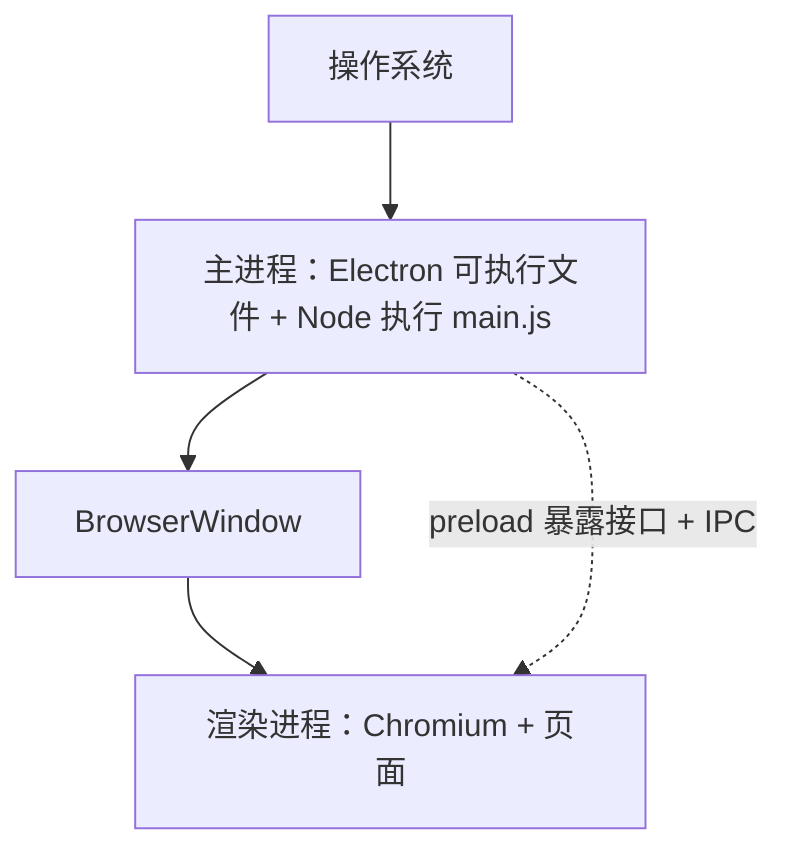
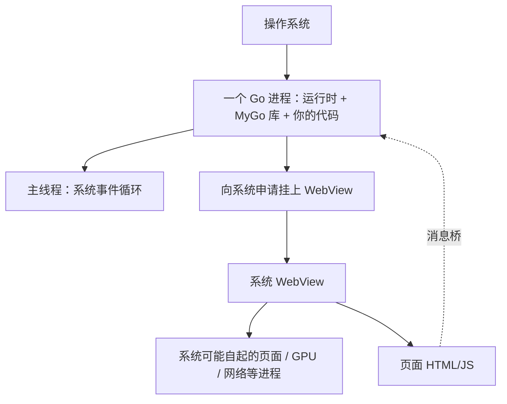
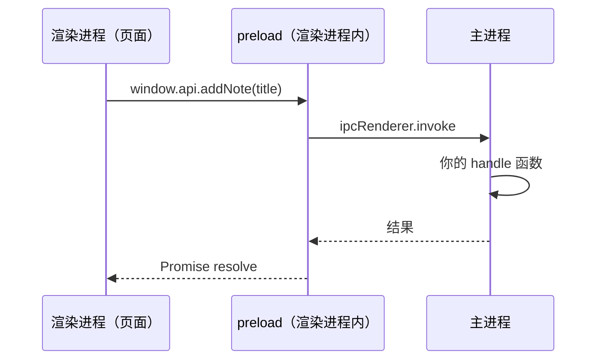
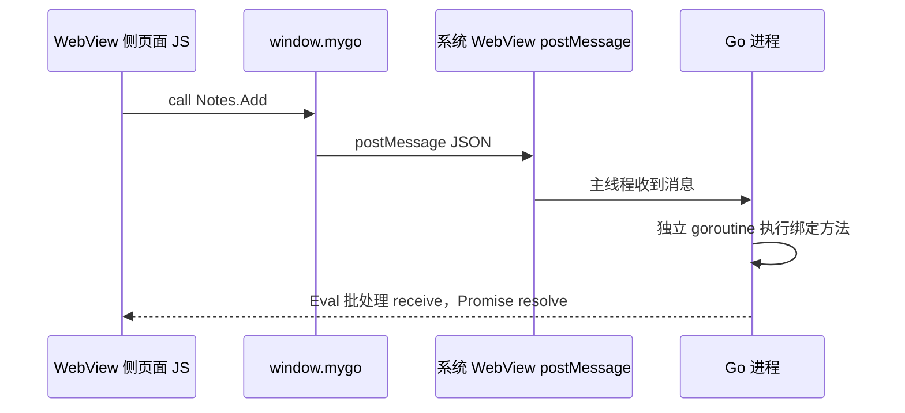

## TL;DR

双击桌面应用时，操作系统启动的是一个**可执行文件**，并得到至少一个**进程**（一份正在跑的程序实例）。

Electron 启动的是官方预编译好的 Electron 程序。这个进程叫**主进程**，跑 Node，负责生命周期、开窗口、调系统能力。每开一个窗口，主进程还会再起一个**渲染进程**，里面跑自带的 Chromium 来显示页面。页面在渲染进程，后台在主进程，两边不共享内存里的对象，所以要发消息（IPC）才能互相调用。

MyGo 启动的是你自己 `go build` 出来的那个程序，得到**一个 Go 进程**：Go 运行时、MyGo 库、你的业务 Go 代码都在这里。需要显示网页时，这个 Go 进程向操作系统申请，在原生窗口里挂上**系统自带的 WebView**（浏览器引擎不在安装包里）。系统 WebView 往往会再拉起自己的辅助进程去跑页面、GPU、网络等；页面 HTML/JS 在 WebView 这一侧执行，业务仍在 Go 进程里。两边也不在同一套脚本环境，所以同样要走消息桥。

两边前端都是 HTML/JS/CSS，不事先变成机器码，由各自的 JS 引擎在运行时执行。差别在：Electron 自己管「主进程 + 渲染进程」；MyGo 是「一个 Go 进程 + 系统 WebView（及其可能自起的进程）」。

## 背景

网页跑在浏览器里，受沙箱限制，一般不能随意读写本地文件或画系统托盘。桌面应用由操作系统直接启动，可以开窗口、调文件对话框、读写磁盘。传统做法要为每个系统各写一套原生界面，成本高。常见折中是：**界面仍用 Vue / React 写成网页，系统能力交给本地后台**；页面不能直接碰系统，必须经框架提供的桥发请求。MyGo 与 Electron 都走这条路，但双击之后「谁在跑、引擎从哪来」不同。

后面会反复用到**进程**：操作系统里一份正在跑的程序实例。一个应用可以有多个进程；不同进程之间不能直接共享内存里的对象，要通信就得发消息。

还需要几句，只为理解「双击启动的是谁」：**可执行文件**是操作系统能直接启动的程序文件（如 `.exe`）。Go 是编译型语言，`go build` 事先把源码（含链进去的库和 Go 运行时）变成这种文件。JavaScript 通常不事先产出可执行文件，必须有一个已经存在的宿主来提供引擎和事件循环——Electron 就是那个宿主。**WebView** 是操作系统提供的「把浏览器内核嵌进普通窗口」的控件（macOS：WKWebView；Windows：WebView2；Linux：WebKitGTK）。

## 打包时各自把什么放进安装包

语言不同，决定了安装包长什么样，也决定了最终双击的文件不同。

**Electron**：`npm install electron` 得到一份已经编译好的宿主（内含 Chromium 与 Node）。打包时复制这份宿主并改名，把你的主进程脚本、preload、前端文件放进资源目录（常见为文件夹或 `app.asar`）。前端 JS、主进程 JS 仍是文本脚本，由宿主里的引擎在运行时执行。

```text
安装包/
  Electron 可执行文件（改名后的宿主）
  Resources/
    app.asar 或 app/
      package.json   ← main 字段指向主进程入口
      main.js
      preload.js
      前端 HTML/JS/CSS
```

**MyGo（WebView 模式）**：`go build`（或 `mygo build`）把你的 Go 业务、MyGo 库、Go 运行时静态链接成一个可执行文件。前端先经 Vite 等打成静态文件，再嵌入该二进制；正式包里用 `mygo://` 提供这些文件。浏览器引擎不打进安装包。

```text
安装包/
  你的可执行文件
    ├─ Go 运行时 + MyGo 库 + 你的 Go 代码（机器码）
    └─ 嵌入的前端 HTML/JS/CSS（数据，不是机器码）
  （运行时再去加载系统里的 WebView）
```

## Electron：从双击到界面可用（按进程）

1. 用户双击 → 操作系统启动**改名后的 Electron 可执行文件**。这个进程就是**主进程**。
2. 主进程里跑的是 Node 环境。它读取 `package.json` 的 `main`，执行你的 `main.js`。主进程管应用生命周期、创建原生窗口、调用菜单 / 对话框等系统能力。
3. `main.js` 调用 `BrowserWindow` 创建窗口。每创建一个窗口，主进程会再拉起至少一个**渲染进程**：里面跑 Electron 自带的 Chromium，负责解析 HTML/CSS、用 V8 执行页面 JS、画出界面。
4. 创建窗口时可指定 **preload** 脚本。preload 在**渲染进程**里、页面自己的脚本之前运行，能使用一部分 Electron / Node API，用来安全地给页面暴露有限接口（常见写法是 `contextBridge.exposeInMainWorld`），而不是把整套特权 API 直接交给页面。
5. 渲染进程加载前端：开发时常见本地文件或开发服务器；打包后从 `app.asar` 等资源加载。
6. 主进程与渲染进程不共享内存里的对象。页面要调系统能力，须经 preload 暴露的接口，再通过 IPC（例如 `ipcRenderer.invoke` / `ipcMain.handle`）把请求发到主进程，结果再回渲染进程。



除主进程与渲染进程外，Chromium 还会为 GPU、网络等再起辅助进程，这是引擎自己的多进程模型，应用代码一般不直接管。要点：操作系统启动的是 Electron；「后台」在主进程，「界面」在渲染进程；两边靠 IPC。

## MyGo（WebView 模式）：从双击到界面可用（按进程）

操作系统只启动**你的 Go 可执行文件**，得到**一个 Go 进程**。Go 运行时、MyGo 库、你的业务 Go 代码都在这个进程里——没有另装的「MyGo 运行时安装包」，也没有你再写一份「MyGo 渲染进程」。

这个 Go 进程在主线程上跑系统事件循环：窗口拖动、点击、关闭等系统事件由它处理。进入你的 `main` 后，调用 MyGo 库创建应用、绑定服务、`App.Run`；MyGo 通过 purego（macOS/Linux 上运行时 `dlopen` 系统库）或 Windows 的 `syscall` 去加载系统窗口与 WebView 组件（默认 `CGO_ENABLED=0`，不靠 cgo）。

需要显示网页时，Go 进程向操作系统申请：在原生窗口里挂上**系统自带的 WebView**。浏览器引擎不在安装包里——macOS 用 WKWebView，Windows 用 WebView2，Linux 用 WebKitGTK。

系统 WebView 往往会再拉起自己的辅助进程来跑页面、GPU、网络等。这些进程由系统 WebView / 平台负责，不是 MyGo 再起的「渲染进程」。

页面 HTML/JS 在 WebView 这一侧执行；你的业务 Go 代码仍在 Go 进程里。两边不在同一套脚本环境，所以要消息桥，不能直接互相调用函数。

和 Electron 对照着看页面放哪、谁跑页面：Electron 把前端文件放进安装包资源（如 `app.asar`），由**自己起的渲染进程**加载并执行这些文件。MyGo 把前端文件嵌进 Go 可执行文件，由 **Go 进程把文件交给系统 WebView 去加载**；页面在系统 WebView（及其可能自起的进程）里跑，窗口里嵌的就是这块 WebView。不是 MyGo 再写一个「渲染进程」去跑页面。

页面从哪加载，开发时和正式包不一样，也不等于「Go 开了一个网络端口给人访问」。

开发时：前端还在改、还没打进正式包。这时常见做法是另起一个 **Vite 开发服务器**（你跑 `bun run dev` / `mygo dev` 时，项目脚本或 CLI 会把它拉起来）。Vite 的工作是：在本机开一个 HTTP 服务、监听一个端口，把你的 Vue/React 源码按需编译成浏览器能跑的 JS/CSS，并提供热更新——你改前端文件，页面往往不用整包重编就能刷新。那个链接（如 `http://localhost:5173`）就是 **Vite 起的这个本机服务的地址**，不是 Go 起的。Go 进程（或 Electron 主进程）只是让 WebView / 渲染进程去打开这个地址，向 Vite 要页面；所以开发时 WebView 里看到的内容和你用浏览器打开同一个链接时类似，只是外面多了桌面窗口和 IPC。

正式包：前端文件已经嵌进 Go 可执行文件。WebView 打开的是自定义协议地址（如 `mygo://localhost/`）。WebView 每要一个文件，就向 Go 进程要；Go 从嵌入数据里取出对应文件交给 WebView。这不是在本机开一个 HTTP 端口，地址里的 `localhost` 只是协议里的主机名写法。Windows 上 WebView2 会把这类地址映射成 `http://mygo.localhost` 一类形式，仍由应用在进程内应答，不是对外开端口。`mygo://` 只负责把前端文件递给 WebView，不负责页面调 Go。

Electron 也类似：开发时也常让渲染进程去加载 Vite 等开发服务器地址；正式包里前端在 `app.asar` 等资源里，主进程让渲染进程用 `loadFile` / 资源路径（或自定义协议）加载本地文件，默认同样不是「主进程开个端口再让页面来取」。

页面要调 Go，需要一个双方都认的入口。WebView 开始加载某个 HTML 文档时，MyGo 会先往这个页面里塞进一段它自带的 JS（桥接脚本），在页面自己的业务 JS 跑起来之前执行。这段脚本在页面的 `window` 上挂出一个对象，名字叫 `window.mygo`，并冻结住，避免页面乱改。之后页面 JS 调用 `window.mygo.call(...)`，才是走消息通道去 Go。Go 把结果送回页面时，也是通过这个桥上的接收入口。

和 Electron 的 **preload** 对齐的，是上面这段**注入的桥接脚本**（装上 `window.mygo`），不是 `mygo-runtime`：都是在页面自己的业务 JS 之前，先在页面环境里挂好「去调后台」的入口。差别是 Electron 常由你写 preload、用 `contextBridge` 暴露有限 API；MyGo 由框架注入桥，入口统一是 `window.mygo`。

前端项目里常安装的 npm 包 `mygo-runtime`，**不是**应用的运行时底座（底座是编进二进制的 Go 运行时 + MyGo 库），也**不是** preload 那一层。它只是给前端 TS/JS 用的薄封装：你 `import` 它，它内部还是去调已经注入好的 `window.mygo`。没有 `window.mygo`（例如在普通浏览器里打开同一套前端），这个包调不通。

只有受信任的页面（应用自己的前端、自定义协议页、开发时的本机开发服务器等）才能调用已绑定的 Go 方法；第三方网页默认不能调。



对照 Electron：Electron 自己管主进程 + 渲染进程（引擎打在安装包里）；MyGo 是「一个 Go 进程 + 系统 WebView（及其可能自起的进程）」，引擎用系统的。

## 一次按钮点击：从前端到后台再返回

假设页面上点「添加笔记」，要调用后台写入数据。关键是：消息从哪个进程出发、到哪个进程、结果怎么回去。

**Electron**

1. 页面 JS 在**渲染进程**里调用 preload 暴露的函数（例如 `window.api.addNote(title)`）。
2. preload（仍在渲染进程）内部执行 `ipcRenderer.invoke('notes:add', title)`，把消息发到**主进程**。
3. 主进程里事先注册的 `ipcMain.handle('notes:add', …)` 收到请求，执行你的函数（可调对话框、读写文件等）。
4. 返回值作为 Promise 结果回到渲染进程，页面更新 UI。

路径概括：渲染进程（页面）→ preload 暴露的函数 → `ipcRenderer.invoke` → 主进程 `ipcMain.handle` → 结果回渲染进程。安全上通常不把整个 `ipcRenderer` 暴露给页面，只暴露包装好的几个方法。



**MyGo**

1. 页面 JS 在 **WebView 侧**调用 `window.mygo.call("Notes.Add", title)`（经生成的 TS 客户端或 `mygo-runtime` 最终都会走到这里）。
2. 注入的桥把 JSON 消息经系统 WebView 的 postMessage 通道发出：WebKit 上为 `window.webkit.messageHandlers.mygo.postMessage`；WebView2 上为 `window.chrome.webview.postMessage`。
3. 消息进入 **Go 进程**：主线程先收到；真正执行你绑定的方法在**独立 goroutine**里跑，以免堵死必须跑在主线程上的界面事件循环。
4. Go 通过让 WebView 执行一段脚本（批处理调用页面上的 `receive`）把结果送回；页面上的 Promise resolve，UI 更新。

路径概括：WebView 侧页面 JS → `window.mygo.call` → 系统 WebView 的 postMessage → Go 进程（主线程收消息，独立 goroutine 执行绑定方法）→ Go 让 WebView 执行脚本把结果送回页面。`mygo://` 不负责这次调用——它只负责提供前端静态文件；方法调用走的是上面的 postMessage 桥。Go 回到页面也不是对称的 postMessage，而是原生侧对页面执行脚本。



## 为什么两种模式会「相反」

根因是语言能不能独立变成可执行文件。

Go 能编译成可执行文件，并能在链接阶段把库合并进去，所以框架表现为「你程序里的库」：用户启动的是你的二进制。JavaScript 不能单独变成操作系统直接加载的本地程序，必须有一个已经存在的宿主来提供事件循环和引擎，所以 Electron 表现为「宿主程序加载你的脚本」：用户启动的是 Electron。

系统 WebView 能直接用，是因为各系统把它作为已安装且公开的组件提供。MyGo 用 purego / syscall 在运行时加载这些系统库。选择系统 WebView，安装包不必带浏览器引擎。Electron 选择自带 Chromium，是为了各平台页面行为更一致、跟进 Web 新特性更可控；代价是每个应用都带上一份引擎，体积和内存都更大。

## 轻重与代价

Electron 重在「引擎打进安装包」。MyGo Web 模式轻在「引擎用系统的」；官方自测 hello 约 7 MB 二进制，带 WebView 时约 62 MB 内存（作者自测，含 WKWebView 拉起的进程）。轻的代价是 macOS / Windows / Linux 上 WebView 内核不同，同一套前端可能有兼容差异。轻重主要不取决于「前端组件库多不多」，而取决于浏览器引擎是否捆绑。

## 原生 UI 模式（简短）

MyGo 还可以不启 WebView：用 `ui` 包在 Go 里描述界面，经 Metal / Direct3D / OpenGL（或 CPU）绘制，文字走系统文本引擎。没有「前端页面 ↔ 后端」的 IPC，视图代码与业务同在 Go 进程里直接调用。纯原生窗口的应用甚至可以不加载 WebKit / WebView2；官方也提到这类窗口的内存占用低于带 WebView 的窗口（具体数字随平台与示例而变）。需要内嵌网页时，仍可在原生界面里再挂系统 WebView 控件，那是另一条能力，与「整窗都是网页」的模式不同。

## 开发一个项目的流程

**MyGo**

```bash
bunx mygo-cli init my-app
cd my-app && bun run dev
bun run build
```

**Electron（Forge）**

```bash
npx create-electron-app@latest my-app
cd my-app && npm start
npm run make
```

都是：生成项目 → 开发运行 → 打包。差别仍是最终双击的是「你的 Go 程序」还是「改名后的 Electron 宿主」，以及进程结构如上。

## 对照表

| 项目 | MyGo（WebView） | Electron |
|------|-----------------|----------|
| 进程结构 | 一个 Go 进程 + 系统 WebView（及其可能自起的进程） | 主进程 + 每个窗口的渲染进程（另有 GPU 等辅助进程） |
| 双击启动谁 | 你的 Go 可执行文件 | Electron 可执行文件 |
| 后台跑在哪 | Go 进程 | 主进程（Node） |
| 页面跑在哪 | 系统 WebView 侧 | 渲染进程（自带 Chromium） |
| 前端放哪 | 嵌入二进制，经 `mygo://` 提供 | `app.asar` / 资源目录 |
| IPC | `window.mygo` + WebView postMessage ↔ Go | preload + invoke / handle |
| 体积倾向 | 轻（引擎不捆绑） | 重（引擎打进包） |
| 页面一致性 | 随系统 WebView | 各平台更接近 |

## 参考

- MyGo 架构 https://mygo.egoist.dev/docs/architecture
- MyGo 前端加载 https://mygo.egoist.dev/docs/frontend
- MyGo 前端调用 Go https://mygo.egoist.dev/docs/bindings
- Electron 进程模型 https://www.electronjs.org/docs/latest/tutorial/process-model
- Electron preload 教程 https://www.electronjs.org/docs/latest/tutorial/tutorial-3-preload
- Electron IPC https://www.electronjs.org/docs/latest/tutorial/ipc
- Electron 应用分发 https://www.electronjs.org/docs/latest/tutorial/application-distribution
- Electron Forge https://www.electronforge.io/
