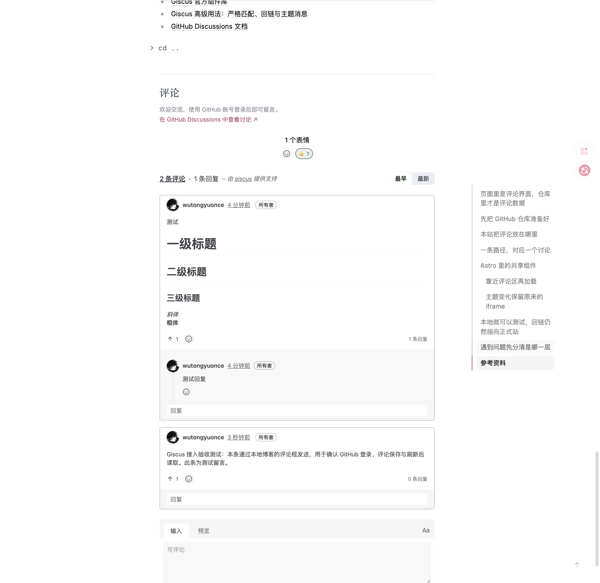
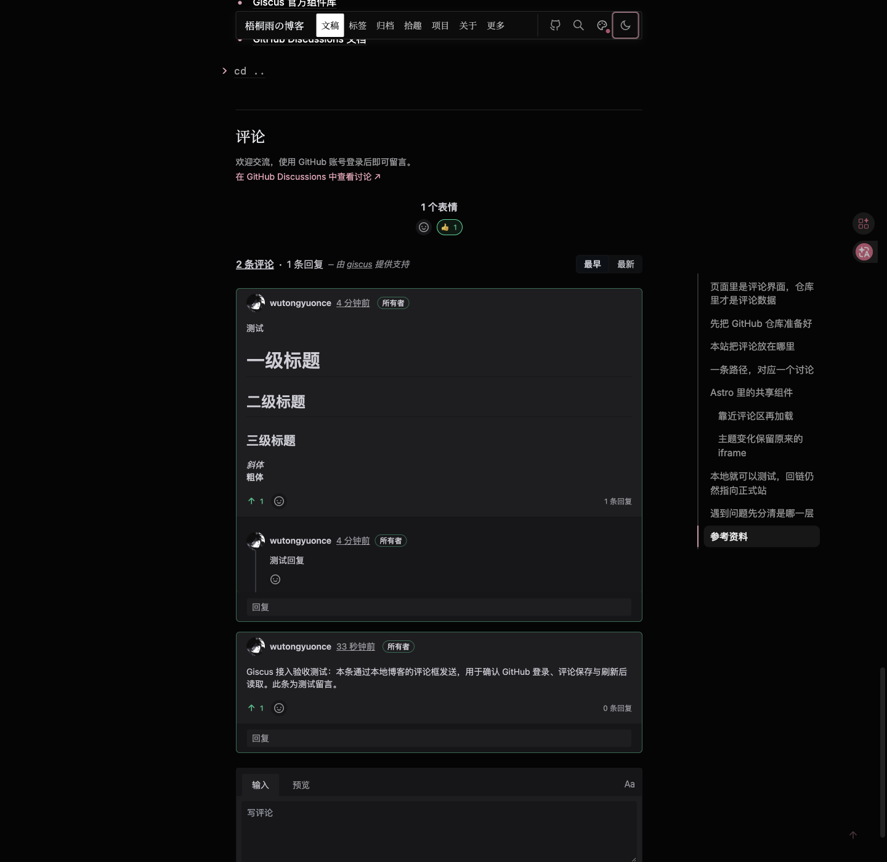

读到 EastonJiang 的[《给博客接入 GitHub 评论：Giscus 从配置到落地》](https://www.jiangxu.net/blog/giscus-github-discussions-comments)后，我也想给自己的博客加上评论。

需求很具体：文章读完以后可以交流，友链页可以直接提交站点信息，拾趣里的设备、动漫、电影、电视剧、游戏、书和 Kpop 页面也各自留一块讨论的地方。评论放在这些页面正文之后，用现成的 GitHub 账号留言，数据继续由 GitHub 保存。

这篇记录本站的 Astro 实现。配置部分参考了上面的文章和 Giscus 官方文档；代码与页面安排来自 YuBlog 自己的结构。

## 页面里是评论界面，仓库里才是评论数据

Giscus 把 GitHub Discussions 包装成可以嵌入网页的评论区。

```text
打开 /blogs/某篇文章/
  → 进入评论区附近
  → 加载 Giscus iframe
  → 按页面关联键查找 Discussion
  → 用 GitHub 登录并留言
  → 评论保存在仓库的 GitHub Discussions
```

所以，“给选定页面嵌入一个 JavaScript 模块，再让不同页面对应不同 Discussion”这个理解基本准确。补充两个细节：页面和 Discussion 的对应方式需要配置；打开一个没有评论的页面，也不会马上在仓库里创建空讨论，第一次有人留言或回应时才会创建。

嵌入界面和保存数据分开后，静态站也能有评论。本站依然由 Astro 构建静态 HTML，不需要为了评论加一套数据库、用户注册和后台服务。管理留言时，直接去 GitHub Discussions 回复、编辑或处理讨论即可。

读者的门槛也很明确：可以阅读公开评论，发表和回应则需要 GitHub 账号，并完成 Giscus 的 OAuth 授权。这更适合习惯使用 GitHub 的读者。

## 先把 GitHub 仓库准备好

本站使用公开仓库 `wutongyuonce/YuBlog` 保存评论。博客源码和评论可以放在同一个仓库，也可以另建专门的公开评论仓库；决定好以后，把配置一直指向同一个仓库就行。

准备工作有三步。

1. 确认目标仓库是公开的。
2. 在仓库 **Settings → General → Features** 中开启 **Discussions**。
3. 在 [Giscus App 安装页](https://github.com/apps/giscus/installations/new)选择仓库所属账号，使用 **Only select repositories**，只勾选目标仓库，再安装。

安装 App 时，GitHub 可能要求 Passkey、验证器或 GitHub Mobile 再验证一次身份。这是仓库管理员的安全验证，与读者在评论框里登录是两件事。

App 获得目标仓库 Discussions 的读写权限；读者授权则允许 Giscus 以自己的身份评论。前者完成了，不代表后者自动完成。

接下来打开 [Giscus 中文配置页](https://giscus.app/zh-CN)，填入仓库名称，确认检查通过，再选择 Discussion 分类。官方推荐公告类型的 **Announcements**：普通访客在页面下评论，顶层讨论由维护者和 Giscus 创建。

配置页会生成仓库与分类的节点 ID。它们是公开标识，不是密码；复制生成的值即可。维护者也可以通过 GitHub GraphQL 查询这些节点，关键是使用真实仓库里的 ID，不猜测、不照抄别人的值。

## 本站把评论放在哪里

| 页面 | 放置位置 | 留言用途 |
| --- | --- | --- |
| 每篇博客文章 | 正文之后 | 交流文章内容 |
| 友链页 | 友链列表与申请说明之后 | 提交友链信息、一般留言 |
| 每个拾趣分类子页 | 分类正文之后 | 讨论该分类的内容 |

拾趣入口负责展示分类和说明，不再放一个总评论区。首页、文稿列表、标签、归档、项目和关于也不加评论。

文章页从上到下依次是正文、`cd ..` 返回链接、评论区。评论区复用正文的 `--blog-prose-width`，与站点整体保持相同版心，桌面不铺满整个窗口，手机随视口收窄。

这些入口最终都调用同一个 `GiscusComments.astro`。文章页由 `RenderPost.astro` 接入，友链页由 `FriendsView.astro` 接入，拾趣由 `InterestsView.astro` 在有分类内容时接入。以后新增拾趣分类，它会自动经过同一条渲染路径，不需要再维护一个“需要评论的分类名单”。

友链评论只是申请入口。访客按页面上的模板留下站名、简介、网址、头像，作者审核后再维护友链数据；不会因为有人留言就自动把站点加入列表。原有提交 PR 的入口也保留。

## 一条路径，对应一个讨论

Giscus 提供 pathname、完整 URL、页面标题、自定义字符串和固定讨论编号等映射方式。

对这个博客，我希望正式站、本地开发和预览地址下的同一页面都读到同一份评论；标题改个字也不应该换一个评论区。因此关联键使用页面路径。

本站进一步把路径规范化后作为 `specific` 映射的 `term`：

```html
<giscus-widget
  mapping="specific"
  term="/interests/device/"
  strict="1"
></giscus-widget>
```

这里的配置与直接写 `mapping="pathname"` 有区别。键由本站在构建页面时明确生成，保留开头和结尾的 `/`，中文使用 URL 编码形式，然后让 Giscus 严格匹配这个字符串。

例如：

```text
/interests/device/     → 设备页讨论
/interests/kpop/       → Kpop 页讨论
/friends/             → 友链申请与留言
/blogs/astro/         → 对应文章的讨论
```

域名、查询参数与锚点不参与关联，所以同一路径在 `localhost` 与正式站共用讨论。严格匹配则用于区分相似路径，避免 GitHub 的模糊搜索把另一篇文章的讨论找过来。

这也意味着本地测试会写入真实评论仓库，应该明确写上“测试留言”。如果以后调整文章文件名、路由层级或部署 base，关联键会改变，需要处理旧讨论的关联。当前实现没有独立于路径的文章身份系统，也不会自动迁移评论。

## Astro 里的共享组件

参考文章使用了脚本注入。在本站，我采用 Giscus 官方的 Web Component，安装的是 `giscus` 包：

```bash
pnpm add -D giscus
```

它适合 Astro：服务端输出静态结构，浏览器在需要时注册 `<giscus-widget>`。不需要为评论引入 React 或 Vue。它依赖 Lit，体积成本需要计算，但可以复用官方对登录、iframe 消息和事件清理的处理。

仓库、仓库 ID、分类、分类 ID 统一放在 `src/config.ts` 的 `GISCUS` 中。页面组件只负责放置评论，避免在三个入口复制一整套配置。

另一个边界是正文。评论组件放在 Markdown 的正文容器之外，因此评论标题、登录按钮和读者留言不会混进本站的文章全文 RSS，也不会成为 Pagefind 索引的作者正文。

### 靠近评论区再加载

服务端先输出标题、提示、GitHub 讨论入口，以及一个不立即执行的 `<template>`。

浏览器通过 `IntersectionObserver` 观察评论容器，距离可见区域约 200px 时再加载官方组件、挂载 widget：

```ts
await import('giscus')
if (!this.isConnected) return

const template = this.querySelector('template')!
const content = template.content.cloneNode(true) as DocumentFragment
this.append(content)
```

这让没有读到页面底部的访客不必先加载评论 iframe。等待模块下载时如果已经换页，也不再向离开的页面挂载组件。

OAuth 回调有一个例外：URL 带有 Giscus 返回的登录参数时，立即初始化组件，让官方组件保存登录结果，不等待读者再次滚到文章底部。本站不另外解析或保存这份登录凭证。官方组件清除回调参数时会调用 `history.replaceState`，共享组件在初始化后保留 Astro 原有的 history state，避免登录后的前进／后退丢失页面状态。

### 主题变化保留原来的 iframe

本站的实际主题由根元素上的 `dark` class 表示，已有 `observeTheme` 工具监听变化。评论直接复用这个入口：

```ts
widget.theme = document.documentElement.classList.contains('dark')
  ? 'noborder_dark'
  : 'noborder_light'
```

官方 Web Component 会把属性更新转换成发给 iframe 的配置消息。因此切换明暗主题不需要重新创建评论区，也不会因为换肤而重载正在阅读的讨论。

Astro 的 ClientRouter 会交换页面内容。共享组件在断开时停止可见性观察、取消主题订阅，官方 widget 清理自己的消息监听；进入下一页时，新的组件携带新页面的关联键初始化。这里没有额外的评论缓存或轮询。

## 本地就可以测试，回链仍然指向正式站

只要仓库、App 和网络配置正确，Giscus 可以在本地页面运行，OAuth 和评论也可以实际测试。无需先把博客部署到正式域名。

不过，本地测试还有一个容易忽略的细节：Discussion 正文中的“返回原文”链接。

默认情况下，Giscus 会使用当前页面地址。如果第一次留言来自 `localhost`，讨论可能留下一个其他人打不开的本地链接。本站在页面头部显式提供正式站 canonical 地址：

```html
<meta
  name="giscus:backlink"
  content="https://www.wutongyu.site/interests/device/"
/>
```

实际值与页面现有的 canonical 使用同一个 URL。这样本地页面可以操作同一份评论，讨论里的回链仍指向正式站。

完整验收可以按下面的顺序检查；“看见评论框”和“评论确实保存成功”是两项不同的证据：

1. 打开较长的页面，首屏没有 Giscus 请求；滚到正文下方后评论加载。
2. 用 GitHub 登录并发送一条明确标记的测试留言。
3. 到仓库 Discussions 核对分类、关联键、评论作者和正式站回链。
4. 刷新原页面，确认还是这条讨论、留言仍然可见。
5. 打开另一篇文章或拾趣子页，确认没有出现上一页的留言。
6. 切换明暗主题，确认 iframe 没有重建；再检查手机宽度和站内跳转。

这次已经在本地页面完成了 GitHub 登录、发送测试留言和刷新读取。留言保存在 [本站对应的 Discussion](https://github.com/wutongyuonce/YuBlog/discussions/113#discussioncomment-18945026)，分类为 Announcements，讨论标题就是文章路径，正文回链指向正式站。浏览器检查还覆盖了明暗主题、站内转场，以及桌面和手机下正文与评论区的对齐。

下面两张截图来自本站同一个评论区，分别为浅色与深色；可以看到返回链接位于正文和评论之间，评论宽度与正文保持一致。

:::gallery



:::

## 遇到问题先分清是哪一层

配置页提示不可用，先查仓库是否公开、Discussions 是否开启、Giscus App 是否安装到了正确仓库，再查分类是否选对。只把代码粘进页面，无法代替这些准备工作。

出现“找不到 Discussion”，对还没有人评论的页面可能只是正常初始状态。首次留言或回应后才会创建讨论，不需要给每篇文章预先建一条空帖子。

评论区配色与博客不同，先检查是否只用了系统主题，而博客允许手动选明暗。本站同步的是实际生效的 `dark` class。

有的页面显示另一篇的评论，则检查关联键和匹配方式。不要用会重复的页面标题作为键，也不要在不同页面复用同一个 `term`。

第三方服务或网络不可用时，文章仍然可以阅读，页面也保留直接前往 GitHub Discussions 的入口。无 JavaScript 时同样保留这个入口与友链模板；页面内的登录和评论仍需要 JavaScript。

## 参考资料

- [EastonJiang：给博客接入 GitHub 评论：Giscus 从配置到落地](https://www.jiangxu.net/blog/giscus-github-discussions-comments)
- [Giscus 中文配置与使用说明](https://giscus.app/zh-CN)
- [Giscus 官方组件库](https://github.com/giscus/giscus-component)
- [Giscus 高级用法：严格匹配、回链与主题消息](https://github.com/giscus/giscus/blob/main/ADVANCED-USAGE.md)
- [GitHub Discussions 文档](https://docs.github.com/en/discussions)
