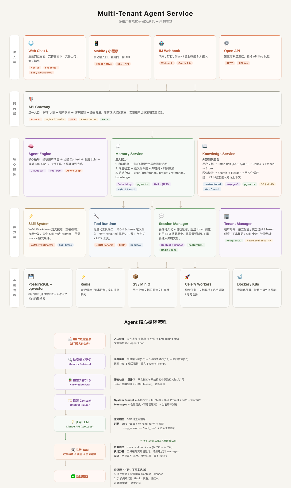
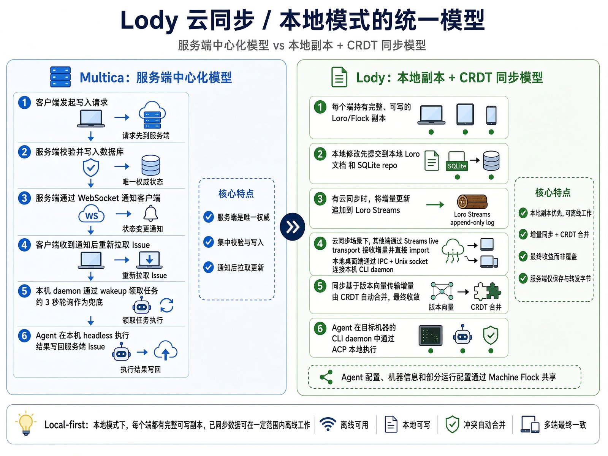
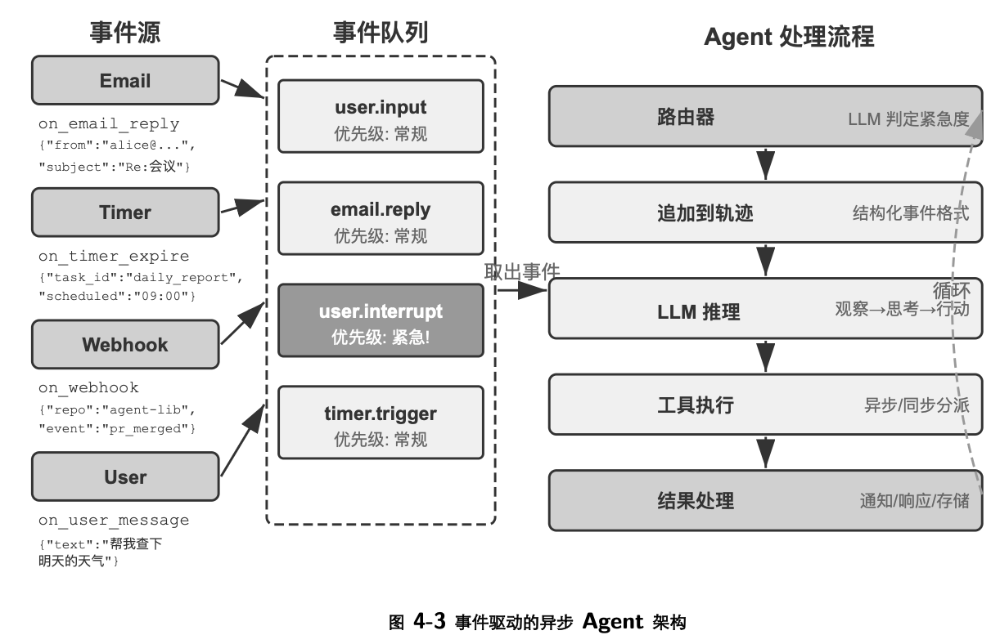
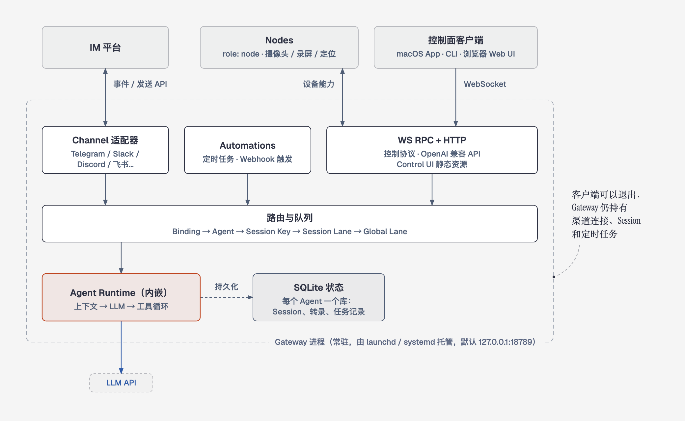
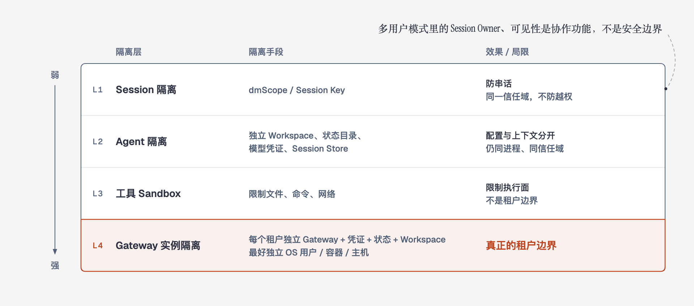
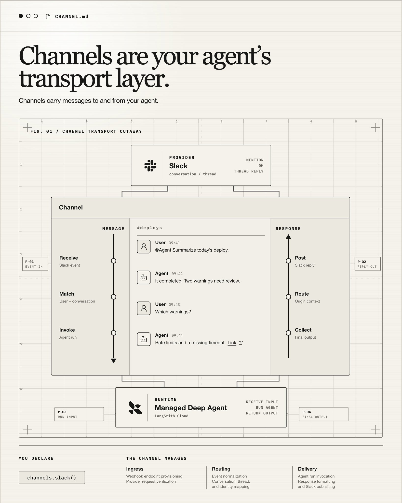
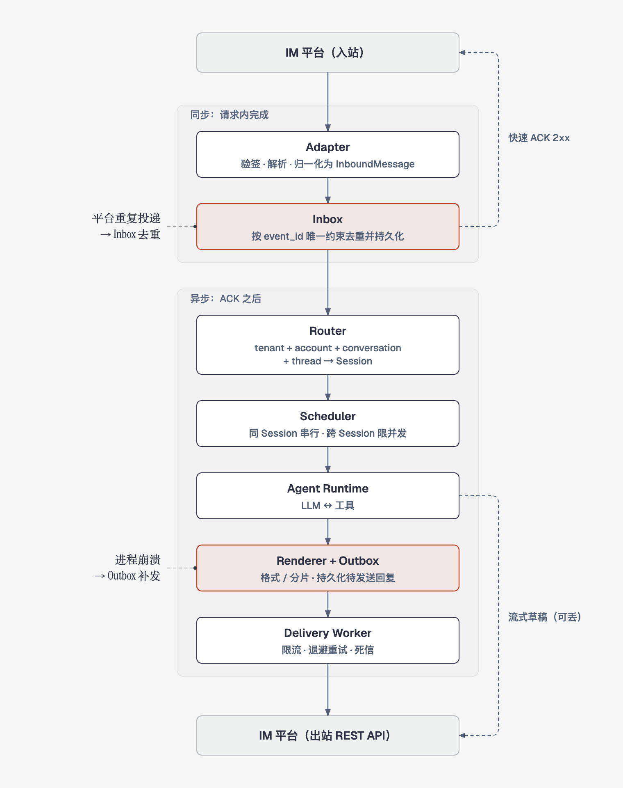

> **TL;DR（面试时可以直接这么说）**
>
> 讨论 Agent 的“形态”，要先拆成四个相互独立的问题：计算在本地还是云端，UI 和后端是否在同一进程，状态是否跨设备同步，以及是否服务多个互不信任的租户。
>
> OpenClaw 是一个自托管的常驻服务：一个 Gateway 进程持有所有渠道连接、Agent、Session、队列、定时任务和 SQLite 状态；App、CLI、浏览器 Web UI 和手机 Node 都是通过 WebSocket 连进来的客户端。所以它是“客户端-服务端分离，服务端是单体”。一条消息进来后，Gateway 先用 Binding 选 Agent，再按来源算出 Session Key，然后进入 Session Lane 串行、Global Lane 限并发，最后由内嵌的 Agent Runtime 执行“LLM → 工具”循环。
>
> 多 Agent、多用户都不等于多租户。OpenClaw 官方的立场是“一个 Gateway 一个信任边界”，互不信任的租户必须各自独立运行 Gateway、凭证和状态。
>
> 把 IM 接入 Agent 的桥接层，核心是四个稳定边界：统一消息模型、Session Key、Inbox 幂等去重、Outbox 可靠投递。入站先验签、落库再快速 ACK，Agent 在 ACK 之后异步执行；同一会话串行；流式草稿可以丢，最终回复必须经 Outbox 可重试地送达。

本文对比两类系统：以 OpenClaw 为代表的“客户端-服务端分离、服务端是单体”的自托管 Agent，以及把 IM 接入 Agent 的 Channel 桥接层。先看一张多租户 Agent Service 的分层架构：接入层（Web / 小程序 / IM Webhook / Open API）→ 网关层（JWT、租户识别、限流）→ 核心服务（Agent Engine / Memory / Knowledge）→ 能力层（Skill、Tool Runtime、Session、租户隔离）→ 基础设施。



## Agent 形态

常见的 Agent 形态有下面几种（原表保留，代表项目不变）：

| 形态 | 核心特征 | 代表项目 |
| :-- | :-- | :-- |
| **云端 Agent** | **计算在云端**，通常 7x24 小时运行，可为每个用户分配独立的虚拟机环境 | **[Grok Bot](https://docs.x.ai/grok-bot/overview)**：每个 Bot 一台独立的云端 Linux VM；**[Cloudflare](https://github.com/cloudflare/computer)** |
| **单体全栈 Agent** | **前后端不分离**，UI 和后端服务运行在**同一个进程**中，部署简单，开箱即用 | **[OpenClaw](https://github.com/openclaw/openclaw)**：典型的自托管个人 Agent，可通过多种聊天平台交互 |
| **前后端分离 Agent** | **前后端独立部署**，通过 API 通信，架构灵活，易于维护和扩展 | |
| **云同步 Agent** | **以本地运行为主**，通过云端服务同步**会话、配置等状态数据**，实现跨设备协作 | **[Lody](https://github.com/LodyAI/Lody)**：提供协作工作空间，使用 CRDT 同步引擎同步状态 |
| **多租户 Agent** | **一套系统服务多个相互隔离的用户或团队**，关键是数据和计算环境的**严格隔离** | **[AgentClaw](https://github.com/wuding129/agentClaw)**：把 OpenClaw 改造成多租户平台，为每个用户提供隔离的 Docker 沙箱；**[Nexus Agent Model Hub](https://github.com/Dajucoder/nexus-agent-model-hub)**：一个多租户的 Agent 工具平台 |

这张表容易让人误以为五种形态是互斥的分类，其实它把**四个相互独立的维度**放在了同一列：

- **计算在哪**：本地 / 自托管，还是云端（云端 Agent）；
- **进程怎么分**：UI 和后端在同一进程（单体），还是分成客户端和服务端两个部署单元（前后端分离）；
- **状态在哪**：只在一台机器上，还是通过云端同步到多台设备（云同步 Agent）；
- **服务谁**：一个信任域，还是多个互不信任的租户（多租户 Agent）。

一个具体系统要在每个维度上各取一个值。以 OpenClaw 为例：它是**自托管**的；状态都在本机的 Gateway 里，**不做云同步**；**一个 Gateway 只对应一个信任域**，不是多租户。进程这一维要说得更准确：**服务端是单体，客户端是分离的**。渠道连接、路由、队列、Agent Runtime、定时任务、状态存储，以及 Control UI 的静态资源，全部由同一个 Gateway 进程承载；但 macOS App、CLI、浏览器里的 Web UI、手机上的 Node 都是独立进程，通过 WebSocket 连接 Gateway。原表把 OpenClaw 归为“UI 和后端同进程的单体”，只说对了服务端那一半。另外，OpenClaw 是 Node.js / TypeScript 实现的，Gateway 用异步 I/O 在一个事件循环里同时服务多个连接，不是 FastAPI 或 Next.js 托管的。

相关的几个概念，顺带分清：

- **Web 前后端项目**：前端在浏览器渲染，后端提供 API 服务，**两者之间必须有网络通信**。
- **全栈项目**：指同一个人同时写前端界面和后端接口，但**前后端通常仍是两个独立的部署单元**（或者通过 Next.js 这类 SSR 框架合在一起，但逻辑上依然分层）。
- **CLI / Agent 项目**：属于**本地可执行应用**。它把界面交互、业务逻辑、数据存储都打包在一个进程里，内部逻辑再复杂，也是**单体架构（Monolith）**。

**多租户（Multi-tenancy）**：同一个软件实例（一套代码、一个数据库）同时服务**多个互不信任的客户（组织）**。数据严格隔离，租户 A 绝对看不到租户 B 的数据；每个租户通常还有独立的配置和计费。

**云同步 Agent** 关注的是**数据一致性**：把 Agent 的配置、会话记录、记忆（Memory）存到云端，让不同设备（电脑、手机）访问同一份数据。



> **Monolith（单体架构）和 Monorepo（单体仓库）不是一回事。**
>
> **Monolith** 讲的是**部署**：所有业务逻辑打包在同一个进程里，统一部署。前端界面、后端业务逻辑、数据访问层都在一起，编译成一个 `.jar`、一个 `.exe`，或者一个完整的 Node.js 服务。它的对立面是**微服务（Microservices）**：把系统拆成订单服务、用户服务等独立的小服务，各自部署，通过网络调用。“把所有逻辑写在一个进程里的 CLI 工具”就是典型的 Monolith，哪怕它内部做了模块化拆分。
>
> **Monorepo** 讲的是**代码组织**：一个 Git 仓库里放着多个项目，比如 `packages/` 或 `apps/` 下分别是 `frontend`（React）、`backend`（Java）、`shared-types`（TS）和你的 `CLI-tool`。它的对立面是 **Polyrepo（多仓库）**：每个项目单独一个仓库。Google、Meta 内部用一个巨大的 Monorepo 存放全公司的代码；前端圈的 Babel、Vue 源码仓库也都是 Monorepo。

> **面试版：** Agent 形态要从四个维度分别看：计算位置、进程拓扑、状态同步、租户模型。OpenClaw 是自托管、单信任域、不做云同步，服务端是单体的 Gateway，客户端通过 WebSocket 与它分离。Monolith 说的是部署单元，Monorepo 说的是代码仓库。

## OpenClaw：以 Gateway 为中心的常驻 Agent 系统



### 1. 整体定位

OpenClaw 不是运行一次就退出的 Agent CLI，而是一套以 **Gateway 常驻进程**为中心的 Agent 系统。

> Gateway 统一持有渠道连接、控制接口、Agent、Session、运行队列和自动化任务。App、CLI、Web UI、移动端与外部聊天平台都围绕 Gateway 工作。

整体职责可以压缩成一条主线：

> **多种入口 → Gateway 统一控制 → Agent 与 Session 路由 → Agent Loop → 模型和工具执行 → 回复与状态持久化**

OpenClaw 的重点不是把所有输入塞进一个全局事件队列，而是由 Gateway **先确定输入属于哪个 Agent 的哪个 Session**，再用 Session 级队列控制执行顺序。[Gateway architecture](https://docs.openclaw.ai/concepts/architecture)



这张图表达的是控制关系和进程边界，不代表所有输入都走同一种网络协议。Channel、WebSocket 客户端、HTTP API 和 Webhook 是不同的入口，只是在 Gateway 内部汇合。

### 2. 运行形态

#### 2.1 Gateway 是独立常驻进程

Gateway 可以直接在前台运行：

```bash
openclaw gateway --port 18789
```

也可以安装成由操作系统托管的后台服务：macOS 用用户级 `launchd` LaunchAgent；Linux 通常用 `systemd` user service，也可以部署为 system service；Windows 用 Scheduled Task，受限时退回 Startup 目录启动器。需要长期在线时，官方推荐交给系统服务监督，崩溃后能自动拉起。[Gateway runbook](https://docs.openclaw.ai/gateway)

所以说“Gateway 是运行在 OpenClaw App 背后的守护进程”基本正确，但要补充一个边界：

> App 只是 Gateway 的客户端和管理界面之一。Gateway 可以由 App 辅助安装或连接，也可以脱离 App 独立运行。真正长期持有渠道、Session 和自动化状态的是 Gateway，而不是 App 界面。

#### 2.2 一个端口承载多种服务

Gateway 默认绑定 `127.0.0.1:18789`，同一个端口复用多种能力：

| 接口 | 使用方 | 作用 |
| --- | --- | --- |
| WebSocket RPC | App、CLI、Web UI、Node、自动化客户端 | 发送控制请求，接收 Agent 流式事件和状态事件 |
| HTTP API | OpenAI 兼容客户端、工具调用客户端 | 模型列表、Chat Completions、Responses、Tools 等接口 |
| HTTP 页面与静态资源 | Control UI、Canvas、A2UI | 提供浏览器界面和渲染资源 |
| 插件 HTTP 路由 / Webhook | 插件或外部服务 | 扩展 Gateway 的 HTTP 接入能力 |

“同一个端口”不等于“同一种 Channel”。WebSocket 是控制协议，HTTP 是接口的承载方式，Slack、Telegram 这些才是消息 Channel。

#### 2.3 本机模式与远程模式

本机模式下，App、CLI 和 Web UI 连接本机 Gateway：

```text
App / CLI / Web UI → ws://127.0.0.1:18789 → Gateway
```

远程模式下，Gateway 运行在另一台长期在线的机器上，客户端通过 VPN、Tailscale、SSH Tunnel 或受保护的 HTTPS/WSS 入口连接：

```text
本机 App / CLI → 安全隧道 → 远端 Gateway → 渠道 / Agent / Workspace
```

远程部署只改变了连接位置，Gateway 仍然是状态的所有者。

#### 2.4 单 Gateway、多 Agent 与多租户

一个 Gateway 可以管理多个渠道账号和多个 Agent。每个 Agent 有独立的 Workspace、状态目录、模型与认证配置，以及基于 SQLite 的 Session 历史；Channel Account 通过 Binding 路由到指定 Agent。[Multi-agent routing](https://docs.openclaw.ai/concepts/multi-agent)

但多 Agent 不等于安全意义上的多租户。官方的安全前提是**一个 Gateway 只对应一个信任边界**：一个操作者，或者一个成员彼此信任的团队。[Security](https://docs.openclaw.ai/gateway/security) 由此有几个推论：

- 多用户模式用于多个互相信任的人协作。Session Owner、侧边栏可见性、在线状态都是协作功能，不是安全边界；能操作某个 Agent 的人，就能让它做这个 Agent 能做的任何事。
- 互不信任的用户或组织，不能只靠 Session Key、Agent 或 Sandbox 隔离。
- 真正的租户隔离，要为每个租户运行独立的 Gateway、状态、凭证和 Workspace，最好再分到不同的 OS 用户或主机上。写这篇笔记时，官方 Fleet 文档把这种完整实例称为 `cell`，属于实验能力。

```text
同一可信域：
1 个 Gateway ─┬─ Agent A ─ Workspace / Session Store A
              └─ Agent B ─ Workspace / Session Store B

互不信任的租户：
Tenant A → Gateway / State / Credentials / Workspace A
Tenant B → Gateway / State / Credentials / Workspace B
```

从弱到强，隔离可以分成四层，只有最后一层才是租户边界：



> **面试版：** Gateway 是独立常驻进程，由 launchd 或 systemd 托管，一个端口同时承载 WebSocket 控制协议、HTTP API 和 Control UI。App 只是客户端，退出了 Gateway 也照常运行。一个 Gateway 可以跑多个 Agent，但它只对应一个信任边界：Session 隔离防串话，Agent 隔离分开配置，Sandbox 限制执行面，只有独立的 Gateway 实例才算租户隔离。

### 3. 各层职责：跟着一条消息走一遍

下面以“用户在 Telegram 私聊里给 Agent 发了一条消息”为例，按发生顺序看每一层做什么。

#### 3.1 接入层：四类入口不是同一概念

消息先到达 **Channel**。Channel 连接 Telegram、Slack、Discord、WhatsApp 等消息平台，负责建立和维护平台连接；解析平台消息、账号、发送者、群组和线程信息；把 Agent 输出转成渠道支持的文本、媒体或富文本格式；处理渠道相关的分片、重试和投递状态。不同渠道可能使用 Webhook、轮询、长连接或平台 SDK。Channel 的身份来自适配器和账号配置，不是根据 `/ws` 或某个 HTTP Path 临时判断的。

除了 Channel，OpenClaw 还有另外三类入口，容易混在一起：

- **控制面客户端**：App、CLI、Web UI 和 WebChat。它们通过 Gateway 的 WebSocket RPC 发请求，并订阅 `agent`、`chat`、`presence`、`heartbeat` 等事件。它们不是 Slack、Telegram 那种消息渠道。
- **Node**：连到同一个 WebSocket Server 的设备执行端，比如 macOS、iOS、Android 或 headless node。它以 `role: node` 身份连接，暴露摄像头、录屏、定位等设备命令，本质上是 Gateway 可以调度的外部能力节点。
- **Webhook**：外部服务通过 HTTP 主动触发 OpenClaw 的入口，适合 CI、业务系统或自动化平台。它也走 HTTP，但不等于聊天 Channel。

#### 3.2 Gateway 控制层：统一状态所有者

Gateway 是中心常驻进程，负责维护渠道 Provider 连接；对外提供类型化的 WebSocket RPC 和 HTTP 接口，并按 JSON Schema 校验输入帧；校验连接、认证、配对和权限；管理 Agent、Session、路由、队列和自动化状态；向客户端广播 Agent、工具、健康状态和生命周期事件。所以它同时是服务端、控制平面、连接管理器和运行协调器，不只是一个 HTTP 反向代理。

如果消息是从 App 或 CLI 发起的，控制链路是这样的：

```text
客户端 connect（第一帧必须是 connect）
    ↓
Gateway 完成握手、身份校验和配对
    ↓
客户端发送 agent / send 等 RPC
    ↓
Gateway 立即返回 accepted + runId
    ↓
之后通过 WebSocket 持续推送 Agent 和工具事件，最后返回 final 结果
```

RPC 返回 `accepted` 时，Agent 还没开始执行，只是任务已经被接受并分配了 `runId`；真正的执行在队列里异步进行。

#### 3.3 Agent 与 Binding：先决定由谁处理

Agent 是一套完整、可以独立配置的运行范围，通常包含：Workspace 和人格、规则文件；模型与认证配置；工具和 Sandbox 策略；独立的 Session Store。

Binding 把某个 Channel Account 或特定来源映射到 Agent，例如：

```text
Slack workspace A   → work Agent
Telegram account B  → personal Agent
显式 RPC agentId    → 指定 Agent
```

这一层解决“由哪个 Agent 处理”，下一层的 Session 路由再解决“进入这个 Agent 的哪段会话”。

#### 3.4 Session：确定上下文和隔离范围

Gateway 根据消息来源生成或解析 Session Key，并持有 Session 状态。默认路由大致是：

| 来源 | 默认 Session 行为 |
| --- | --- |
| 私聊 | 同一 Agent 的所有私聊默认共享 Main Session |
| 群组 | 每个群组独立 Session |
| 房间 / Channel | 每个房间独立 Session |
| Automation | 默认每次运行用新的隔离 Session，也可以配置成进入 Main Session |
| Webhook | 每个 Hook 独立，除非显式指定 Session |

Session 不只是一个 Transcript 文件名，它还关联着当前会话的 Agent、历史消息、路由信息、运行状态和重置策略。[Session management](https://docs.openclaw.ai/concepts/session)

这里有一个重要的多用户安全默认值：**所有私聊默认共享 Main Session**。单用户的个人助手因此能跨渠道保持连续上下文；但如果有多个人能给 Agent 发私聊，Alice 的私聊内容就会被 Bob 看到。这时要配置 `session.dmScope`，通常使用：

```json5
{
  session: {
    dmScope: "per-channel-peer"  // 按渠道 + 发送者隔离
  }
}
```

可选值还有 `main`（默认，全部共享）、`per-peer`（按发送者跨渠道隔离）和 `per-account-channel-peer`（按账号 + 渠道 + 发送者隔离）。Session 隔离解决的是会话串线问题，不能代替互不信任租户之间的 Gateway 级隔离。

#### 3.5 队列与并发：同一 Session 串行，不同 Session 可并行

OpenClaw 用进程内、按 Lane 划分的队列来调度 Agent Run：

```text
输入
  ↓
session:<sessionKey> Lane   保证同一 Session 同时只有一个 Run
  ↓
Global Lane（main）         限制整个 Gateway 的 Agent 并发量
  ↓
Agent Runtime
```

所以要区分两个结论：同一个 Session 的 Run 会串行化，避免工具执行和会话状态互相覆盖；不同 Session 可以并行，但总并发受 `agents.defaults.maxConcurrent` 等配置限制。

运行期间如果又收到新消息，由 Queue Mode 决定新消息是注入当前运行、等下一轮、合并还是中断。默认的 `steer` 会尽量把消息送进当前 Runtime；不能安全注入时，才等当前 Run 结束。[Command queue](https://docs.openclaw.ai/concepts/queue)

所以“事件驱动、异步”指的是 Gateway 能持续接收和调度事件，并不表示同一个 Session 可以无序并发执行。

#### 3.6 Agent Runtime：完成一次 Agent Loop

Agent Runtime 是内嵌在 Gateway 进程里的，不是单独的服务。它把一个已经确定了 Agent 和 Session 的输入，执行成动作和回复。一轮典型流程是：

```text
解析 Agent / Session / 模型配置
              ↓
加载 Session History、Workspace、Skills 和 Memory
              ↓
构建本轮模型上下文
              ↓
调用 LLM
              ↓
模型请求工具？ ── 是 ─→ 执行工具 → 写回结果 → 再次调用 LLM
      │
      否
      ↓
生成最终回复并结束 Run
```

运行期间产生的文本、工具调用和生命周期状态，会以流式事件推送给客户端。[Agent loop](https://docs.openclaw.ai/concepts/agent-loop)

#### 3.7 上下文层：Workspace、Skills、Memory 各自负责什么

**Workspace** 是 Agent 的默认工作目录和工作上下文，保存 `AGENTS.md`、`SOUL.md`、`USER.md`、本地笔记等文件。它和保存配置、凭据、Session 的 OpenClaw 状态目录是两个概念。Workspace 也不是安全边界；需要限制文件访问时，必须显式启用 Sandbox。[Agent workspace](https://docs.openclaw.ai/concepts/agent-workspace)

**Skills** 是运行时提供给 Agent 的任务说明和能力知识，告诉 Agent 某类任务该怎么完成。它影响上下文和行为，但不负责 Session 路由。

**Memory** 用于跨轮次或跨 Session 检索长期信息；**Session History** 保存当前会话的消息与运行历史。两者都参与上下文构建，但生命周期和检索方式不同。

```text
Workspace       当前 Agent 的文件和工作环境
Skills          如何执行某类任务
Memory          可检索的长期信息
Session History 当前会话已经发生的内容
```

#### 3.8 工具与 Node：让模型产生外部动作

模型不能直接操作文件、浏览器或手机。它先产生工具调用，再由 Runtime 根据工具策略、审批和 Sandbox 配置决定是否执行：

```text
LLM 输出 tool call
        ↓
Runtime 校验工具与权限
        ↓
本机工具执行 / Node 远程执行 / 外部 API
        ↓
工具结果写回 Agent Loop
        ↓
LLM 基于结果继续推理
```

本机工具通常在 Gateway 所在主机或 Sandbox 中运行；摄像头、屏幕录制等设备能力可以转发给已配对的 Node。Channel 负责消息收发，Node 负责设备能力，两者不要混成一层。

#### 3.9 回复、事件与持久化

Agent 的输出按入口走不同的返回路径：Channel 消息由对应适配器转成平台格式后发送；App、CLI、Web UI 通过 WebSocket 接收流式 Agent 与工具事件；HTTP API 返回同步或流式响应；Automation 可以投递到聊天渠道、Webhook，也可以不投递。

持久化不是流程末尾才做的一次动作。Gateway 会在 Run 的不同阶段更新 Session 元数据、消息历史、路由状态、自动化任务和运行记录。默认情况下，每个 Agent 的 Session 记录和转录保存在 `~/.openclaw/agents/<agentId>/agent/openclaw-agent.sqlite`，归档的转录文件放在同级的 `sessions/` 目录下。UI 客户端本身不保存这些状态，需要时向 Gateway 查询。

> **面试版：** 一条消息依次经过：Channel 解析 → Gateway 鉴权 → Binding 选 Agent → 按来源算 Session Key → 进入 Session Lane 串行、Global Lane 限并发 → 内嵌 Runtime 加载 History/Workspace/Skills/Memory，跑“LLM → 工具”循环 → 按入口原路返回，状态写入每个 Agent 自己的 SQLite。RPC 入口先回 `accepted + runId`，结果再通过流式事件推送。私聊默认共享 Main Session，多人使用时要配置 `dmScope`。

### 4. 自动化与事件扩展

#### 4.1 Automations：持久化调度器

当前官方名称是 **Automations**，`openclaw cron` 仍是兼容别名。调度器运行在 Gateway 进程内，所以**只有 Gateway 在线时任务才会触发**；任务定义、运行状态和历史记录都会持久化，Gateway 重启不会丢失计划。[Automations](https://docs.openclaw.ai/automation/cron-jobs)

它支持一次性时间、固定间隔、Cron 表达式，以及 Webhook、Gmail PubSub 等事件型触发。Agent 任务可以唤醒 Main Session，也可以创建隔离 Run：

```text
计划到期
  ↓
Gateway Automations Scheduler
  ↓
Main Session 系统事件 / Isolated Agent Run / Command
  ↓
执行并记录结果
  ↓
Channel / Webhook / 不投递
```

#### 4.2 Heartbeat：系统拥有的周期检查（已并入 Automations）

旧版的 Heartbeat 是一种由系统维护的特殊 Automation：周期性地在 Agent 的 Main Session 里跑一轮 Agent Turn，让模型检查有没有需要主动报告的事项，有就通知用户，没有就静默结束。

```text
Heartbeat 到期
      ↓
Main Session Agent Turn
      ↓
检查 monitor context
      ↓
有事项 → 通知用户
无事项 → 静默结束
```

当前版本已经取消独立的 Heartbeat 监控，改用普通的 Automation 任务：`openclaw doctor --fix` 会把已有的 Heartbeat 转成可编辑的任务，各自带调度、策略和运行历史。[Heartbeat migration](https://docs.openclaw.ai/gateway/heartbeat) 设计上的变化是：周期检查不再是一套特殊机制，而是一个普通任务。

#### 4.3 Internal Hooks：响应 Gateway 内部生命周期

Internal Hooks 是运行在 Gateway 进程中的 JavaScript 或 TypeScript 处理器，用来响应消息、命令和 Session 生命周期事件，比如保存上下文、记录 `/new`、执行一些短小的副作用。[Hooks](https://docs.openclaw.ai/automation/hooks)

它和 Webhook 的方向相反：

```text
Internal Hook：OpenClaw 内部事件 → Hook Handler
Webhook：      外部 HTTP 请求   → Gateway
```

Internal Hook 是受信任的代码，不在 Sandbox 中运行，所以启用第三方 Hook 之前必须审查代码。

### 5. 三条完整运行链路

三种入口只在“怎么进来”和“怎么回去”上不同，中间的路由、排队和 Agent Loop 是共用的：

```text
聊天渠道：  Slack / Telegram 收到消息 → Channel Adapter 解析
            → Binding 选 Agent → 按发送者/群组/房间算 Session Key
            → Session Lane + Global Lane → Agent Runtime
            → 写入 Session 状态 → Adapter 转换格式发回原平台

客户端发起：App / CLI / Web UI 连接 WebSocket → 握手、认证、设备配对
            → 发送 agent RPC → Gateway 解析 Agent / Session，返回 runId
            → Runtime 异步执行 → 持续推送 assistant / tool / lifecycle 事件
            → 客户端渲染流式结果

定时触发：  Scheduler 发现任务到期 → 选择 Main Session 或创建隔离 Run
            → 进入对应 Lane → 执行 Agent Loop 或命令
            → 持久化运行记录 → 按配置投递到 Channel / Webhook / 不投递
```

### 6. 容易混淆的边界

1. **Gateway 不等于 App 的后端子模块**：它可以独立运行并由操作系统监督，App 只是客户端之一。
2. **WebSocket 不等于 Channel**：WebSocket 是控制面的传输协议；Slack、Telegram 等才是消息渠道。
3. **HTTP Path 不负责识别所有 Channel**：渠道身份主要来自适配器、账号配置和路由上下文。
4. **Session 不等于 Agent**：Agent 决定能力和配置，Session 决定一次连续会话的上下文范围。
5. **异步不等于同一 Session 并行**：同一 Session 默认串行，不同 Session 才能受控并发。
6. **Heartbeat 不等于普通 Cron 任务**：旧版里它是系统维护的 Main Session 周期检查，明确的任务用 Automation；当前版本已经统一成普通 Automation 任务。
7. **多 Agent 不等于不可信多租户**：互不信任的租户需要独立的 Gateway 实例和状态边界。
8. **Workspace 不等于 Sandbox**：Workspace 只是默认工作目录，安全隔离必须单独配置。

### 7. OpenClaw 与 Pi 的架构侧重点

- Pi 以 Agent Runtime 为中心，渠道适配、路由和长期服务能力通常由扩展或宿主来补充；
- OpenClaw 以 Gateway 为中心，把渠道连接、控制协议、Agent/Session 路由、队列和自动化作为产品内置能力；
- 单渠道或嵌入式场景中，Pi 的扩展链路更短；多渠道、多 Agent、远程控制和长期在线的场景中，OpenClaw 的 Gateway 控制面更完整。

一句话总结：

> OpenClaw 是一个由 Gateway 常驻进程统一管理入口、Agent、Session、队列、工具和自动化的 Agent 服务系统；客户端负责交互，Gateway 负责控制和状态，Agent Runtime 负责完成每一轮实际工作。

## Agent IM Bridge / Channel 桥接层实现教程



Agent IM Bridge（即时通讯桥接层）负责把飞书、Slack、Telegram、微信等平台接入 Agent。它不负责模型推理本身，而是处理两个系统之间在协议、身份、会话和可靠性上的差异。上一章 OpenClaw 的 Channel 层就是一种集成在 Gateway 里的 Bridge；本章讨论通用实现，不依赖具体的 Agent 或 IM 项目。

> **IM 事件 → 平台适配 → 统一消息 → 会话路由与排队 → Agent Runtime → 统一回复 → 平台发送 API**

### 1. 先明确桥接层解决什么问题

IM 平台和 Agent Runtime 的数据模型不同：

| IM 平台关心 | Agent Runtime 关心 |
| --- | --- |
| App、Bot、Access Token | 模型、系统提示词、工具 |
| 用户、群组、频道、话题线程 | Agent、Session、Turn |
| 事件订阅、Webhook、长连接 | Prompt、流式事件、最终回复 |
| 消息 ID、重试、限流 | 上下文、并发、工具状态 |
| 文本、卡片、图片、文件 | 统一输入和工具可读取的附件 |

桥接层位于两者之间，至少承担五项职责：

1. **接入**：接收 IM 平台推送的事件；
2. **适配**：把平台 JSON 转成统一消息，把统一回复转成平台 API 调用；
3. **路由**：选择 Agent，并把会话映射到稳定的 Session；
4. **调度**：同一会话串行执行，不同会话受控并发；
5. **可靠投递**：处理鉴权、重复事件、重试、限流、断线和最终回复。

边界也要说清：IM SDK 只解决平台协议，不负责 Agent Session；Agent Runtime 只处理模型和工具，不应该依赖飞书或 Slack 的原始 JSON；Bridge 连接二者，但不应该重新实现模型推理、记忆系统，或平台 SDK 已有的能力。

### 2. 必要的技术概念

#### 2.1 入站事件与出站 API 是两条链路

收消息和发消息通常不是同一个接口：

```text
入站：IM Platform ──事件推送──> Bridge
出站：Bridge ──HTTP API──> IM Platform
```

即使入站用 WebSocket 长连接，回复也可能仍要调用平台的 REST API。接入前应分别确认：平台怎么推送事件；Bridge 怎么确认已收到；怎么主动发送、更新或撤回消息；回复时用 `chat_id`、`user_id`、`thread_id` 还是原消息 ID。

#### 2.2 Polling、SSE、WebSocket 与 Webhook

这几种机制都能传递新数据，但方向和生命周期不同：

| 机制 | 谁发起连接 | 连接形态 | 数据方向 | 常见用途 |
| --- | --- | --- | --- | --- |
| 短轮询 | 客户端 | 周期性 HTTP 请求 | 请求 → 响应 | 低频状态查询 |
| 长轮询 | 客户端 | 服务端有数据或超时才响应 | 请求 → 延迟响应 | 没有流式协议时等待事件 |
| SSE | 客户端 | 长期保持一个 HTTP 响应 | 服务端 → 客户端 | LLM 文本流、任务进度 |
| WebSocket | 客户端 | HTTP Upgrade 后保持连接 | 双向 | 聊天、协作、控制面 |
| Webhook | 事件生产方 | 每个事件一个 HTTP 请求 | 平台 → Bridge | IM、支付、CI 事件回调 |

**短轮询**用游标反复查询，比如 `GET /messages?after=42` 先返回空数组，等 2 秒再查，才拿到 `id: 43`。**长轮询**仍然是 HTTP，只是服务端暂时不结束响应，收到数据或超时后返回，客户端立刻发起下一次请求。

**SSE** 返回 `text/event-stream`，服务端不断往响应体里追加 UTF-8 文本事件：

```text
id: 43
event: message
data: {"text":"hello"}

```

浏览器的 `EventSource` 支持自动重连；但要恢复断线期间的数据，服务端还必须保存事件历史并处理 `Last-Event-ID`。SSE 是单向的，客户端发消息仍要用普通 HTTP。[SSE 标准](https://html.spec.whatwg.org/multipage/server-sent-events.html)

**WebSocket** 先用 HTTP 完成 Upgrade 握手（`101 Switching Protocols`），之后双方通过文本帧或二进制帧各自独立发送消息。它只提供长连接传输，断线重连、业务 ACK、消息补发、顺序和背压仍要由应用层实现。[RFC 6455](https://www.rfc-editor.org/rfc/rfc6455)

**Webhook** 是事件回调：平台在事件发生后，调用 Bridge 暴露的 HTTP Endpoint。Bridge 应验证签名、持久化事件，并尽快返回 `2xx`；耗时的 Agent 执行放到响应之后。

在 Agent IM 场景里，常见组合是：

```text
IM 入站             Webhook 或平台长连接
IM 出站             平台 REST API
Web 用户输入        HTTP POST
LLM 流式输出        SSE
Agent 控制面        WebSocket
低频任务状态        HTTP Polling
```

#### 2.3 身份认证有两个方向

**入站认证**证明事件确实来自平台，常见方式有 HMAC 签名、时间戳和 Nonce、Challenge 验证，以及平台签发的请求凭据或证书。验签必须用原始请求体，不能先解析 JSON 再重新序列化，否则字节变化会导致签名不一致。还要校验时间戳窗口，防止攻击者重放旧请求。

**出站认证**用于调用平台 API，通常用 `app_id + app_secret` 换取短期 Access Token。Token 要缓存并在到期前刷新；并发刷新需要 Singleflight 或锁，避免多个请求同时去换 Token。

签名密钥、App Secret 和 Access Token 都不能写进日志，也不能提交到仓库。

#### 2.4 会话标识：用户、群组和线程不是一回事

统一消息至少要保留以下身份：

- `account_id`：哪个 Bot 或平台账号收到了事件；
- `conversation_id`：私聊、群组或频道；
- `thread_id`：群组里的话题或回复线程；
- `sender_id`：发送者；
- `event_id` / `message_id`：用于去重和关联回复。

一个常见的 Session Key 是：

```text
platform:account_id:conversation_id:thread_id
```

是否把 `sender_id` 放进 Session Key，取决于产品语义：群聊通常共享群组上下文；私聊必须按发送者隔离（对应 OpenClaw 的 `dmScope`）。多租户场景还要加入 `tenant_id`，并在鉴权层确认调用者确实属于这个租户。只把 `tenant_id` 拼进 Key 只能防串话，不能防越权。

#### 2.5 幂等、顺序与投递语义

Webhook 和消息平台通常采用 **at-least-once（至少一次）** 投递：平台尽量不丢事件，但同一事件可能重复到达。所以 Bridge 必须用稳定的 `event_id` 去重，让处理变成幂等的。“至少一次投递 + 幂等消费”，效果上就等于每个事件只处理一次。

```text
收到事件
  ↓
以 event_id 原子写入 Inbox
  ├─ 已存在：直接确认，不再执行 Agent
  └─ 新事件：进入处理队列
```

不要把“收到过的 ID”只放在没有上限的内存 `set` 里。生产环境通常用带唯一约束的数据库 Inbox 表，并配置保留期。

同一会话的消息一般要串行执行，否则两轮 Agent 可能同时读到旧上下文、并发调用工具，并覆盖 Session 状态。不同会话可以并行，但要设置全局并发上限。

#### 2.6 流式进度与最终回复

流式输出能改善体验，但不应该承担最终的正确性：

```text
Agent 增量输出 ──节流──> 更新草稿 / 卡片       可丢
Agent 最终回复 ─────────> 持久 Outbox → 发送   不应丢
```

流式更新通常要节流，否则会触发平台限流。最终消息应该走可重试的持久化通道；即使有若干流式片段丢失，用户也能收到完整结果。

> **面试版：** 入站和出站是两条链路，入站认证靠验签加时间戳，出站认证靠缓存的 Access Token。Session Key 由平台、账号、会话、线程组成，私聊再加发送者，多租户再加 `tenant_id` 并在鉴权层校验。平台按至少一次投递，用 `event_id` 唯一约束做幂等，同一会话串行执行。流式草稿可以丢，最终回复走 Outbox。

### 3. 整体架构

一个通用的 IM Bridge 可以分成七层：Platform Adapter（验签、解析、过滤、格式转换、平台 API）→ Inbox / Dedupe（持久接收、幂等去重、快速 ACK）→ Router / Session Mapper（tenant + account + conversation + thread → Session）→ Scheduler（同 Session 串行、跨 Session 并发、超时与背压）→ Agent Runtime（上下文构建、LLM、工具调用、流式事件、最终回复）→ Outbound Router / Renderer（文本、Markdown、卡片、媒体、分片、流式节流）→ Outbox / Delivery Worker（持久化、限流、重试、死信、投递状态）。



图里有两个持久化点，它们决定了可靠性：Inbox 解决“平台重复投递”，Outbox 解决“进程崩溃后回复要补发”。向平台返回 ACK 时，只完成了验签和落库；路由、Agent 执行和回复发送都在 ACK 之后异步进行。

核心的分层规则是：

- Adapter 了解平台协议，但不了解 Agent 内部实现；
- Runtime 了解 Session、模型和工具，但不读取平台原始 JSON；
- Router、Scheduler、Inbox 和 Outbox 只依赖统一数据模型；
- 平台特有的卡片、Mention 和 API 限制留在 Adapter 与 Renderer 里。

这样增加新平台时，主要是新增 Adapter；更换 Agent Runtime 时，主要是替换 Runtime 接口。

### 4. 运行形态

前面的七层是代码分层，不是七个独立服务。实际部署有四种常见形态：

- **嵌入 Agent 主进程**（`Agent Process` 里同时有 Agent Runtime 和 IM Bridge Extension）：适合单机、单 Agent、低流量。部署最少，但 Agent 进程退出时渠道连接也会断，Bridge 和 Runtime 还共享故障和资源边界。
- **独立 Bridge Service**（`IM Platform ↔ Bridge Service ↔ Agent Service`）：Bridge 作为守护进程或容器长期运行，通过 HTTP、WebSocket、RPC 或消息队列调用 Agent。它可以独立重启和扩缩容，也更容易统一管理多个渠道；代价是要处理服务间认证、超时和分布式状态。
- **集成到 Agent Gateway**（`Channels → Gateway → Session Router → Agent Runtime`）：如果 Agent 平台已经有常驻 Gateway、Session Store 和运行队列（比如 OpenClaw），Channel 应该作为 Gateway 的接入插件，复用现有的路由、权限和持久化能力，不再另建一套调度中心。
- **Webhook 与长连接是接入方式，和上面三种形态正交**。Webhook 模式需要平台能访问 Bridge 的公网 HTTPS Endpoint（`Public IM Platform → HTTPS /webhooks/{platform} → Bridge`）；长连接模式由 Bridge 主动连接平台（`Bridge ──outbound WebSocket──> IM Platform`），通常不需要开放入站公网端口。

无论采用哪种方式，生产进程都需要监督和健康检查。长连接还必须处理心跳、重连、重新鉴权和断线补偿。

### 5. 统一数据模型与接口

不要让核心服务直接传递平台原始 JSON。先定义满足路由和回复所需的最小模型：

```python
from dataclasses import dataclass, field
from typing import Any, AsyncIterator, Protocol


@dataclass(frozen=True)
class InboundMessage:
    event_id: str
    platform: str
    account_id: str
    conversation_id: str
    sender_id: str
    text: str
    thread_id: str | None = None
    reply_to: str | None = None
    attachments: tuple[dict[str, Any], ...] = ()
    raw: dict[str, Any] = field(default_factory=dict, compare=False)


@dataclass(frozen=True)
class OutboundMessage:
    conversation_id: str
    text: str
    thread_id: str | None = None
    reply_to: str | None = None
    idempotency_key: str | None = None


class ChannelAdapter(Protocol):
    def verify(self, headers: dict[str, str], body: bytes) -> bool: ...
    def normalize(self, payload: dict[str, Any]) -> list[InboundMessage]: ...
    async def send(self, message: OutboundMessage) -> str: ...
    async def update(self, platform_message_id: str, text: str) -> None: ...


class AgentBackend(Protocol):
    async def run(
        self,
        session_key: str,
        text: str,
    ) -> AsyncIterator[str]: ...
```

这里有两个有意保留的边界：`raw` 只用于审计和平台特例，核心路由不能依赖它；`AgentBackend.run()` 输出增量文本，Bridge 因此可以同时支持流式平台和只接受最终文本的平台。

### 6. 核心实现链路

#### 6.1 入站链路

```text
接收原始事件
  ↓
验证签名、时间戳和请求大小
  ↓
解析并过滤机器人自身事件、非目标事件
  ↓
归一化为 InboundMessage
  ↓
Inbox 按 event_id 原子去重并持久化
  ↓
快速向平台返回成功
  ↓
异步投递到 Router
```

先持久化再 ACK，可以避免“平台以为成功了，但进程在入队前崩溃”导致事件丢失。过滤机器人自身的事件，是为了避免 Bot 回复自己、陷入循环。最小 Demo 可以用进程内后台任务，生产环境应换成持久 Inbox 或消息队列。

#### 6.2 路由与 Session

```text
InboundMessage
  ↓
根据 tenant/account/conversation/thread 计算 conversation_key
  ↓
Binding 选择 Agent
  ↓
查询或创建 session_key
  ↓
进入 session_key 对应的串行队列
```

路由映射必须持久化，否则 Bridge 重启后同一个群聊可能进入新的 Session。私聊、群聊和话题线程要分别定义隔离规则，不能统一只用 `conversation_id`。

#### 6.3 Agent Turn

```text
加载 Session History
  ↓
追加当前用户消息
  ↓
运行 Agent：LLM → Tool → LLM
  ↓
持续产生增量事件
  ↓
生成最终回复并写入 Session
```

Bridge 要为每一轮设置超时和取消机制。超时后，已经产生的外部副作用不能当作没发生，还要记录 Run 状态供诊断。

#### 6.4 出站链路

```text
最终回复
  ↓
按平台能力渲染文本 / 卡片 / 媒体
  ↓
必要时按字符数或字节数分片
  ↓
写入 Outbox
  ↓
Delivery Worker 按渠道限流发送
  ├─ 成功：记录 platform_message_id
  └─ 失败：退避重试，超过上限进入死信
```

Outbox 的意义，是把“Agent 已经生成答案”和“平台已经收到答案”拆成两个可恢复的状态。如果只在内存里直接调用发送 API，进程崩溃时就无法判断这条消息要不要补发。发送时带上 `idempotency_key`，补发才不会让用户收到两条相同的回复（前提是平台支持去重，否则要靠 Outbox 记录的投递状态判断）。

#### 6.5 流式输出

支持消息更新的渠道可以这样处理：

```text
发送占位消息，获得 platform_message_id
  ↓
订阅 Agent 增量文本
  ↓
按时间间隔和最小增量节流
  ↓
更新同一条平台消息
  ↓
结束时写入并发送完整的最终内容
```

不支持更新的渠道，不要把每个 Token 发成一条新消息。可以定期发送阶段性状态，最终只发送一条完整回复。

#### 6.6 命令路由

命令应在进入普通 Agent Prompt 之前解析：

```text
/status、/help          → Bridge 本地命令
/new、/reset、/model    → Agent Runtime 控制命令
其他文本                → 普通 Agent Turn
```

命令也必须经过身份和权限校验。尤其是切换模型、执行工具、查看状态和重置 Session，不能只看字符串前缀就放行。

#### 6.7 长连接恢复

```text
连接建立
  ↓
定期 Ping/Pong 或 SDK Health Probe
  ↓
连接异常 → 指数退避 + 抖动重连
  ↓
重新认证并恢复订阅
  ↓
按平台游标拉取断线期间的事件
  ↓
统一进入 Inbox 去重
```

不能把“Socket 还在”当成“连接健康”。也不要无限快速重连，否则平台故障时会触发配额限制甚至封禁。断线补拉的事件和正常推送的事件可能重复，统一交给 Inbox 去重即可。

> **面试版：** 入站按“验签 → 归一化 → Inbox 去重落库 → ACK → 异步路由”的顺序走，出站按“渲染 → 分片 → 写 Outbox → Worker 限流发送 → 失败退避重试，最后进死信”的顺序走。路由映射要持久化，每轮要有超时和取消，命令先鉴权再执行，长连接靠心跳、退避重连、游标补拉，补拉的事件统一进 Inbox 去重。

### 7. 最小可运行 Demo

下面的 Demo 展示一条完整的主链路：

```text
模拟 IM Webhook
  → HMAC 验签
  → 统一消息
  → event_id 去重
  → conversation_id 级串行锁
  → Session History
  → 模拟 Agent
  → 模拟 Outbox
```

它只需要一个文件 `im_bridge_demo.py`：

```python
import asyncio
import hashlib
import hmac
import json
from collections import defaultdict
from dataclasses import dataclass

from fastapi import BackgroundTasks, FastAPI, Header, HTTPException, Request

app = FastAPI()
WEBHOOK_SECRET = b"demo-secret"


@dataclass(frozen=True)
class InboundMessage:
    event_id: str
    conversation_id: str
    sender_id: str
    text: str


class DemoAdapter:
    def normalize(self, payload: dict) -> InboundMessage:
        event = payload["event"]
        return InboundMessage(
            event_id=payload["event_id"],
            conversation_id=event["conversation_id"],
            sender_id=event["sender_id"],
            text=event["text"],
        )


class MockAgent:
    async def run(self, history: list[dict[str, str]]) -> str:
        await asyncio.sleep(0.2)
        return f"收到：{history[-1]['content']}"


class Bridge:
    def __init__(self) -> None:
        self.adapter = DemoAdapter()
        self.agent = MockAgent()
        self.seen: set[str] = set()
        self.locks: defaultdict[str, asyncio.Lock] = defaultdict(asyncio.Lock)
        self.sessions: defaultdict[str, list[dict[str, str]]] = defaultdict(list)
        self.outbox: list[dict[str, str]] = []

    async def handle(self, message: InboundMessage) -> None:
        # 同一进程内 check + add 之间没有 await；生产环境改成数据库唯一约束。
        if message.event_id in self.seen:
            return
        self.seen.add(message.event_id)

        async with self.locks[message.conversation_id]:
            history = self.sessions[message.conversation_id]
            history.append({"role": "user", "content": message.text})
            reply = await self.agent.run(history)
            history.append({"role": "assistant", "content": reply})
            self.outbox.append(
                {
                    "conversation_id": message.conversation_id,
                    "text": reply,
                    "source_event_id": message.event_id,
                }
            )


bridge = Bridge()


@app.post("/webhook")
async def webhook(
    request: Request,
    background_tasks: BackgroundTasks,
    x_signature: str = Header(default=""),
):
    body = await request.body()
    expected = hmac.new(WEBHOOK_SECRET, body, hashlib.sha256).hexdigest()
    if not hmac.compare_digest(x_signature, expected):
        raise HTTPException(status_code=401, detail="invalid signature")

    try:
        payload = json.loads(body)
        message = bridge.adapter.normalize(payload)
    except (KeyError, TypeError, json.JSONDecodeError) as error:
        raise HTTPException(status_code=400, detail="invalid event") from error

    background_tasks.add_task(bridge.handle, message)
    return {"accepted": True}


@app.get("/outbox")
async def get_outbox():
    return bridge.outbox


@app.get("/sessions/{conversation_id}")
async def get_session(conversation_id: str):
    return bridge.sessions[conversation_id]
```

安装并启动：

```bash
python -m venv .venv
source .venv/bin/activate
pip install fastapi uvicorn
uvicorn im_bridge_demo:app --reload
```

另开一个终端，模拟平台发送 Webhook：

```bash
python - <<'PY'
import hashlib
import hmac
import json
import urllib.request

payload = {
    "event_id": "evt-1",
    "event": {
        "conversation_id": "chat-1",
        "sender_id": "user-1",
        "text": "你好",
    },
}
body = json.dumps(payload).encode()
signature = hmac.new(b"demo-secret", body, hashlib.sha256).hexdigest()
request = urllib.request.Request(
    "http://127.0.0.1:8000/webhook",
    data=body,
    headers={"Content-Type": "application/json", "X-Signature": signature},
)
print(urllib.request.urlopen(request).read().decode())
PY
```

查看输出和 Session：

```bash
curl http://127.0.0.1:8000/outbox
curl http://127.0.0.1:8000/sessions/chat-1
```

再次发送同一个 `event_id`，Outbox 不会新增消息；改一个 `event_id` 再发，Session History 会继续增长。

这个 Demo 有意省略了持久化 Inbox/Outbox、时间戳防重放、真正的 IM 发送 API 和 Agent Runtime，只用来验证模块边界，不能直接当生产服务用。它和第 6 节的生产链路有两处关键差别：一是 FastAPI 的 `BackgroundTasks` 在返回响应后、在同一进程里执行，进程如果在这之后崩溃，事件就丢了，因为它没有“先落库再 ACK”；二是先把 `event_id` 标记为已处理、再执行 Agent，如果执行失败，这个事件不会再被处理（相当于至多一次）。生产环境要在 Inbox 里记录处理状态，失败后能够重试。

### 8. 从 Demo 升级到生产

按风险优先级补齐：

1. **安全**：平台标准验签、时间戳窗口、请求大小限制、密钥管理、命令权限；
2. **不重复**：数据库 Inbox 表、`event_id` 唯一约束和保留期；
3. **不丢回复**：持久 Outbox、退避重试、死信和人工重放；
4. **不串会话**：持久化 Session Mapping，区分租户、账号、私聊、群组和线程；
5. **不互相阻塞**：Session 级串行队列、全局并发限制、超时和取消；
6. **不断线**：连接监督、指数退避、游标补收和优雅退出；
7. **不被限流**：出站限速、流式节流、`Retry-After` 和背压；
8. **可诊断**：结构化日志、event/run/session ID、队列长度、投递延迟和失败率；
9. **支持媒体**：先下载到受控的临时存储，校验大小和类型，再交给 Agent；
10. **租户隔离**：每个请求都携带并校验 `tenant_id`，高风险租户使用独立的进程、容器或 Gateway。

生产化不是一次把所有组件都加上。最小的合理顺序是：

```text
平台适配 + Session 串行
  → 持久 Inbox / Outbox
  → 重试、限流和观测
  → 长连接恢复或多实例扩展
```

### 9. 总结

IM Bridge 的本质不是转发一段文本，而是维护一条可恢复的双向处理链：

> **可信地接收事件 → 转成与平台无关的消息 → 映射到正确的 Session → 有序执行 Agent → 把最终结果可靠地送回原会话。**

只要统一消息模型、Session Key、Inbox 幂等和 Outbox 投递这四个边界稳定，新增渠道或替换 Agent Runtime 都不需要重写核心调度。

## 参考资料

- [OpenClaw：Gateway architecture](https://docs.openclaw.ai/concepts/architecture)
- [OpenClaw：Session management](https://docs.openclaw.ai/concepts/session)
- [OpenClaw：Command queue](https://docs.openclaw.ai/concepts/queue)
- [OpenClaw：Security（一个 Gateway 一个信任边界）](https://docs.openclaw.ai/gateway/security)
- [WHATWG：Server-Sent Events](https://html.spec.whatwg.org/multipage/server-sent-events.html)
- [RFC 6455：The WebSocket Protocol](https://www.rfc-editor.org/rfc/rfc6455)
- [GitHub：Webhook 最佳实践](https://docs.github.com/en/webhooks/using-webhooks/best-practices-for-using-webhooks)
