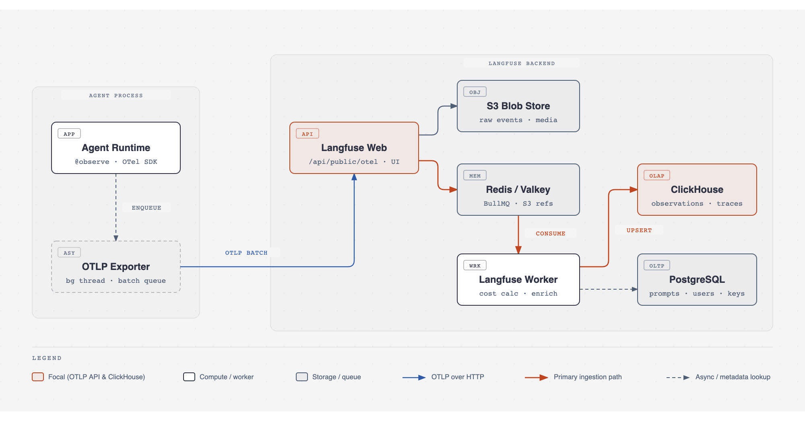
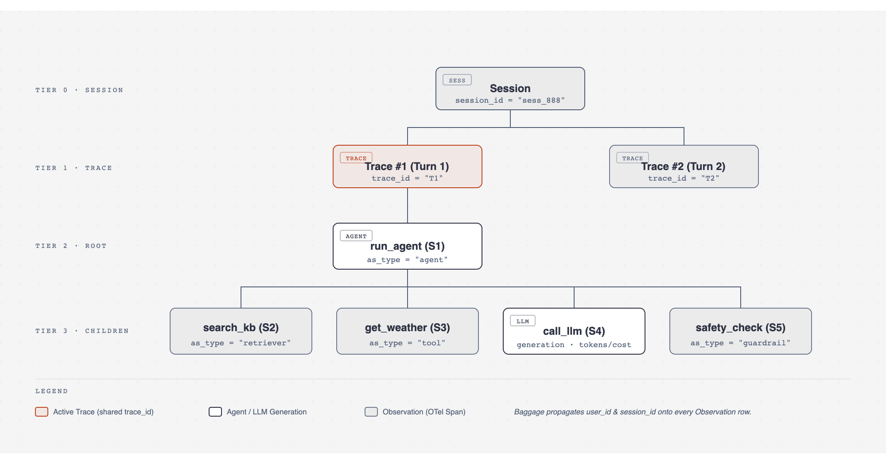
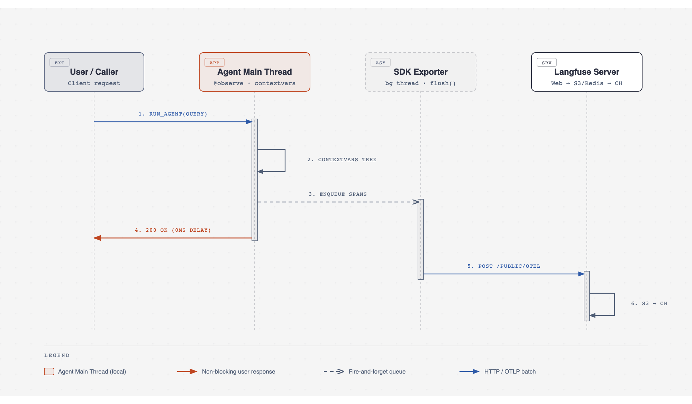

## TL;DR（面试开场直接背）

> **Langfuse 是怎么监测 Agent 轨迹的？**
> 传统日志是扁平文本，看不清 Agent 多轮思考、工具调用的树状层级和 Token 成本。Langfuse 从 Python SDK v3 / JS SDK v4 开始，底层完全基于 **OpenTelemetry（OTel）** 标准构建。
> 在数据模型上，它用三层结构还原全貌：一次完整的用户请求叫一条 **Trace（轨迹）**；多轮对话的多条 Trace 归为一个 **Session（会话）**；而 Agent 在执行过程中的每一步操作（调大模型、调工具、查向量库）在 OTel 里叫 **Span**，在 Langfuse 里统称为 **Observation（观测节点）**，并通过 `as_type` 细分为 `generation`（算 Token 和成本）、`tool`、`agent`、`retriever` 等子类型。
> 在运行原理上，业务代码通过装饰器或框架 Callback 埋点，SDK 利用线程/协程上下文（`contextvars`）自动串联父子节点的 `span_id`，并由业务进程内的**后台线程攒批异步上报**，不阻塞主流程。服务端收到请求后先落 **S3** 并入 **Redis** 队列立即返回，再由后台 **Worker** 异步算好成本、把 Trace 属性冗余平铺到每个节点上，最终批量写入列式数据库 **ClickHouse** 供分析检索。

---

## 一、整体架构与运行形态：Langfuse 是怎么跑起来的？

调试普通后端接口时，看几行文本日志就能定位报错；但 Agent 的执行是非确定性的：用户问一句话，Agent 可能先改写问题、查一次向量库、连续调两次外部工具、中间还因为格式错误重试了一次大模型，最后才输出回答。如果只打普通日志，你既看不出哪一步卡住了，也算不清这次请求到底花了多少 Token、合多少美金，更没法把线上出错的完整 Prompt 捞出来做评测（Eval）。Langfuse 解决的就是**把这些分散的步骤组装成一棵带耗时、带成本、带完整输入输出的调用树**。



要理解 Langfuse 的工作原理，首先要分清它的代码跑在什么地方，不要把 SDK 里的模块当成独立服务：

**1. 业务进程内（客户端 SDK）：嵌入在你的 Agent 进程里的库**
你在 Python 或 Node.js 项目里引入的 `langfuse` 只是一个普通的依赖库，和你的 Agent 业务代码跑在**同一个进程**里。当你的 Agent 函数执行时，SDK 在内存里记录每一步的开始时间、输入输出和父子关系。为了不拖慢 Agent 回复用户的速度，SDK 会在当前业务进程内启动一个**后台导出线程（OTLP Exporter）**。主线程记录完数据往内存队列一丢就立刻继续往下走；后台线程在攒够一批数据（Batch）或到达定时周期后，通过 HTTP 把数据发给 Langfuse 服务端。

**2. 独立部署的后端（Langfuse 服务端）：两个常驻容器 + 四个存储组件**
Langfuse 服务端是独立常驻运行的后端系统（可以用云服务，也可以用 Docker 自托管）。在 v3/v4 架构中，它由两个应用容器和四个各司其职的存储组件配合工作：

- **Langfuse Web 容器**：运行 Next.js 前端看板和后端接收 API（包括标准的 OTLP 接收接口 `/api/public/otel`）。它只负责快速收下客户端发来的数据，不做繁重的入库计算。
- **Langfuse Worker 容器**：常驻的后台异步消费服务，负责真正的数据解析、Token 计费核算和数据库写入。
- **四个存储组件的分工**：
  - **S3（或 MinIO 等对象存储）**：持久化保存客户端上报的最原始 JSON 事件（Raw Events）以及图片、音频等多模态附件。
  - **Redis / Valkey**：既作缓存（缓存 API Key 鉴权信息和 Prompt 模板），又作消息队列（基于 BullMQ），用来在 Web 容器和 Worker 容器之间传递 S3 事件引用。
  - **ClickHouse（OLAP 列式数据库）**：所有轨迹数据（Traces、Observations、Scores）的**最终归宿**。因为轨迹数据动辄几千万上亿行，且看板经常要做“按天统计 Token 消耗、算 P95 延迟”等大范围聚合，行式数据库扛不住这种读写压力，必须用列式数据库。
  - **PostgreSQL（OLTP 关系型数据库）**：只存事务型和配置型数据，比如用户账号、项目权限、Prompt 管理模板、测试数据集（Datasets）定义。

> **【本章面试速答】**
> 面试官问架构时直接抓两条线：**客户端是进程内库 + 后台线程批量异步发送**，保证对业务零阻塞；**服务端是读写分离 + 异步削峰架构**，Web 容器收数据落 S3、入 Redis 队列就返回，Worker 容器异步消费写入 **ClickHouse**（存海量轨迹做 OLAP 分析），而配置和账号等事务数据存 **PostgreSQL**。

---

## 二、核心概念与 OTel 规范：Trace、Span 和 Observation 是什么关系？

很多刚接触的人容易被 OTel、Trace、Span、Observation、Generation 这些词绕晕。其实只要顺着“还原一次 Agent 执行需要记录哪些信息”来推演，概念就非常自然。



**1. 怎么记录单步动作？（OTel 的 Span vs Langfuse 的 Observation）**
Agent 干活是由一个个具体动作拼起来的：调一次 OpenAI 接口、执行一次天气查询函数、去向量库搜一次文档。为了监控每一个动作，我们需要记录它的名字、开始时间、结束时间、输入参数和返回结果。
在云原生领域，CNCF 旗下的 **OpenTelemetry（简称 OTel）** 是统一的可观测性工业标准。在 OTel 的规范里，这样一个“有开始时间、有耗时、有父子关系的基本工作单元”就叫 **Span**。

但标准的 OTel Span 是为传统微服务设计的，它只关心 HTTP 状态码和耗时，不懂大模型特有的概念——比如这次调用用了哪个模型（`gpt-4o`）、输入输出分别消耗了多少 Token、命中了多少缓存 Token、花了多少钱。
于是 Langfuse 在 OTel Span 的基础上做了一层领域封装，把 Agent 里的每一个观测步骤统称为 **Observation（观测节点）**，并通过 `as_type` 参数（对应 OTel 属性 `langfuse.observation.type`）把节点细分成符合 Agent 语义的具体类型：

- **`generation`**：专门记录大模型调用。除了耗时和输入输出，还会记录 `model`、模型参数、Token 用量（`usage_details`）并自动匹配单价算出美金成本（`cost_details`）。
- **`span`**：记录一段通用的代码块或业务逻辑耗时。
- **`agent` / `tool` / `retriever` / `chain` / `guardrail` / `evaluator`**：分别标识这一步是在做 Agent 决策编排、调外部工具、查知识库、串流程、做安全护栏还是跑评测打分。
- **`event`**：记录没有持续耗时的瞬时事件（即开始时间等于结束时间的打点）。

所以不用纠结 Span 和 Observation 的区别：**在物理实现上，Langfuse 里的每一个 Observation 底层就是一个标准的 OTel Span；只是在 Langfuse 的概念里，整体叫 Observation，而 `span`、`generation`、`tool` 都是它的具体分类。**

**2. 怎么把零散动作串成一棵树？（Trace 与 Session）**
当用户发来一句提问，Agent 执行过程中产生了 1 个 `agent` 根节点和 4 个子节点（`retriever`、`tool`、`generation`、`guardrail`）。为了知道这 5 个节点属于同一次请求，它们会共享同一个全局唯一的 `trace_id`。所有共享同一个 `trace_id` 的 Observation 集合，就叫一条 **Trace（轨迹）**。
而在一条 Trace 内部，谁调用了谁？每个节点除了有自己的唯一编号 `span_id` 外，还会记录是谁触发了自己，即 `parent_span_id`。没有 `parent_span_id` 的就是根节点（Root Observation），前端看板拿到这批节点后，顺着 `parent_span_id` 就能画出完整的树状调用图和瀑布流耗时图。

如果这是一个多轮对话机器人，同一个用户在同一个聊天窗口里连续问了多个问题，就会产生多条独立的 Trace。我们只要给这些 Trace 打上相同的 `session_id`，它们在 Langfuse 里就会按时间顺序聚合成一个 **Session（会话）**，方便回放整个聊天上下文。

**3. Langfuse 是完全按照 OTel 规范来的吗？**
**是的，全面兼容。** 从 Python SDK v3 和 TypeScript SDK v4 开始，Langfuse 彻底重构了 SDK，底层直接就是官方 OpenTelemetry 客户端的一层薄封装，同时服务端把 OTLP 接口（`/api/public/otel`）作为标准入库通道（取代了早期的私有 `/api/public/ingestion` 接口）。
当你在代码里用 Langfuse SDK 打点时，它生成的是标准 OTel Span；反过来，如果你不用 Langfuse SDK，而是用社区的 OpenLLMetry、OpenLIT，或者用 Java/Go 的原生 OTel SDK 按照 **OTel GenAI 语义规范**（比如打上 `gen_ai.request.model`、`gen_ai.usage.input_tokens` 等标准属性）发往 `/api/public/otel`，Langfuse 服务端收到后会自动把这些标准属性映射成自己的 `generation` 节点和 Token 统计。这意味着你的业务代码不会被 Langfuse 绑定，同一份埋点数据甚至可以通过 OTel Collector 同时分发给 Datadog 看机器监控、分发给 Langfuse 看大模型轨迹。

> **【本章面试速答】**
> 面试官问概念和 OTel 关系时，记住三个对应关系：
> 1. **标准关系**：Langfuse 新版 SDK 底层就是标准 OpenTelemetry（OTel），服务端直接暴露 `/api/public/otel` 接收 OTLP 协议并自动映射 `gen_ai.*` 属性。
> 2. **三层结构**：多轮对话是 **Session** → 单次请求是 **Trace**（共用 `trace_id`）→ 单步执行是 **Observation**（靠 `span_id` 和 `parent_span_id` 串成树）。
> 3. **Span 与 Observation**：OTel 里的 Span 到 Langfuse 里就叫 Observation，为了贴合大模型场景，Langfuse 用 `as_type` 把它细分为 `generation`（算 Token/Cost）、`tool`、`retriever`、`agent` 和普通 `span`。

---

## 三、真实场景全链路追踪：一次 Agent 任务从触发到落盘经历了什么？

我们用一个具体的例子，沿着真实请求发生的时间顺序，把从代码执行到你在看板上看到数据的全过程串起来。

假设用户 `user_123` 在会话 `sess_888` 中问 Agent：“北京今天 20 度，适合穿什么？”
代码里有三个函数：入口函数 `run_agent`、查天气的工具函数 `get_weather`、调大模型的函数 `call_llm`。

```python
from langfuse import observe, get_client, propagate_attributes

langfuse = get_client()

@observe(as_type="tool")
def get_weather(city: str):
    return {"city": city, "temp": 20}

@observe(as_type="generation")
def call_llm(prompt: str):
    # 假设这里调用了大模型接口
    langfuse.update_current_generation(
        model="gpt-4o-mini",
        usage_details={"input": 35, "output": 50}
    )
    return "北京今天 20 度，建议穿卫衣或薄外套。"

@observe(as_type="agent")
def run_agent(query: str):
    with propagate_attributes(user_id="user_123", session_id="sess_888"):
        weather = get_weather("北京")
        answer = call_llm(f"用户问：{query}，天气：{weather}")
        return answer
```



当 `run_agent("北京今天穿什么")` 被调用时，按顺序发生了以下三件事：

**第一步：进程内埋点与上下文自动传递（正在执行业务代码时）**
1. 请求进入 `run_agent` 时，外层的 `@observe(as_type="agent")` 装饰器先触发。它去当前线程/协程的 OTel Context（Python 底层是标准库的 `contextvars`）里检查有没有正在运行的 Span。发现是空的，说明这是入口根节点，于是生成一个新的 `trace_id`（比如 `T1`）和自己的 `span_id`（比如 `S1`），记录函数的入参 `query` 和开始时间，并把 `S1` 设为当前上下文的“活跃 Span（Active Span）”。
2. 接着进入 `with propagate_attributes(user_id="user_123", session_id="sess_888")`。这里解决了一个关键查询问题：在 Langfuse 新架构里，看板的筛选和聚合是直接针对底层的 `observations` 单表做的；如果 `user_id` 只记在根节点 `S1` 上，以后你想查“用户 `user_123` 调用所有 `generation` 花了多少钱”，数据库就必须拿子节点去 Join 根节点，在百亿行数据下会极慢。所以 `propagate_attributes` 利用 **OTel Baggage（行李袋）** 机制，把 `user_id` 和 `session_id` 放进当前上下文的行李袋里，后续当前链路创建的所有子 Span 都会**自动复印一份**这两个属性带在自己身上。
3. 代码往下调 `get_weather("北京")`。它头上的 `@observe(as_type="tool")` 去 `contextvars` 里一看，发现当前活跃的是 `S1`，于是自动生成子节点 `S2`，把 `S2.parent_span_id` 设为 `S1`，`trace_id` 设为 `T1`，同时从行李袋里抄走 `user_id` 和 `session_id`。函数返回 `{"city": "北京", "temp": 20}` 时，装饰器自动把这个返回值记为 `S2` 的 `output`，记下结束时间，把活跃状态恢复回 `S1`。
4. 随后调用 `call_llm`，同理生成子节点 `S3`（`parent_span_id = S1`，类型为 `generation`），记录模型名和 Token 用量后结束 `S3`。最后 `run_agent` 返回结果，`S1` 也记录最终输出并结束。

整个过程中，你没有手动传过一次 `trace_id` 或 `parent_span_id`，全靠语言底层的 `contextvars` 在同一个调用链里自动透传。

**第二步：客户端内存缓冲与批量导出（业务响应返回时）**
当 `S2`、`S3`、`S1` 依次结束时，它们并没有发起网络请求，而是被 `LangfuseSpanProcessor` 放进了进程内存的发送队列里。
此时，`run_agent` 已经把最终回答返回给了前端用户——**对用户来说，这次请求已经 100% 结束了，埋点带来的网络延迟是 0**。
而在你的业务进程后台，Exporter 线程发现队列里有数据（或者定时时间到了），在后台把 `[S2, S3, S1]` 打包成一个 OTLP HTTP 请求，发送给 Langfuse 服务端的 `/api/public/otel`。
*（注：如果你的程序不是常驻 Web 服务，而是一个跑完就退出的本地脚本或 Serverless 函数，主线程结束时后台线程可能还没来得及发完队列里的数据，所以必须在脚本末尾调用 `langfuse.flush()`，阻塞等待后台队列清空。）*

**第三步：服务端落 S3、排队与写 ClickHouse（后台异步落盘时）**
1. **快速接单**：Langfuse Web 容器收到 HTTP 请求后，**还没有写进 ClickHouse 数据库**。Web 容器先把原始数据包写入 **S3** 留底，再往 **Redis 队列**里推入一条只包含 S3 文件路径的轻量级任务，随后立刻给客户端 SDK 返回 HTTP 200。
2. **Worker 加工与入库**：后台的 **Langfuse Worker** 从 Redis 队列取出任务，去 S3 捞出原始 Span 数据，做属性映射和加工（例如根据 `S3` 节点上的模型名 `"gpt-4o-mini"` 和输入输出 Token 数，查表算出这次调用的具体美金花费）。最后，Worker 将整理好的宽表记录批量追加写入 **ClickHouse** 的 `observations` 表中。

为什么要绕这么大一圈，不直接写数据库？因为在真实生产中，一个 Span 可能会分两次上报（比如先上报开始，几秒后再上报流式结束的 Token 数），而 ClickHouse 这种列式数据库最怕频繁的单行 `UPDATE`。通过 Redis 缓冲 + S3 存原始事件 + Worker 异步合并后写入 ClickHouse 的 `ReplacingMergeTree` 表引擎，既扛住了高并发写入，又保证了分析查询极快。

> **【本章面试速答】**
> 面试官让你串一遍 Trace 收集原理时，按“三步走”回答：
> 1. **进程内怎么串成树**：靠装饰器/拦截器 + 线程协程上下文（`contextvars` / OTel Context），自动继承 `trace_id` 和 `parent_span_id`；通过 OTel Baggage 把 `user_id`/`session_id` 冗余复制到每个子 Span 上。
> 2. **怎么保证不影响业务性能**：`span.end()` 只写进程内存队列，业务响应当场返回；由后台 Exporter 线程攒批异步发 HTTP（短生命周期脚本退出前需 `flush()`）。
> 3. **服务端怎么扛住海量写入**：Web 层只存 S3 原文并往 Redis 发引用就返回；Worker 异步拉取、算好 Token 成本后批量写进 ClickHouse，避免在列式库上做高频单行更新和跨表 Join。

---

## 四、实际工程中怎么用：三种典型接入方式与选型

理解了底层就是 OTel Context 和 Span 之后，实际项目里接入 Langfuse 只需要根据你的代码组织方式三选一，而且它们可以无缝混用：

**1. 手写 Agent 代码：用 `@observe` 装饰器或上下文管理器**
如果你的 Agent 是自己用 Python/TS 写的循环和工具调用，直接在函数上加 `@observe(as_type="...")` 是最省事的。函数的入参和返回值会被自动抓成 `input` 和 `output`。如果遇到流式输出（Streaming）或者不想抓取整个大对象，可以在函数内部调用 `langfuse.update_current_generation(...)` 或 `langfuse.update_current_span(...)` 手动补充 Token 数、模型名或裁剪后的输入输出。

**2. 用 OpenAI SDK / LangChain / LangGraph 等框架：用 Wrapper 或 CallbackHandler**
如果你直接调 OpenAI，只需把 `from openai import OpenAI` 换成 `from langfuse.openai import OpenAI`，它会自动拦截每次请求并生成 `generation` 节点。
如果你用 LangChain 或 LangGraph，框架内部自己维护了图节点的跳转，你没法去改框架源码加装饰器。这时只需初始化一个 `CallbackHandler()`，在调用时传进去：`graph.invoke(inputs, config={"callbacks": [langfuse_handler]})`。
**最实用的一点是**：因为 Langfuse 自己的 `@observe` 和 LangChain 的 `CallbackHandler` 共用同一个进程内的 OTel Context，如果你在自己的业务入口函数上加了 `@observe`，里面再调带 `CallbackHandler` 的 LangGraph，LangGraph 内部产生的所有节点会自动识别并挂载到你外层入口函数的子节点下，不会分裂成两条孤立的 Trace。

**3. 跨语言或多监控平台并存：直接走 OTel 原生导出**
如果公司的 Agent 网关是用 Go 或 Java 写的（没有官方 Langfuse SDK），或者基础设施团队要求所有服务统一用 OpenTelemetry Collector 采集数据，你完全不需要引入 Langfuse 的包。直接在代码里用标准 OTel SDK 打点（遵循 `gen_ai.*` 或 `langfuse.*` 属性命名），在 Collector 里配一个 `otlphttp` 导出器指向 Langfuse 的 `/api/public/otel` 接口（带上 Basic Auth 和 `x-langfuse-ingestion-version: 4` 请求头）即可。

> **【本章面试速答】**
> 面试官问“你们项目里怎么接的 Langfuse”时，回答：**自研编排逻辑用 `@observe` 装饰器 + OpenAI Wrapper，框架层（如 LangGraph）传 `CallbackHandler`**；因为底层共享同一个 OTel Context，自研外层逻辑和框架内部节点能自动合并到同一棵 Trace 树下，再配合 `propagate_attributes` 注入 `user_id` 和 `session_id`，就能在看板上按用户、会话和节点类型做完整的耗时、成本监控与 Bad Case 回放。

---

## 参考资料
- [Observability Data Model - Langfuse](https://langfuse.com/docs/observability/data-model)
- [Observation Types - Langfuse](https://langfuse.com/docs/observability/features/observation-types)
- [OpenTelemetry (OTEL) for LLM Observability - Langfuse](https://langfuse.com/integrations/native/opentelemetry)
- [Langfuse Platform Architecture - High-Level Overview](https://langfuse.com/handbook/product-engineering/architecture)
- [From Zero to Scale: Langfuse's Infrastructure Evolution](https://langfuse.com/blog/2024-12-langfuse-v3-infrastructure-evolution)
