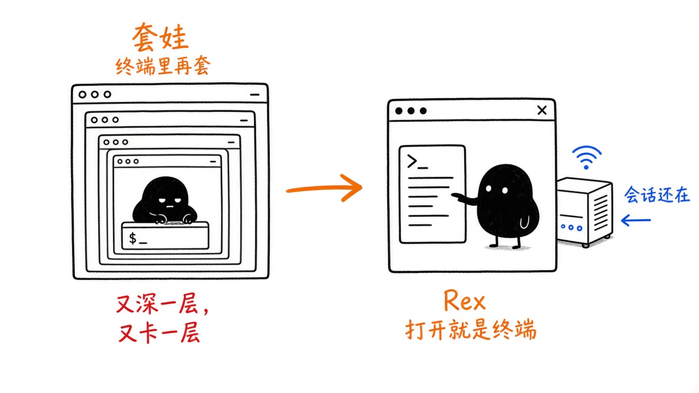
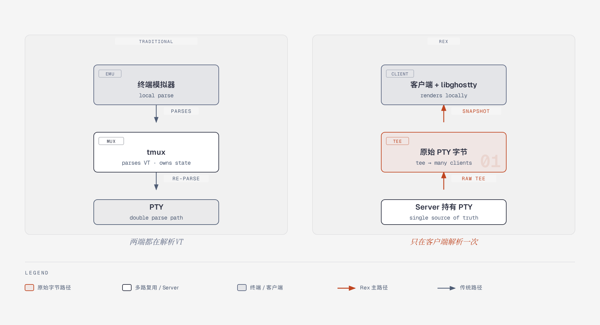
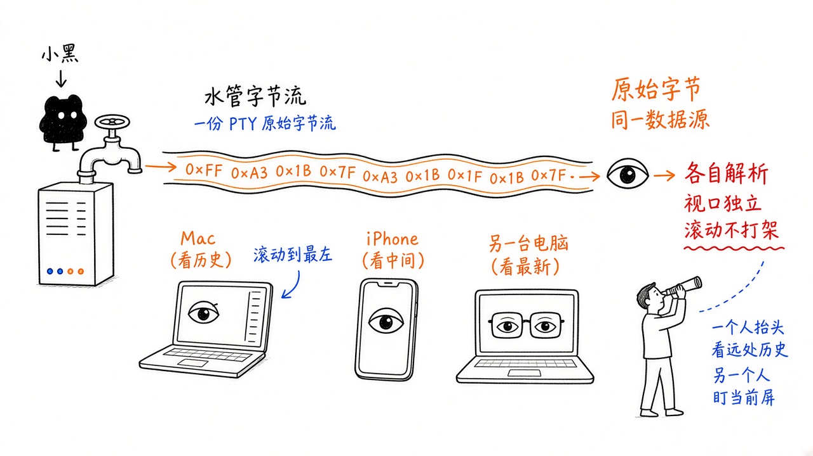
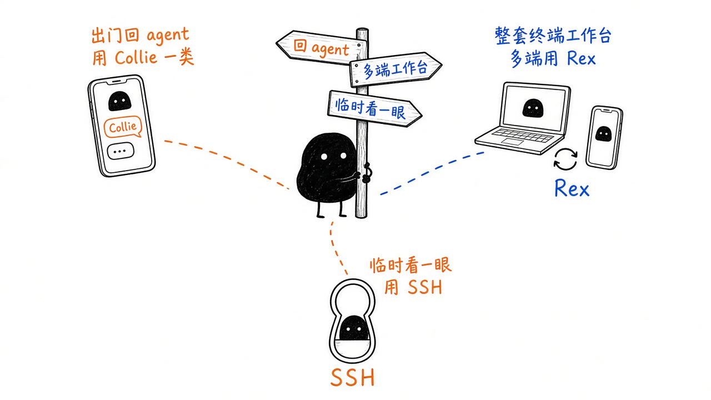
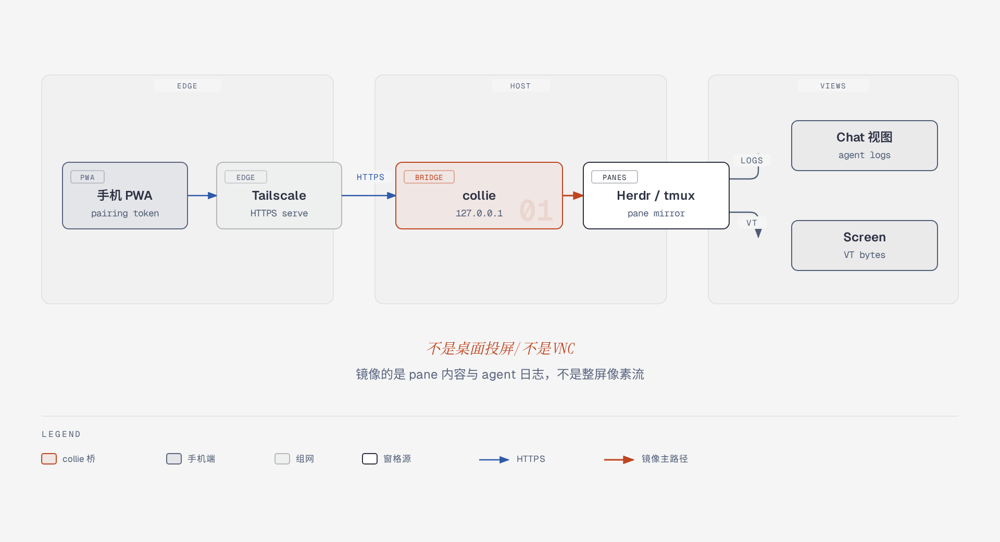

**TL;DR**：传统终端把界面渲染和命令进程绑在本地窗口里，想断线保活或多设备接力就得套一层 `SSH + tmux`，不仅会导致终端控制字节被服务端和客户端重复解析两次，还会让多台设备被迫共用同一个屏幕尺寸和滚动位置。Rex（由 Ghostty 作者 Mitchell Hashimoto 创立的 Superlogical 开发）把终端拆成了“常驻后台的会话服务端（Rex Server）”和“内嵌 `libghostty` 渲染引擎的原生客户端（Rex Client）”：Server 负责持有会话、分屏格（每个分屏对应一个独立的系统 PTY 管道）和真实 Shell 进程，客户端只负责本地解析与渲染。当新设备连入时，Server 先发一份当前屏幕的二进制快照还原现场，随后把底层 PTY 产出的原始字节流实时分流（`tee`）给所有客户端；各端在本地独立解析字节并维护各自的显示视口，从而实现了关窗不断进程、多端字号与滚屏互不干扰、键盘输入按序排队的多端原生终端体验。

## 为什么传统终端一做“多端同步”就别扭？

要看懂 Rex 在改什么，得先弄清楚平时我们在电脑上打开终端敲命令时，底下到底有几个角色在配合。

很多人习惯把屏幕上的黑色窗口直接叫作“终端”，以为那个窗口自己就在执行 `git`、`vim` 或编译命令。实际上，操作系统把这件事分成了两头：你眼睛看到的窗口程序（比如 macOS 自带的 Terminal、iTerm2、Ghostty）叫**终端模拟器（Terminal Emulator）**，它本质上只是一个“画布”，只管接收键盘鼠标操作、把字符和颜色画在屏幕上；真正跑命令的是后台的 **Shell 进程**（比如 `zsh`、`bash`）以及它启动的子进程。为了让前头的画布窗口和后头的 Shell 进程通信，操作系统内核在它们中间拉了一根虚拟的双向数据管道，叫 **PTY（Pseudo-Terminal，伪终端）**。你在窗口里敲下的按键通过 PTY 传给后台程序；后台程序吐出的结果再通过 PTY 传回窗口。而且，后台程序往 PTY 里写的并不只是纯文本，还夹杂着控制文字颜色、移动光标位置、清屏、绘制全屏表格的特殊控制指令（沿用早期硬件终端标准，统称 **VT 字节流**）。终端模拟器从 PTY 读出这串字节流后，必须先把它**解析（Parse）**成“第几行第几列显示什么字、什么颜色”，最后才能画到屏幕上。

在传统设计里，这根 PTY 管道是由本地的终端窗口直接创建的。一旦你手滑关掉窗口，PTY 管道就会跟着销毁，里面跑了一半的编译任务或 AI Agent 进程就会直接收到挂断信号（`SIGHUP`）而退出。如果要操作远端服务器，还会叠加上一层网络问题，这也是为什么传统远程开发几乎总是绑着 **`SSH + tmux`** 这对组合——但很多人容易混淆这俩工具各自到底在干什么：

- **`SSH`（Secure Shell）只管“跨机器的加密网络管道”，不管会话保活**：当你在 Mac 上敲 `ssh user@server` 时，SSH 负责在两台机器之间建起一条加密的 TCP 网络连接，并让远端服务器的 `sshd` 进程替你创建一根 PTY 管道和 Shell。但 SSH 的致命短板是**远端 PTY 的死活跟这条网络连接死死绑在一起**——只要你的笔记本合盖休眠、地铁里 Wi-Fi/5G 切换导致 TCP 连接断开，远端 `sshd` 就会判定你掉线并立刻销毁 PTY，正在跑的任务当场暴毙；而且一条 SSH 连接只能一对一服务当前这一个窗口，不支持“手机和电脑同时连进同一个终端现场”。
- **`tmux`（或 `zellij`）只管“单机内的进程保活与分屏复用”，自己根本不懂跨机网络**：为了不让 SSH 断网害死进程，人们在服务器上引入了叫作**终端多路复用器（Multiplexer，简称 mux）**的 `tmux`。它是一个常驻在服务器后台的本地进程，专门负责替你向操作系统申请并托住多根 PTY 管道（对应多个窗口和分屏）。这样一来，你先用 `SSH` 跨网络连上服务器，再在里面接上（`attach`）后台的 `tmux`：哪怕外层的 SSH 网络断了，里层的 `tmux` 依然在服务器后台稳稳托着 PTY 和任务进程；等你换台设备重新连上 SSH、再次 `tmux attach`，就能把刚才的画面接回来。

这套“外层用 SSH 跨网传输、里层用 tmux 保活分屏”的组合拳虽然保住了进程，却因为“在终端里又套了一层终端管理程序”带来了两处明显的别扭。第一是**双重解析**：底层程序吐出的 VT 字节流，得先被服务端的 tmux 拦截并解析一遍，在 tmux 自己的内存里拼出一张包含各个分屏的完整字符画面，然后再由 tmux 把这张画面重新编码成另一串 VT 字节流，通过 SSH 发给外层的终端模拟器去再解析一遍。第二是**多端视口锁死**：因为整张屏幕画面是由服务端的 tmux 统一排版决定的，当你用电脑和手机同时连上同一个 tmux 会话时，两边只能看同一张“已经被服务端排版好的画面”——手机屏幕窄，电脑上的画面就会被迫跟着缩成一小块；你在手机上往上翻看历史报错日志，电脑屏幕的画面也会跟着往上跳，根本没法做到“你在手机上看历史、我在电脑上看最新输出”。

## Rex 的整体架构与实际运行形态

Rex 的核心思路是砍掉中间套娃的那层命令行复用器，让终端本身直接变成一套“服务端管进程与会话、客户端管原生解析与渲染”的多端系统。

在运行形态上，Rex 由常驻后台的 **Rex Server**、各平台的 **Rex Client** 以及内置的 **`rex` 命令行工具（CLI）** 组成，它们在不同机器上的部署与配合方式如下：

在个人电脑（如 macOS）上，你日常打开的是一个原生的图形界面客户端应用。这个应用是自包含的：第一次启动时，它会自动在本机后台拉起一个本地的 Rex Server 进程，客户端与本地 Server 之间通过本机的 Unix Socket 通信。当你关掉终端窗口甚至完全退出客户端应用时，后台的本地 Server 进程依然留着，里面的会话和程序继续运行；下次点开应用，窗口画面瞬间恢复。同时，这个客户端应用也可以直接添加并连接其他机器上的远端 Rex Server。

在 Linux 服务器上，Rex Server 作为无界面的后台服务运行，并提供三种运行模式以适应不同权限边界：

- **Personal 模式（个人按需服务）**：适合单人使用的开发机，不需要 root 权限。你在命令行敲任意 `rex` 命令（如 `rex ls`）时，如果后台还没有服务，它会自动以你当前的用户身份拉起一个 Server（默认在最后一个会话和连接关闭约 10 秒后自动退出，也可以用 `rex server start` 让它常驻），通信 Socket 放在 `/run/user/<uid>/rex`，日志和状态保存在 `~/.local/state/rex`。
- **Shared 模式（多人共享服务）**：通过系统的 `rex.service`（或按需激活的 `rex.socket`）启动，统一运行在专门的 `rex` 系统账号下，数据存放在 `/var/lib/rex`。只要把其他用户加进 `rex` 用户组，大家就能连进来共享同一批会话，但注意升级软件包重启该服务时会终止其上的所有会话。
- **Login 模式（多账号独立登录服务）**：最接近传统 SSH 的多用户使用方式。由 root 权限运行的 `rex-login-server` 守护进程统一接收连接，但它不使用密码或 SSH 密钥，而是根据来访者的连接身份（比如本机 Socket 对端的系统用户，或者来访者的 Tailscale 账号）去核对 `/etc/rex/accounts.jsonc` 配置文件；校验通过后，它会为该用户在后台单独启动并移交一个属于该用户自己系统账号的 Server 进程。由于每个人的会话跑在各自独立的账号 Server 里，即使重启或升级外层的 `rex-login-server`，每个人正在跑的会话和程序也不会中断。

把三种运行模式理顺后，下一个关键问题是：**手机或另一台电脑是怎么跨网络连上 Rex Server 的？这里经常提到的 Tailscale 又在里面干什么？**

首先要明确职责边界：**真正负责监听终端输入输出流、管理 PTY 管道和对外提供会话服务的，始终是 Rex Server 自己；而 Tailscale 完全不碰终端字节流，它只是一条“带身份证明的私人虚拟网线”。**

具体来说，Tailscale 的本质原理是基于 WireGuard 协议的**点对点虚拟局域网（Mesh VPN，统称 Tailnet）**。平时你家里的开发机、公司的 Mac 和兜里用 5G 流量上网的手机，各自处于不同的路由器和运营商内网（NAT）后面，没有公网 IP，互相根本连不上。当你在这些设备上都登录同一个 Tailscale 账号后，Tailscale 会自动帮它们完成内网穿透（打洞）并建起加密隧道，给每台设备分配一个固定的虚拟内网 IP 和专属域名（如 `build.<tailnet>.ts.net`），效果就像把全世界的这几台设备插在了同一个私人路由器下。更重要的是，传统网络连上端口后服务端并不知道对面是谁，所以 SSH 必须自己搞密码或公私钥验证；而在 Tailscale 网络里，每一条连接都天然绑定了来访者的 Tailscale 登录账号（如 `alice@example.com`），服务端可以直接向本地 Tailscale 询问“刚刚连进来的这个请求是谁发的”。

理解了这一点，就能看懂 Rex Server 的连接设计了。**Rex Server 并不是所有场景都用 Tailscale**：在同一台机器内部（比如 Mac 客户端连本机后台 Server，或在终端里敲 `rex` 命令），它直接走操作系统内核的**本机 Unix Socket**，完全不经过网络。只有当你需要**跨设备远程连接**时，因为当前测试阶段的 Rex 还没有上线自建的密码或 SSH 密钥认证系统，Rex Server 自己无法校验密码，只能依赖底层连接通道告诉它“来访者是谁”。因此，Rex 远程接入目前优先建立在 Tailscale 之上，并提供四种监听方式：
- **内置 Tailscale（`rex server start --tailscale`）**：Rex 二进制程序里直接内嵌了 Tailscale 客户端模块。哪怕这台 Linux 服务器上根本没装 Tailscale 软件，Rex Server 自己就能作为一台名叫 `rex` 的独立虚拟设备加入你的虚拟局域网，直接对外提供 `https://rex.<tailnet>.ts.net` 地址。
- **挂载系统 `tailscale serve`（`--extra-listen tailnet-serve:///run/rex/serve.sock`）**：如果机器上已经装了系统的 `tailscaled` 服务，可以让系统的 `tailscale serve` 监听 443 端口的 HTTPS，再把流量转发给 Rex 的专用 Socket，并把来访者的账号身份一并透传给 Rex（Shared 模式和 Login 模式最常用）。
- **直接监听 Tailnet 地址（`--extra-listen tailnet://:7297`）**：直接绑定在这台机器的 Tailscale 虚拟网卡端口上，借用本机的 Tailscale 识别来访者身份。
- **不用 Tailscale 的纯 HTTP 监听（`--extra-listen :7297 --allow-anonymous`）**：如果你不用 Tailscale，而是自己搭了公司 VPN、ZeroTier 或内网专线，也可以让 Rex 直接监听普通 TCP 端口。但因为普通 HTTP 无法向 Rex 证明来访者身份，必须显式加上 `--allow-anonymous` 允许匿名完全控制，安全隔离完全交由你自己的外层网络负责。

在内部数据组织上，Rex Server 把你的工作区按三层结构管理：最外层是 **Session（会话）**，通常对应一个项目或工作主题，只要 Server 活着它就一直在后台运行；Session 下面是 **Window（窗口，对应客户端里的标签页 Tab）**；Window 里面则排布着一个个 **Block（应用格）**。在当前版本中，每个 Block 就是一个独立的终端格，**你在界面上每切出一个分屏（Split），Server 就在后台创建一个独立的 Block，并为它分配一根独立的系统 PTY 管道和 Shell 进程**。客户端本身不跑任何 Shell，它内部嵌入了从 Ghostty 终端抽离出来的核心引擎 **`libghostty`**，通过自定义的二进制协议与 Server 通信，专门负责把收到的字节流解析成画面并响应本地交互。

## 一次真实任务的全流程：从分屏、重连到多端同看

为了看清这套架构在细节上是怎么工作的，我们沿着一个具体的使用场景走一遍：**假设你在公司的 Mac 上打开 Rex 连上远端 Linux 开发机，左边分屏开着全屏交互工具 `lazygit` 看代码改动，右边分屏跑着一个持续打印日志的编译任务；随后你合上电脑坐地铁回家，在路上掏出 iPhone 连进同一个会话检查编译报错，回家后又在另一台电脑上同时挂着这个会话继续操作。**

### 1. 新建分屏与日常输出：每个分屏独立 PTY，只在客户端解析一次

当你在 Mac 客户端里按下分屏快捷键时，客户端并不是在现有的字符画面上用竖线字符画一个“假分屏”，而是通过二进制协议通知 Rex Server 在当前 Window 下新增一个 Block。Server 收到请求后，直接向操作系统申请一根全新的 PTY 管道，并在里面启动一个新的 Shell 进程。

随后你在左边运行 `lazygit`，在右边运行编译命令。两个程序各自往自己的 PTY 管道里吐出包含颜色和光标控制指令的 VT 字节流。与 tmux 在服务端把字节流解析成字符画面再重绘输出不同，**Rex Server 只做 PTY 的持有者和原始字节的搬运工**：它从 PTY 读出原始字节流后，直接通过协议把字节流推给 Mac 客户端；客户端收到后，交由左右两个分屏格各自内嵌的 `libghostty` 引擎在本地完成 VT 解析和 GPU 渲染。因为整条链路上字节流只在客户端被解析了一次，而且每个分屏都是原生界面里的独立组件，你不仅能用鼠标直接拖拽分屏间距、双击复原比例，还能在任意一个分屏里丝滑地选中文本或独立缩放字号，再也不会出现跨分屏复制串行的问题。

### 2. 地铁上用手机半路连入：先拿二进制快照还原现场，再续接实时字节流

半小时后，你在地铁上掏出 iPhone 打开 Rex 客户端连向这台开发机。这时会遇到一个棘手的问题：如果 Server 只是单纯地把“从手机连上这一刻起”新产生的 PTY 字节流转发给手机，那么手机屏幕上是没法看的——右边编译窗口前 30 分钟打印的几千行历史日志全没了；更糟的是左边正在跑的 `lazygit`（或者 `vim`、`htop` 这类全屏交互程序），它们在半小时前启动时就已经把全屏界面画完了，此刻没有新的按键触发重绘，PTY 管道里静悄悄的没有新字节流出，新连上来的手机如果只等实时字节流，只会看到一片漆黑。

为了解决“新设备随时加入都能完整接续现场”的问题，Rex Server 在后台为每个 Block 维护了一个轻量的无界面（headless）终端状态机和历史滚屏缓存。当你的 iPhone 客户端刚建立连接时，同步分两步完成：
1. **下发二进制快照（Snapshot）**：Server 先把该分屏格当前的完整屏幕字符矩阵、颜色样式、光标位置、终端模式以及历史滚屏缓冲区，打包成一份紧凑的二进制快照发给手机。手机端的 `libghostty` 拿到这份快照后，不需要重放过去半小时的所有历史字节，就能瞬间在屏幕上精准还原出 `lazygit` 当前的全屏界面和右边编译窗口的历史日志。
2. **无缝切换为实时字节流分流（raw PTY tee）**：快照加载完毕的同一时刻，Server 把这部 iPhone 加入该 PTY 管道的实时订阅列表。就像在水管上装了一个分流三通阀（Unix 里称为 `tee`，即把同一股输入流原样复制给多个输出端），此后底层程序每往 PTY 里写出一串新字节，Server 就原样复制一份实时推给手机。

靠“二进制快照定格初始状态 + 原始字节流持续增量更新”的组合，无论是断网重连还是新设备半路加入，都能在毫秒级恢复出哪怕最复杂的全屏终端应用画面。

### 3. 多台设备同时在线：各自解析带来独立视口，服务端排队避免输入打架

回到家后，你把家里的电脑也连上了这个会话，此时你的手机和电脑正同时盯着右边的编译分屏。

由于 Rex Server 发给每台设备的都是底层的原始字节流，而**画面怎么排版、字号多大、当前滚屏停在哪一行，完全由每台设备本地的客户端和 `libghostty` 自己决定**。这就意味着每台设备都拥有完全独立的显示视口（Viewport）：你可以在 iPhone 狭小的屏幕上把字号调大，用手指往上划几百行，停在半小时前的某条报错堆栈上仔细阅读；与此同时，家里的电脑大屏幕上依然保持小字号，稳稳停留在最底部实时刷新最新的编译进度。两边看的是同一个底层 PTY 的数据源，但滚动条、窗口尺寸和缩放比例互不干扰。

如果此时你在手机上敲了一个回车，同时在电脑键盘上敲了一行命令，两边会不会冲突？在 Rex 中，所有客户端的键盘输入都不会直接写进进程，而是先发往 Rex Server。Server 会把来自不同客户端的输入事件按到达先后顺序**排队（序列化）**，再统一写入目标 Block 的 PTY 管道里，从而保证多端操作同一个会话时不会出现并发写入错乱。

### 4. 在终端里用命令与脚本自省：环境变量注入与 Lua 事件

除了图形界面的多端同步，当你在 Rex 的某个终端格里工作时，还可以直接用内置的 `rex` 命令行工具或 Lua 脚本来自动化操作会话。

Rex Server 在启动每一个 Block 的 Shell 进程时，会自动把与当前 Server 版本匹配的 `rex` 可执行文件目录塞到环境变量 `PATH` 的最前面（同时记录在 `REX_BIN_DIR` 中），并在 Shell 里自动注入三个上下文环境变量：`REX_SERVER`（当前服务端地址）、`REX_SESSION`（当前会话 ID）和 `REX_BLOCK`（当前所在的终端格 ID）。正因为进程天生带着这三个坐标，你在某个终端格里直接敲 `rex split`，它不需要你传任何参数就知道要切分当前这格；如果你想跨会话操作，也可以显式指定目标，比如运行 `rex send -s build -w 2 'make test'` 往 `build` 会话的第 2 个窗口发送命令，或者运行 `rex capture -b logs` 把标签名为 `logs` 的终端格画面抓取出来。

此外，Rex Server 在运行过程中会持续对外广播三类状态事件：会话级事件（如新建或关闭分屏格 `block_closed`）、终端级事件（如子进程退出 `terminal.child_exited`、工作目录改变 `terminal.pwd_changed`、终端响铃 `terminal.bell`，以及支持程序主动上报当前是“正在工作”还是“卡在权限确认等待输入”的协议状态）和服务端事件。你可以在命令行用 `rex events -s SESSION` 实时查看 JSON 格式的事件流，也可以在 `~/.config/rex/init.lua` 配置文件里用 Lua 编写监听逻辑——例如监听 `terminal.pwd_changed` 事件，每当你在 Shell 里 `cd` 切换目录时，自动调用 `rex.session.set_block_label` 把当前分屏卡片的标题改成所在的文件夹名；或者在长耗时命令退出、终端响铃时自动调用系统通知提醒自己。

## 另一条路：如果不换终端，只想在手机上看本机的 AI Agent 呢？（Collie 对比）

聊到“在手机上看电脑里的终端会话”，现在很大一部分开发者的真实诉求其实非常具体：电脑上已经在用 `tmux`、`zellij` 或 `Herdr`（专为多 Agent 协作设计的终端复用器）同时跑着好几个 Claude Code、Codex 等编码 Agent；人离开工位去吃饭或坐车时，并不是想在手机屏幕上写代码，只是想随时掏出手机看一眼哪个 Agent 停下来等着审批权限（比如询问是否允许执行某条 Bash 命令），顺手点个“同意”或回一句话让它继续跑。

如果你的诉求是这个，把整套主力终端迁移到 Rex 并不是唯一解。**Collie（ColliePWA）** 代表了另一种更轻量的“外挂桥接”思路：它不替代你现有的终端，也不接管 PTY 所有权，而是作为一个单文件桥接程序，直接挂在你本机已经在跑的 `Herdr`、`tmux` 或 `zellij` 旁边。

在连接链路上，Collie 自己不接管底层进程，只在电脑本机的回环地址（`127.0.0.1`）上跑一个本地 Web 服务，去读取 `Herdr / tmux / zellij` 里现成的窗格数据。为了让手机在外面也能连回来，它默认会自动调用电脑上的 `tailscale serve` 充当反向代理前门，把你私人 Tailscale 网络里的 HTTPS 域名转发给这个本机服务（也可以换成 Cloudflare Tunnel 或 Caddy）。这样手机根本不用去应用商店装专门的客户端，直接用浏览器打开网址、添加到主屏幕就能作为网页应用（PWA）使用，同时借用 Tailscale 自动签发的合法 HTTPS 证书开启手机后台推送通知与麦克风语音输入；在此基础上，再通过 `collie pair` 一次性设备配对码和敏感信息（如 API Key、私钥）自动脱敏，守住终端的读写安全。

在呈现方式上，Rex 的目标是把原汁原味的桌面级终端体验搬到每一台设备上，而 Collie 则专门针对“手机小屏幕怎么舒服地管 Agent”做了视图转换。它既不是费流量又看不清字的远程桌面投屏（VNC），也不逼你在手机软键盘上别扭地敲终端命令，而是把正在等待你处理的窗格置顶，提供两种视图按需切换：默认打开的是 **Chat 视图（对话视图）**，它会把 Agent 的多轮对话和工具调用解析成清爽的聊天卡片，并把终端里弹出的 `1. Yes / 2. No` 权限确认直接变成手机上单手就能点按的大按钮；只有当你想看原始终端画面时，切到 **Screen 视图（屏幕视图）**，它才会把该窗格的 VT 字节流直接送到手机上还原出带颜色的终端屏幕。

## 参考资料

- [Rex 官方文档（Superlogical）](https://superlogical.com/rex/docs)
- [Public testing is beginning — Superlogical](https://www.superlogical.com/updates/public-testing-beginning)
- [Collie (ColliePWA) 官方网站与文档](https://colliepwa.dev)
