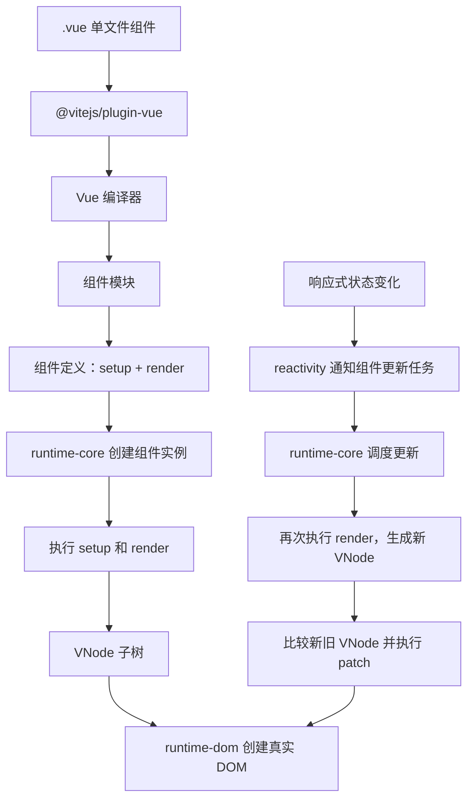

> [Vue 官网](https://vuejs.org)
>
> 官网教程：https://cn.vuejs.org/guide/quick-start

## 1、先会写组件，再理解更新

先从一个实际 Vue 组件开始：

```vue
<!-- Counter.vue -->
<template>
  <section>
    <p>数量：{{ count }}</p>
    <button @click="increment">加一</button>
  </section>
</template>

<script setup>
import { ref } from 'vue'

const count = ref(0)

function increment() {
  count.value++
}
</script>

<style scoped>
button { color: blue; }
</style>
```

一个 `.vue` 文件称为**单文件组件（SFC）**，通常包含三部分：

- `<template>`：描述页面结构；
- `<script setup>`：编写状态、事件和其他 JavaScript 逻辑；
- `<style scoped>`：编写当前组件的样式，`scoped` 用于限制样式作用范围。

模板中最常用的写法：

```vue
<p>{{ message }}</p>                    <!-- 显示数据 -->
<button @click="submit">提交</button>   <!-- 监听事件 -->
<input v-model="keyword">              <!-- 输入值与状态同步 -->
<p v-if="loading">加载中</p>            <!-- 条件渲染 -->
<li v-for="item in items" :key="item.id">
  {{ item.name }}
</li>                                   <!-- 列表渲染 -->
```

- `{{ }}` 把 JavaScript 数据显示到模板；
- `@click` 是 `v-on:click` 的简写；
- `:disabled` 是 `v-bind:disabled` 的简写，用于绑定动态属性；
- `v-model` 常用于表单输入；
- `v-if` 控制内容是否存在；
- `v-for` 根据数组重复生成内容，列表应提供稳定的 `key`。

`.vue` 不是浏览器原生格式，因此它会经历两个阶段：

```text
开发/构建阶段：把 .vue 源码转换成 JavaScript 和 CSS
浏览器运行阶段：执行转换结果，创建页面并处理后续更新
```

## 2、使用 Vite 创建和开发 Vue 项目

Vue 官方推荐使用 [`create-vue`](https://github.com/vuejs/create-vue) 创建基于 [Vite](https://vite.dev/guide/) 的项目。`create-vue` 是脚手架：它根据选择生成项目文件；真正负责启动开发服务器和生产构建的是 Vite。

### 创建并运行项目

先安装符合当前官方要求的 Node.js。然后在准备存放项目的目录中执行：

```bash
npm create vue@latest
cd <项目目录>
npm install
npm run dev
```

`npm create vue@latest` 会询问是否加入 TypeScript、Vue Router、Pinia、测试、ESLint 和 Prettier。不确定时可以先不选；这些能力以后仍可安装。对于准备长期维护的项目，通常建议从 TypeScript、Router、ESLint 开始，确实需要跨页面共享状态时再加入 Pinia。

常见项目结构如下：

```text
my-app/
├── index.html          # 浏览器最先请求的 HTML，也是 Vite 入口
├── package.json        # 依赖和 npm scripts
├── vite.config.js      # Vite 配置
├── public/             # 不经过模块处理、保持原文件名的静态资源
└── src/
    ├── main.js         # JavaScript 入口，创建并挂载 Vue 应用
    ├── App.vue         # 根组件
    ├── components/     # 可复用组件
    ├── views/          # 路由页面组件
    ├── router/         # 路由配置
    ├── stores/         # Pinia Store
    └── assets/         # 由 Vite 处理的图片、字体等资源
```

目录不是 Vue 的强制规范。小项目不需要预先创建所有目录，出现对应代码后再拆分即可。

### npm scripts 分别做什么

`package.json` 中通常有这些命令：

```json
{
  "scripts": {
    "dev": "vite",
    "build": "vite build",
    "preview": "vite preview"
  }
}
```

| 命令 | 作用 |
| --- | --- |
| `npm run dev` | 启动 Vite 开发服务器，监听源码变化并提供 HMR |
| `npm run build` | 生成经过打包、代码分割和压缩的生产资源，默认输出到 `dist` |
| `npm run preview` | 在本地启动静态服务器检查 `dist`，不是正式生产服务器 |

### 从 `npm run dev` 到页面出现

```text
npm 读取 package.json 的 scripts.dev
  → Node.js 启动 Vite 开发服务器
  → Vite 读取 vite.config.js 和 vue() 插件
  → 浏览器请求 index.html
  → index.html 加载 /src/main.js
  → main.js 导入 App.vue
  → @vitejs/plugin-vue 按需转换 .vue
  → 浏览器执行模块
  → createApp(App).mount('#app')
```

Vite 把 `index.html` 当作源码入口，并根据其中的 `<script type="module">` 和后续 `import` 建立**模块图**。模块图记录每个模块导入了哪些模块，用于按需转换文件，以及判断某个文件变化会影响哪些模块。

开发时，Vite 不会先把整个应用完整打包后再启动。浏览器请求哪个模块，Vite 就处理并返回哪个模块。修改文件后，Vite 通过 **HMR（热模块替换）**通知浏览器更新受影响的模块；`@vitejs/plugin-vue` 负责 Vue 单文件组件的 HMR，很多模板和样式修改可以在不刷新整页的情况下生效。

生产时才由 `vite build` 分析完整模块图，生成适合部署的 HTML、JavaScript、CSS 和其他资源。

### `vite.config.js` 和 Vue 插件

最小配置通常是：

```js
import { defineConfig } from 'vite'
import vue from '@vitejs/plugin-vue'

export default defineConfig({
  plugins: [vue()]
})
```

Vite 本身不理解 `.vue` 文件。`vue()` 向 Vite 注册 Vue 单文件组件的转换和 HMR 能力，再由它调用 Vue 编译器处理 `<script>`、`<template>` 和 `<style>`。

### 环境变量

客户端代码通过 `import.meta.env` 读取 Vite 环境变量：

```dotenv
# .env.development
VITE_API_BASE=/api
```

```js
const apiBase = import.meta.env.VITE_API_BASE
```

需要注意：

- 只有以 `VITE_` 开头的自定义变量默认会暴露给客户端代码；
- 环境变量读取后默认是字符串，需要时自行转换为数字或布尔值；
- `VITE_` 变量会进入浏览器产物，不能存数据库密码、服务端密钥等秘密；
- `.env.local` 和 `.env.[mode].local` 通常用于本地配置，不应提交到 Git；
- 修改 `.env` 后需要重启 Vite 开发服务器。

### 开发代理

前端运行在 `localhost:5173`、后端运行在其他端口时，可以让 Vite 开发服务器转发 `/api` 请求：

```js
import { defineConfig } from 'vite'
import vue from '@vitejs/plugin-vue'

export default defineConfig({
  plugins: [vue()],
  server: {
    proxy: {
      '/api': {
        target: 'http://localhost:8080',
        changeOrigin: true
      }
    }
  }
})
```

组件仍然请求相对地址：

```js
const response = await fetch('/api/users')
```

`server.proxy` 只在 Vite 开发服务器运行时生效。部署后，应由 Nginx、网关、后端服务或部署平台配置转发和跨域规则。

### 静态资源

源码使用的图片和字体优先放在 `src/assets` 并通过模块导入：

```vue
<script setup>
import logoUrl from './assets/logo.png'
</script>

<template>
  
</template>
```

这类资源会进入模块图，生产构建时可以获得 hash 文件名和正确 URL。只有必须保留原文件名，或者不需要被源码导入的文件才放入 `public`：

```text
public/favicon.ico → 页面中使用 /favicon.ico
```

### TypeScript 类型检查与构建

Vite 可以把 TypeScript 转换成 JavaScript，但不会检查整个项目的类型。开发时由 IDE 的 Vue - Official 扩展提示问题，命令行和 CI 使用 `vue-tsc`：

```json
{
  "scripts": {
    "type-check": "vue-tsc --noEmit",
    "build": "npm run type-check && vite build"
  }
}
```

实际项目优先保留 `create-vue` 生成的 scripts 和 TypeScript 配置，不必手动改成完全相同的写法。最终部署的是 `npm run build` 生成的 `dist`，不是 Vite 开发服务器。

## 3、主链路

### 核心包在链路中的位置

| 所处阶段         | 直接负责的包         | 核心职责                                                     |
| ---------------- | -------------------- | ------------------------------------------------------------ |
| Vite 转换 `.vue` | `@vitejs/plugin-vue` | 接收 Vite 的转换请求，调用 Vue 编译器并组织组件模块与 HMR 信息 |
| 解析单文件组件   | `@vue/compiler-sfc`  | 提供解析和编译 `<script>`、`<template>`、`<style>` 的底层能力 |
| 编译浏览器模板   | `@vue/compiler-dom`  | 在 `@vue/compiler-core` 基础上处理 HTML 元素和 `v-model`、`v-show` 等 DOM 规则，生成渲染函数代码 |
| 通用模板编译能力 | `@vue/compiler-core` | 提供模板解析、AST 转换和代码生成的通用基础，不直接操作 DOM   |
| 响应式状态       | `@vue/reactivity`    | 实现 `ref`、`reactive`、`computed` 和依赖追踪                |
| 组件与更新       | `@vue/runtime-core`  | 创建组件实例、执行 `setup` 和 `render`、调度更新、比较 VNode |
| 浏览器 DOM       | `@vue/runtime-dom`   | 提供 `createApp` 的浏览器入口，把运行时操作落实为 DOM 属性、事件和节点操作 |

业务代码通常统一从 `vue` 导入公开 API：

```js
import { createApp, ref } from 'vue'
```

业务代码不需要逐个安装或导入这些 Vue 内部包。这里列出包名，是为了说明编译、状态、协调和 DOM 操作由不同部分负责。

### 第一步：构建工具处理 `.vue`

Vite 通过 `@vitejs/plugin-vue` 接入 Vue 编译器，将模板编译为“返回虚拟 DOM 树的渲染函数”：

1. `@vue/compiler-sfc` 解析 `.vue` 文件中的 `<template>`、`<script>`、`<style>`。
2. `<template>` 交给 `@vue/compiler-dom` 编译成 `render()`，Vue 模板编译器通常生成 `createElementVNode`、`createElementBlock` 等经过优化的运行时调用；`h()` 则是开发者手写 Vue 渲染函数时使用的便利 API。它们最终都生成 VNode，而不直接创建真实 DOM。
3. `<script setup>` 也会被转换成普通组件代码。
4. 样式交给构建工具单独处理。
5. `@vitejs/plugin-vue` 把脚本、渲染函数、样式引用和开发期 HMR 信息组织成 Vite 可以加载的组件模块。

```vue
<!-- Counter.vue -->
<script setup>
import { ref } from 'vue'

const count = ref(0)

function increment() {
  count.value++
}
</script>

<template>
  <button @click="increment">
    {{ count }}
  </button>
</template>
```

下面代码只用于说明组件模块、组件定义、`setup` 和 `render` 的结构关系，不是编译器保证生成的固定源码：

```js
import {
  ref,
  openBlock,
  createElementBlock,
  toDisplayString
} from 'vue'

// 组件的状态初始化逻辑
function setup() {
  const count = ref(0)

  function increment() {
    count.value++
  }

  return {
    count,
    increment
  }
}

// 组件的 UI 计算逻辑
function render(_ctx) {
  return (
    openBlock(),
    createElementBlock(
      'button',
      {
        onClick: _ctx.increment
      },
      toDisplayString(_ctx.count)
    )
  )
}

// 完整组件定义
const Counter = {
  setup,
  render
}

// 当前 JavaScript 模块的默认导出
export default Counter
```

如果父组件写了两个计数器：

```vue
<template>
  <Counter />
  <Counter />
</template>
```

`Counter.vue` 组件模块只加载一次，组件定义也只有一份：

```js
const Counter = {
  setup,
  render
}
```

但是 Vue 会创建两个组件实例：

```
Counter 组件定义
  ├─ 组件实例 A
  │   └─ count = 0
  └─ 组件实例 B
      └─ count = 0
```

两个实例：

- 共用同一个组件定义；
- 共用同一个 `render` 函数代码；
- 分别执行一次 `setup()`；
- 拥有各自独立的 `count`；
- 分别保存上一次渲染产生的 VNode 子树。

渲染函数执行后会产生 VNode。VNode 是描述元素类型、属性和子节点的 JavaScript 数据，不是真实 DOM。Vue 根据 VNode 创建页面，并在状态变化后比较新的 VNode 和旧的 VNode，再更新必要的 DOM。

### 第二步：用响应式状态驱动页面

**状态**是会发生变化，并且变化后需要反映到页面上的数据，例如计数、输入内容、登录用户和加载状态。

普通变量发生变化时，Vue 不知道需要更新页面：

```js
let count = 0
count++ // 数据变了，但不会自动触发 Vue 更新组件
```

因此 Vue 提供了 `ref` 和 `reactive`，用来创建**响应式状态**。响应式的核心含义是：组件使用过这份数据后，数据变化时 Vue 能通知组件重新渲染。

#### `ref`：常用的状态写法

`ref` 从公共入口 `vue` 导入，具体响应式能力由 `@vue/reactivity` 实现。它可以保存数字、字符串、布尔值、对象等数据：

```vue
<script setup>
import { ref } from 'vue'

const count = ref(0)

function increment() {
  count.value++
}
</script>

<template>
  <button @click="increment">数量：{{ count }}</button>
</template>
```

这里需要记住：

- `ref(0)` 创建初始值为 `0` 的响应式状态；
- 在 JavaScript 中通过 `count.value` 读写；
- 在模板中 Vue 会自动处理 `.value`，所以写 `{{ count }}`；
- 修改 `count.value` 后，Vue 会重新计算使用了它的组件内容并更新 DOM。

`ref` 返回一个对象，真实值放在 `.value` 中。这样 Vue 才能介入这个属性的读取和修改，记录哪些组件使用了它，并在它变化时触发更新。数字等原始值本身无法被 Vue 直接监听，这就是 `.value` 存在的主要原因。

#### `reactive`：管理对象状态

`reactive` 适合把一个对象的多个字段作为响应式状态管理：

```vue
<script setup>
import { reactive } from 'vue'

const form = reactive({
  username: '',
  loading: false
})

function submit() {
  form.loading = true
}
</script>
```

`reactive` 通过 JavaScript 的 Proxy 监听对象属性的读取和修改，因此直接写 `form.username`、`form.loading`，不需要 `.value`。它只能用于对象、数组等对象类型，不能写 `reactive(0)`。

入门时可以这样选择：

| 情况                             | 建议                |
| -------------------------------- | ------------------- |
| 单个数字、字符串、布尔值         | 使用 `ref`          |
| 需要整体替换的对象               | 使用 `ref`          |
| 多个字段组成、主要逐项修改的对象 | 可以使用 `reactive` |

两者背后都是 Vue 的响应式系统。

### 第三步：在入口挂载应用

Vue 项目通常有入口文件：

```js
// main.js
import { createApp } from 'vue'
import App from './App.vue'

createApp(App).mount('#app')
```

HTML 中则有挂载容器：

```html
<div id="app"></div>
<script type="module" src="/src/main.js"></script>
```

浏览器执行 `main.js` 后：

1. 浏览器加载 `main.js` 和编译后的 `App.vue` 组件模块；
2. `@vue/runtime-dom` 提供的 `createApp(App)` 创建浏览器应用对象，并使用 `App` 作为根组件定义；
3. `app.mount('#app')` 调用 Vue 的 `mount` 方法，`@vue/runtime-dom` 使用浏览器 API 找到 `<div id="app">`；
4. `@vue/runtime-core` 创建根组件实例，执行一次 `setup()` 建立当前实例的状态，再执行 `render()` 得到 VNode；
5. `@vue/runtime-core` 的渲染器遍历 VNode，调用 `@vue/runtime-dom` 提供的 DOM 操作创建元素、设置事件并插入 `#app`；
6. 后续状态变化时，`@vue/reactivity` 和 `@vue/runtime-core` 共同驱动组件更新。

`createApp` 和 `mount` 都是 Vue API。`mount` 负责确定 Vue 接管页面的哪个位置，其内部才会使用 `document.querySelector` 等浏览器 API。一个页面也可以挂载多个互相独立的小型 Vue 应用。

### 第四步：状态变化后如何更新

用户点击按钮后：

1. 浏览器触发点击事件，调用由 `@vue/runtime-dom` 绑定的 `increment`；
2. `count.value++` 进入 `@vue/reactivity` 的 ref setter，修改值并通知使用过 `count` 的响应式任务；
3. `@vue/runtime-core` 的调度器把当前组件的更新任务加入队列，同一轮中的重复任务会被合并；
4. 调度器执行更新任务，`@vue/runtime-core` 再次调用当前组件的 `render()`，得到新的 VNode 树；
5. `@vue/runtime-core` 比较旧 VNode 和新 VNode，确定文本需要从“数量：0”更新为“数量：1”；
6. `@vue/runtime-dom` 把这个变化落实为真实 DOM 的文本更新，组件实例再保存新的 VNode 子树。

把构建和运行阶段连起来，就是：

```text
Counter.vue
  → @vitejs/plugin-vue 调用 Vue 编译器
  → compiler-sfc / compiler-dom / compiler-core 生成组件模块和 render
  → 浏览器从 vue 公共入口使用运行时 API
  → runtime-dom 创建并挂载应用
  → runtime-core 创建组件实例并执行 setup、render
  → reactivity 在状态读写时追踪和触发依赖
  → runtime-core 调度更新并比较 VNode
  → runtime-dom 调用浏览器 DOM API 更新页面
```

### 列表为什么需要 `key`

考虑列表：

```vue
<li v-for="item in items" :key="item.id">
  {{ item.name }}
</li>
```

Vue 更新列表时需要判断新旧项目是否是同一项。它主要依据节点类型和 `key`：

- 节点类型不同：旧节点不能直接复用，卸载旧节点并挂载新节点；
- 类型相同：继续更新属性、事件和子节点；
- 列表中使用 `key`：根据 `key` 判断新旧项目是不是同一个业务项；

因此 `key` 不是为了消除警告而随便填写。它表达列表项身份。使用不稳定的索引作为 `key`，在插入、删除和重排时可能导致错误复用组件状态或 DOM。



## 4、Vue 组件开发最常用的能力

组件的价值是把一块 UI 的结构、状态、事件和样式放在一起，再通过组合形成页面。

父组件通过 props 向子组件传数据，子组件通过 emit 向父组件报告事件：

- props 是父组件传入的数据，子组件不应直接修改它；
- emit 表示子组件发生了事件，由父组件决定如何修改状态；
- 这种单向数据流让状态来源和修改位置更清楚。

```vue
<!-- UserCard.vue -->
<script setup>
defineProps({ name: String })
const emit = defineEmits(['remove'])
</script>

<template>
  <article>
    <span>{{ name }}</span>
    <button @click="emit('remove')">删除</button>
  </article>
</template>
```

```vue
<UserCard :name="user.name" @remove="removeUser" />
```

- **`:name="user.name"`（传递数据）**：
  - 这是**动态 Prop**。`:` 是 `v-bind` 的缩写，把父组件中的 `user.name` 变量值（如 `'张三'`）传给子组件的 `name` 属性。
- **`@remove="removeUser"`（监听事件）**：
  - 这是**事件监听**。`@` 是 `v-on` 的缩写。
  - 当子组件内部 `emit('remove')` 被调用时，父组件的 `removeUser` 方法会立即执行。

其他常用 API：

| API              | 用途                               |
| ---------------- | ---------------------------------- |
| `computed`       | 根据现有状态计算派生值，并缓存结果 |
| `watch`          | 状态变化后执行请求、存储等额外操作 |
| `onMounted`      | 组件首次挂载到 DOM 后执行逻辑      |
| `provide/inject` | 在较深的组件层级间共享依赖         |

### `computed`、`watch` 和 `onMounted`

```vue
<script setup>
import { computed, onMounted, ref, watch } from 'vue'

const count = ref(0)
const users = ref([])

// 派生状态：count 不变时可以复用之前的计算结果
const double = computed(() => count.value * 2)

function increment() {
  count.value++
}

// 监听状态变化并执行额外动作
watch(count, (newCount, oldCount) => {
  console.log(`count: ${oldCount} → ${newCount}`)
})

// 当前组件首次挂载到 DOM 后执行
onMounted(async () => {
  const response = await fetch('/api/users')
  if (!response.ok) throw new Error('加载用户失败')
  users.value = await response.json()
})
</script>

<template>
  <p>{{ count }} × 2 = {{ double }}</p>
  <button @click="increment">加一</button>
  <p>用户数量：{{ users.length }}</p>
</template>
```

- `computed` 用于**根据现有状态得到新值**，例如总价、筛选结果、完整姓名；
- `watch` 用于**状态变化后执行额外动作**，例如重新请求、写入本地存储、调用第三方 API；
- `onMounted` 是生命周期钩子，表示组件已经产生真实 DOM，适合初始化只在挂载后才能进行的工作。

能够直接计算出的值优先使用普通表达式或 `computed`，不要为了得到另一个值而使用 `watch`。`watch` 的重点是副作用，不是返回计算结果。

### `provide` 和 `inject`

普通父子组件优先使用 props 和 emit。当数据需要跨过多层中间组件时，可以由上层组件提供，由后代组件注入：

```vue
<!-- 上层组件 -->
<script setup>
import { provide, ref } from 'vue'

const theme = ref('dark')
provide('theme', theme)
</script>
```

```vue
<!-- 任意后代组件 -->
<script setup>
import { inject } from 'vue'

const theme = inject('theme', 'light') // 第二个参数是默认值
</script>

<template>
  <p>当前主题：{{ theme }}</p>
</template>
```

`provide/inject` 解决跨层传递依赖的问题，不等于完整的全局状态管理。大量跨页面共享状态通常再考虑 Pinia 等状态库。

### slot：向子组件传入 UI 内容

props 用于传递数据，slot 用于传递一段由父组件决定的模板内容。子组件通过 `<slot>` 指定内容出现的位置：

```vue
<!-- BaseButton.vue -->
<template>
  <button class="base-button">
    <slot>默认文字</slot>
  </button>
</template>
```

```vue
<BaseButton>
  保存 <span aria-hidden="true">✓</span>
</BaseButton>
```

父组件提供的内容会替换默认文字，并且仍然可以访问父组件作用域中的数据。需要多个内容位置时再使用具名 slot，入门阶段先掌握默认 slot 即可。

### 组件 `v-model` 与 `defineModel`

原生输入框可以使用 `v-model`，封装输入组件时也经常希望父组件这样使用：

```vue
<CustomInput v-model="keyword" />
```

子组件通过 `defineModel()` 声明这个双向绑定：

```vue
<!-- CustomInput.vue -->
<script setup>
const model = defineModel({ type: String, required: true })
</script>

<template>
  <input v-model="model">
</template>
```

`defineModel()` 返回一个 ref。读取它会得到父组件传入的当前值，修改它会向父组件提交新值。它本质上是 `modelValue` prop 和 `update:modelValue` 事件的简化写法，不表示子组件可以随意修改其他 props。

### 模板 ref、`nextTick` 和卸载清理

大多数页面更新应交给模板完成。只有需要聚焦输入框、读取尺寸或接入第三方 DOM 库时，才直接取得真实 DOM：

```vue
<script setup>
import { onMounted, useTemplateRef } from 'vue'

const searchInput = useTemplateRef('searchInput')

onMounted(() => {
  searchInput.value?.focus()
})
</script>

<template>
  <input ref="searchInput">
</template>
```

状态修改后，Vue 会把 DOM 更新安排到当前同步代码之后。如果确实需要等待这次 DOM 更新完成，可以使用 `nextTick`：

```js
import { nextTick } from 'vue'

items.value.push(newItem)
await nextTick()
// 此时由这次状态修改引起的 DOM 更新已经完成
```

组件自行注册的全局事件、定时器和外部订阅必须在卸载时清理：

```js
import { onMounted, onUnmounted } from 'vue'

function handleResize() {
  // 根据窗口尺寸执行逻辑
}

onMounted(() => window.addEventListener('resize', handleResize))
onUnmounted(() => window.removeEventListener('resize', handleResize))
```

## 5、Options API 与 Composition API

Options API 和 Composition API 是 Vue 编写组件逻辑的两种组织方式。它们使用同一套响应式系统、组件系统和 DOM 渲染器，不是两个不同版本的 Vue，也没有性能上的根本区别。

### 用同一个计数器对比

Options API 把代码放入 Vue 规定的选项：

```vue
<template>
  <button @click="increment">{{ count }} × 2 = {{ double }}</button>
</template>

<script>
export default {
  data() {
    return { count: 0 }
  },
  computed: {
    double() {
      return this.count * 2
    }
  },
  watch: {
    count(newCount, oldCount) {
      console.log(`${oldCount} → ${newCount}`)
    }
  },
  mounted() {
    console.log('组件已挂载')
  },
  methods: {
    increment() {
      this.count++
    }
  }
}
</script>
```

这些选项分别表示：

- `data()` 返回的对象会被转为响应式状态；
- `computed` 定义派生状态；
- `watch` 监听状态变化；
- `mounted` 是挂载完成后的生命周期钩子；
- `methods` 保存模板可以调用的方法；
- `this` 指向 Vue 创建的组件公开实例，因此这些选项可以通过 `this.count` 相互访问。

Composition API 直接在 `setup()` 中调用 Vue API。`<script setup>` 是更简洁的编译语法，适合单文件组件：

```vue
<template>
  <button @click="increment">{{ count }} × 2 = {{ double }}</button>
</template>

<script setup>
import { computed, onMounted, ref, watch } from 'vue'

const count = ref(0)
const double = computed(() => count.value * 2)

function increment() {
  count.value++
}

watch(count, (newCount, oldCount) => {
  console.log(`${oldCount} → ${newCount}`)
})

onMounted(() => {
  console.log('组件已挂载')
})
</script>
```

这里没有 `data`、`methods` 等分类，也不依赖组件 `this`。状态、计算、监听和方法都是当前 JavaScript 作用域中的变量与函数，模板可以直接使用 `<script setup>` 顶层声明。

### 两种方式最关键的区别

| 问题               | Options API                                 | Composition API                    |
| ------------------ | ------------------------------------------- | ---------------------------------- |
| 如何组织代码       | 按 `data`、`methods`、`computed` 等选项分类 | 按业务功能组织相关状态、计算和方法 |
| 如何声明响应式状态 | `data()` 返回值由 Vue 自动处理              | 显式调用 `ref`、`reactive`         |
| 如何访问组件内容   | 主要通过组件实例 `this`                     | 使用普通变量、函数和导入           |
| 如何复用逻辑       | mixin、组件或其他选项机制                   | 组合式函数（composable）           |
| TypeScript         | `this` 和选项之间需要额外推导               | 普通函数和变量更容易直接推导类型   |

Options API 并不是只适合小项目，Composition API 也不是必须使用。对于逻辑简单的组件，Options API 的固定分类容易阅读；当一个组件包含多个复杂功能，或者同一功能涉及状态、请求、监听和生命周期时，Composition API 更容易把相关代码放在一起。

### 组合式函数如何复用逻辑

组合式函数是调用 Composition API、封装可复用状态逻辑的普通函数。Vue 社区通常使用 `use` 开头命名：

```js
// useCounter.js
import { computed, ref } from 'vue'

export function useCounter(initialValue = 0) {
  const count = ref(initialValue)
  const double = computed(() => count.value * 2)

  function increment() {
    count.value++
  }

  return { count, double, increment }
}
```

组件中直接调用：

```vue
<script setup>
import { useCounter } from './useCounter.js'

const { count, double, increment } = useCounter(10)
</script>
```

每次调用 `useCounter()` 都会创建本次调用自己的状态。组合式函数不负责渲染 UI，它只封装状态和相关逻辑。

Vue 将这种函数称为 **composable（组合式函数）**。React 中功能相近的复用函数称为 **自定义 Hook**；两者命名习惯相似，但分别运行在各自框架的规则中。

Options API 按 `data`、`methods` 和生命周期等选项组织代码，因此同一个功能的状态、方法和清理逻辑可能分布在不同选项中。组合式函数可以把一个功能需要的响应式状态、方法和生命周期放进同一个普通函数，并通过明确的参数和返回值供组件复用。

### 为什么 mixin 容易维护困难

Options API 可以通过 mixin 合并可复用选项：

```js
export default {
  mixins: [paginationMixin, loadingMixin]
}
```

多个 mixin 的 `data`、`methods`、生命周期等会合并进同一个组件。项目变复杂后可能出现：

- 模板中某个属性来自组件自身还是哪个 mixin 不清楚；
- 不同 mixin 使用相同属性或方法名，产生冲突；
- 一个 mixin 依赖另一个 mixin 提供的字段，依赖关系不直观。

组合式函数通过普通的导入、参数和返回值明确数据来源，因此更适合复用复杂逻辑。

## 6、Vue 应用常用生态：Router、Pinia、HTTP 和 TypeScript

Vue 核心负责组件、响应式状态和页面更新。完整应用通常还要解决 URL 导航、跨页面状态、后端通信和类型检查，这些能力分别由 Vue Router、Pinia、Fetch/Axios 和 TypeScript 提供。

| 工具          | 解决的问题             | 核心模型                   |
| ------------- | ---------------------- | -------------------------- |
| Vue Router    | URL 应该显示哪个页面   | 路径映射到页面组件         |
| Pinia         | 多个组件或页面共享状态 | 全局可访问的响应式 Store   |
| Fetch / Axios | 与后端 API 通信        | HTTP 请求与响应            |
| TypeScript    | 开发阶段发现类型错误   | 为 JavaScript 增加静态类型 |

### Vue Router：让 URL 对应页面组件

[Vue Router](https://router.vuejs.org/guide/) 是 Vue 官方客户端路由。单页应用切换路由时，通常只改变 URL 和当前渲染的组件，不重新加载整个 HTML 页面。

```js
// src/router.js
import { createRouter, createWebHistory } from 'vue-router'
import HomeView from './views/HomeView.vue'

export default createRouter({
  history: createWebHistory(),
  routes: [
    { path: '/', component: HomeView },
    { path: '/about', component: () => import('./views/AboutView.vue') }
  ]
})
```

```js
// src/main.js
import { createApp } from 'vue'
import App from './App.vue'
import router from './router.js'

createApp(App).use(router).mount('#app')
```

```vue
<!-- App.vue -->
<template>
  <nav>
    <RouterLink to="/">首页</RouterLink>
    <RouterLink to="/about">关于</RouterLink>
  </nav>
  <RouterView />
</template>
```

- `routes` 是路径和组件的映射表；
- `<RouterLink>` 改变 URL，并避免普通页面跳转导致的整页重载；
- `<RouterView>` 是当前路由组件的渲染出口；
- `useRoute()` 读取当前路由，`useRouter()` 用于 `push()` 等编程式导航。

`() => import('./views/AboutView.vue')` 是路由懒加载。Vite 会把这个页面拆成独立代码块，用户访问 `/about` 时再加载；首屏必须使用的页面可以直接静态导入。

`createWebHistory()` 使用正常 URL，例如 `/about`。部署服务器必须把找不到的前端路由回退到 `index.html`，再由 Vue Router 根据 URL 选择页面；否则用户直接访问或刷新 `/about` 时，服务器可能返回 404。这是生产服务器配置，不由 Vite 开发代理自动解决。

### Pinia：共享响应式状态

[Pinia](https://pinia.vuejs.org/introduction.html) 是 Vue 的状态管理库。它把需要跨组件共享的状态和修改逻辑放进 Store；组件调用同一个 `useStore()` 时，会取得同一个 Store 实例。

```js
// src/stores/counter.js
import { computed, ref } from 'vue'
import { defineStore } from 'pinia'

export const useCounterStore = defineStore('counter', () => {
  const count = ref(0)                              // state
  const double = computed(() => count.value * 2)  // getter
  const increment = () => count.value++            // action

  return { count, double, increment }
})
```

```js
// src/main.js
import { createApp } from 'vue'
import { createPinia } from 'pinia'
import App from './App.vue'

createApp(App).use(createPinia()).mount('#app')
```

```vue
<script setup>
import { useCounterStore } from '@/stores/counter.js'

const counter = useCounterStore()
</script>

<template>
  <button @click="counter.increment">
    {{ counter.count }} × 2 = {{ counter.double }}
  </button>
</template>
```

Store 的三个核心部分是：

- state：原始共享状态；
- getter：根据 state 计算出的派生状态，本质类似 `computed`；
- action：修改状态或执行异步流程的方法。

组件自己的输入值、弹窗开关等局部状态继续使用 `ref`，不要因为安装了 Pinia 就把所有状态全局化。登录用户、购物车、跨页面筛选条件等真正共享的数据才适合进入 Store。

直接通过 `counter.count` 访问状态可以保持响应式。如果需要解构 state 或 getter，应使用 `storeToRefs`：

```vue
<script setup>
import { storeToRefs } from 'pinia'
import { useCounterStore } from '@/stores/counter.js'

const counter = useCounterStore()
const { count, double } = storeToRefs(counter)
const { increment } = counter // action 可以直接解构
</script>
```

不要直接写 `const { count } = counter`，因为普通对象解构只取出当前属性值，不会保留它与 Store 属性之间的响应式连接。

### Fetch / Axios：获取并更新后端数据

Fetch 是 WHATWG 定义的 Web API，现代浏览器和 Node.js 都提供实现；它不是 Vue API。Axios 是第三方 HTTP 客户端，可以根据环境和配置使用 XHR、Node HTTP 或 Fetch adapter，并额外提供实例默认值、拦截器和统一错误对象等能力。

Vue 只关心请求结果最终写入了哪个响应式状态，不依赖具体 HTTP 客户端。简单项目优先使用 Fetch；项目已经需要统一 `baseURL`、认证处理、拦截器或现有 Axios 封装时再使用 Axios。

请求通常会经历：

```text
组件触发加载 → 发送 HTTP 请求 → 检查响应 → 更新 ref 或 Store → Vue 更新页面
```

```vue
<script setup>
import { onMounted, ref } from 'vue'

const users = ref([])
const loading = ref(false)
const error = ref('')

async function loadUsers() {
  loading.value = true
  error.value = ''

  try {
    const response = await fetch('/api/users')
    if (!response.ok) throw new Error(`HTTP ${response.status}`)
    users.value = await response.json()
  } catch (cause) {
    error.value = cause instanceof Error ? cause.message : '请求失败'
  } finally {
    loading.value = false
  }
}

onMounted(loadUsers)
</script>
```

如果组件可能在请求完成前卸载，或者后一次查询应该取消前一次查询，可以进一步使用 `AbortController`；没有实际取消需求时不必增加这层代码。

### TypeScript：在运行前检查数据用法

Vue 单文件组件通过 `<script setup lang="ts">` 使用 TypeScript：

```vue
<script setup lang="ts">
import { ref } from 'vue'

interface User {
  id: number
  name: string
}

defineProps<{
  user: User
  editable?: boolean
}>()

const users = ref<User[]>([])
const selectedUser = ref<User | null>(null)
</script>
```

TypeScript 能检查组件 props、emit、响应式状态和函数参数，并提供自动补全；它的类型在构建后通常会被删除，不能验证服务器实际返回的 JSON。接口响应仍然属于外部输入，关键数据需要运行时校验。

Vite 只负责把 TypeScript 转译成 JavaScript，不执行完整类型检查。开发时依靠 Vue - Official 编辑器扩展，提交代码或构建前运行 `vue-tsc --noEmit`；使用 `create-vue` 创建 TypeScript 项目时，优先保留脚手架生成的 `type-check` 和 `build` scripts。

入门可以按以下顺序学习：

```text
Vue 组件、响应式与 TypeScript → Fetch → Vue Router → Pinia
```

已有编程基础时，新项目可以直接启用 TypeScript，但先使用简单类型，不必预先设计复杂类型体系。先用局部 `ref` 和原生 Fetch 完成页面；出现多个页面时加入 Router，确实需要跨页面共享状态时加入 Pinia。
