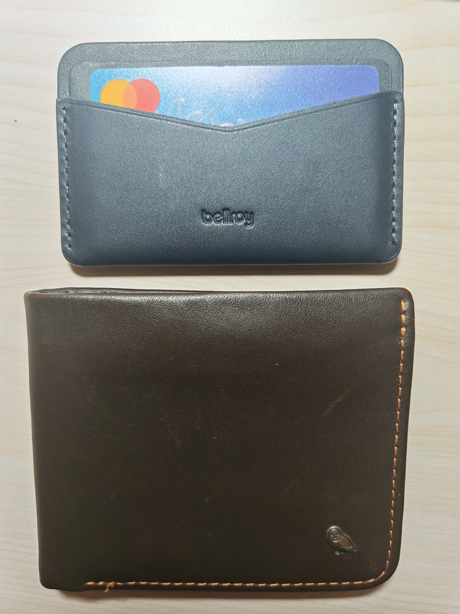
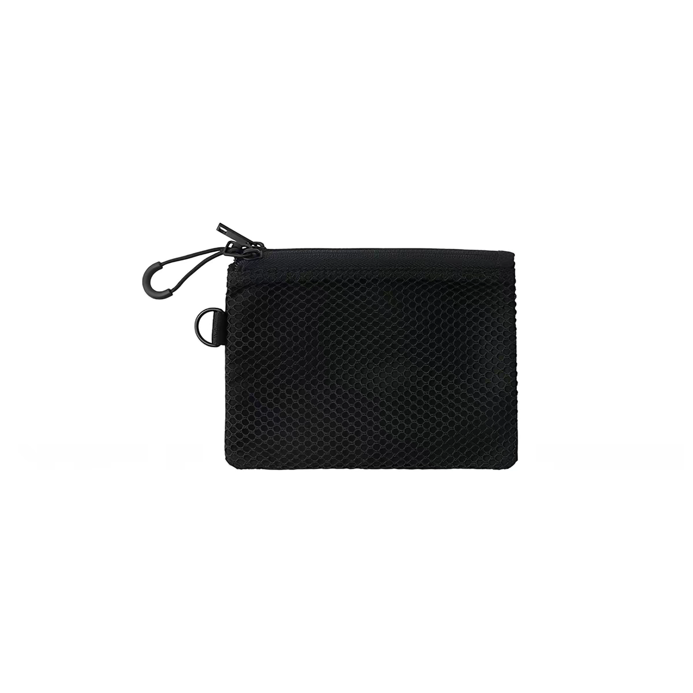

### 我的电子设备

| 类型 | 名称 | 时间 | 价格 | 描述 |
| --- | --- | --- | --- | --- |
| 电脑 | Macbook Pro M5 24+512 午夜色，UKIY AR 屏，LALO 折叠支架 | 2026.1.10-至今 | 11500¥ + 116¥ + 50¥ | 涨价前买的，擦屏幕可用 3M 清洁布 |
| 电脑 | 天选4 r9 4070 16+1T，AX210 网卡 | 2023.6.12-至今 | 9499¥ + 116¥ | |
| 电脑 | Samsung T7 固态 1T | 2026.3.8-至今 | 900¥ | |
| 显示器 | SANC 盛色 S65 24.5 英寸 2K320Hz FastIPS | 2026.10.20-至今 | 800¥ | |
| 手机 | Honor Magic7 24+512 | 2024.12.2-至今 | 4250¥ | |
| 手机 | 小米金沙江磁吸充电宝 | 2026.5.7-至今 | 242¥ | |
| 耳机 | Airpods Pro 2 | 2025.8.10-至今 | 1180¥ | |
| 耳机 | ARPTICAL 拉斐尔 + EPZ TP35 Pro | 2026.8.25-至今 | 690¥ + 280¥ | |
| 音响 | Sony SRS-XB100 | 2026.5.2-至今 | 259¥ | 参加婚礼时抽到的 |
| 鼠标 | Razer V3pro | 2026.2.28-至今 | 380¥ | |
| 鼠标 | Logi M650 | 2024.12.24-至今 | 78¥ | |
| 鼠标垫 | D-GLOW【究】 | 2025.11.24-至今 | 144¥ | |
| 手柄 | 盖世小鸡 G7 Pro | 2026.9.7-至今 | 239¥ | |
| 键盘 | Lofree FLOW2 | 2025.10.4-至今 | 754¥ | |
| 路由器 | ZTE 中兴 AX3000 巡天 Pro+ | 2024.4.27-至今 | 279¥ | |

### 我的生活配件

| 类型 | 名称 | 时间 | 价格 | 描述 |
| --- | --- | --- | --- | --- |
| 椅子 | 京东京造 Z9Elite 2代 | 2025.3.1-至今 | 1349¥ | |
| 钱包 | Bellroy Hide & Seek 深咖色 | 2025.11.24-至今 | 528¥ | |
| 钱包 | Bellroy Card Slip 海军蓝 | 2026.10.8-至今 | 370¥ | |
| 香水 | LELABO ANOTHER 13 50ml | 2025.9.11-至今 | 855¥ | |
| 玩偶 | JELLYCAT 史玛吉大象 Medium | 2026.9.30-至今 | 299¥ | |
| 吹风机 | 徕芬 SE2 | 2026.3.2-至今 | 310¥ | |
| 眼镜 | 宝岛眼镜 | 2024.7.1-至今 | 1700¥ | |
| 包包 | mont·bell #1123970 斜挎包 S 码黑色 | 2024.10.25-至今 | 200+¥ | 我爸去日本的时候给我代购的，很好用能放下我的 macbook pro 14 寸 |
| 包包 | tomtoc 14 寸电脑包 | 2026.1.27-至今 | 75¥ | xy 低价捡漏 |
| 包包 | WIWU 电脑内胆包 | 2026.3.3-至今 | 90¥ | 能直接塞 mont·bell 包里很方便 |
| 包包 | 无印良品 MUJI 网格包 | 2026.3.9-至今 | 28 ¥ | |

:::gallery{layout="scroll"}

:::

### 我的订阅服务

| 类型 | 名称 | 时间 | 价格 | 描述 |
| --- | --- | --- | --- | --- |
| AI | [GPT Plus](https://chatgpt.com) | 2026.7.12-至今 | 120 ¥/月 | 专门办了个招行万事达的卡来开通 |
| AI | [Supergrok](https://accounts.x.ai/) | 2026.9.4-2026.12.4 | 230¥ 3个月 | |
| AI | [Deepseek API](https://platform.deepseek.com/usage) | | 270¥+ | |
| 代码 | [阿里云云服务2核2GB](https://ecs.console.aliyun.com/) | 2027.10.25 到期 | 大学生 300 元优惠劵 | |
| 音乐 | qq 音乐 | 2027.11.13 到期 | | 移动电话卡每月能领一个月的会员 |
| 音乐 | ~~apple music~~（已停） | | | |
| 视频 | b 站年会 | 2027.1.6 到期 | 80¥ | |
| 网络 | vpn | 2026.10.22-2027.10.22 | 188¥/年 | |
| 视频 | ~~netflix~~（已停） | | | |

