我的 **Steam Friend Code**：[1554038676](https://steamcommunity.com/id/wutongyuonce/)

### 最近在玩

:::card{title="影之刃零" href="https://zh.wikipedia.org/wiki/影之刃零" label="游戏"}
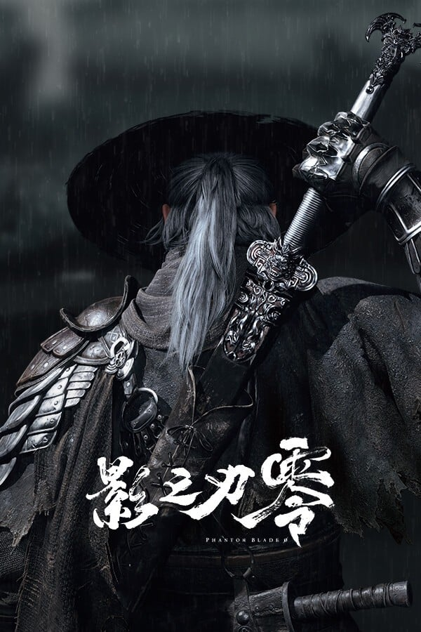

又是类魂～
:::

:::card{title="星露谷物语" href="https://zh.wikipedia.org/wiki/星露谷物语" label="游戏"}
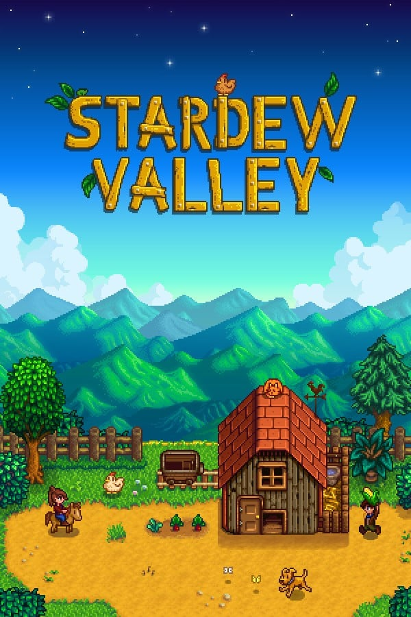

准备玩。
:::

:::card{title="艾尔登法环" href="https://zh.wikipedia.org/wiki/艾爾登法環" label="游戏"}
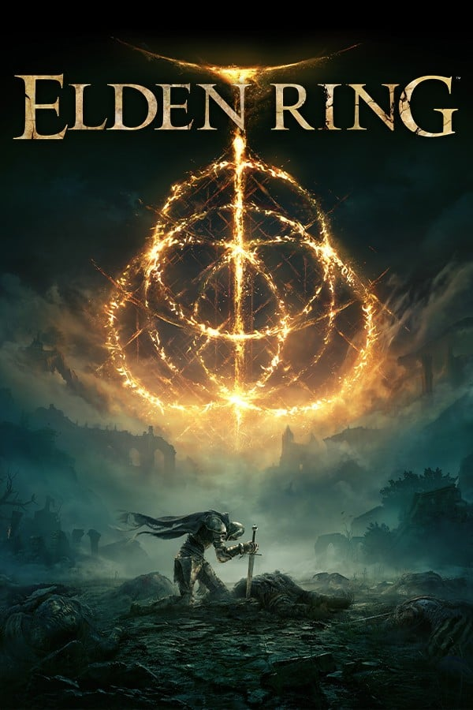

准备玩。
:::

### 玩过

:::card{title="无畏契约" href="https://zh.wikipedia.org/wiki/无畏契约" score="4.5" label="游戏"}
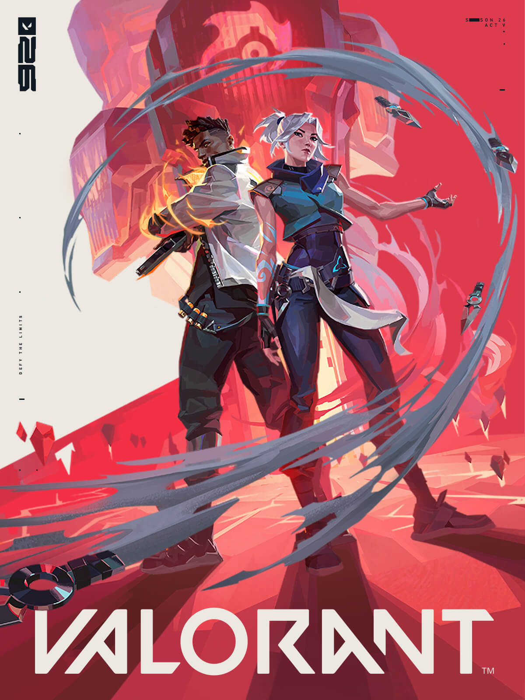

两三个赛季没打了，铂钻。
:::

:::card{title="反恐精英：全球攻势" href="https://zh.wikipedia.org/wiki/反恐精英：全球攻势" score="4.5" label="游戏"}
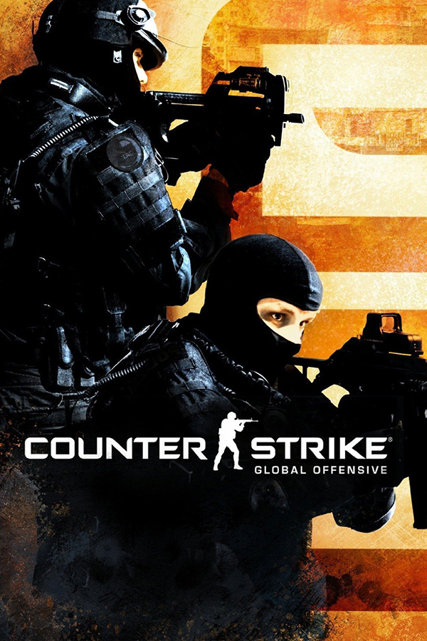

爱看点绿龙 Spirit。
:::

:::card{title="Apex 英雄" href="https://zh.wikipedia.org/wiki/Apex_英雄" score="4.5" label="游戏"}
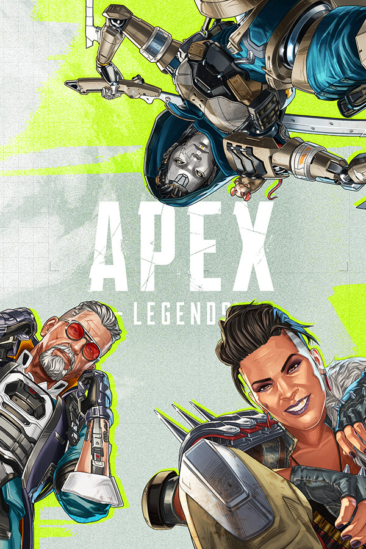

上大学玩的第一个 fps 游戏，抛开 EA 不谈最好玩的 fps 游戏😂。
:::

:::card{title="赛博朋克 2077" href="https://zh.wikipedia.org/wiki/賽博朋克2077" score="4.5" label="游戏"}
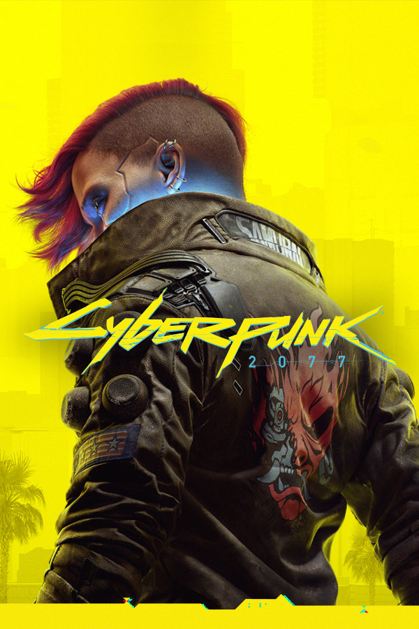

看边缘行者第一部入的坑。
:::

:::card{title="黑神话：悟空" href="https://zh.wikipedia.org/wiki/黑神话：悟空" score="5" label="游戏"}
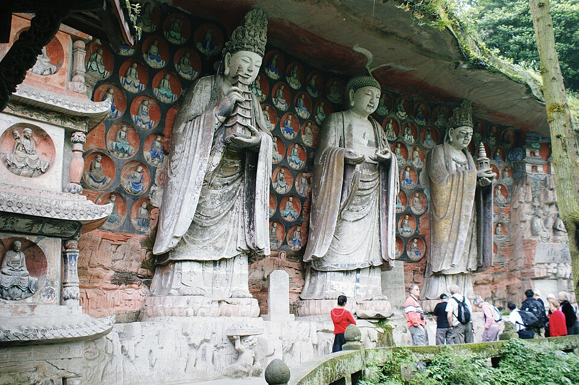

玩的第一部 3A，当时各个直播间都在玩，很有氛围。
:::

:::card{title="小小梦魇 2" href="https://zh.wikipedia.org/wiki/小小梦魇2" score="5" label="游戏"}
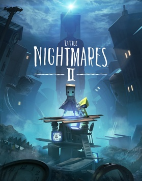

第一个玩的带点恐怖的游戏？很好玩，故事也很有意思。
:::

:::card{title="荒野大镖客：救赎 2" href="https://zh.wikipedia.org/wiki/荒野大镖客：救赎2" score="4.5" label="游戏"}
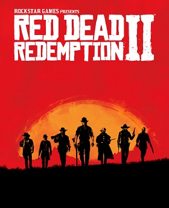

一个帮派在西部的最后几年。
:::

:::card{title="幽灵行者" href="https://zh.wikipedia.org/wiki/幽灵行者" score="4" label="游戏"}
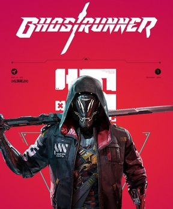

至今未通关...
:::

:::card{title="欧洲卡车模拟 2" href="https://zh.wikipedia.org/wiki/欧洲卡车模拟2" score="4.5" label="游戏"}

风景和电台比刺激重要。
:::

:::card{title="生化危机 2" href="https://zh.wikipedia.org/wiki/生化危机2" score="4" label="游戏"}
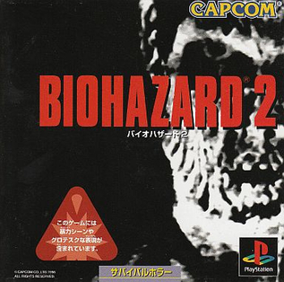

重制后的浣熊市。
:::

:::card{title="生化危机 3" href="https://zh.wikipedia.org/wiki/生化危机3_重制版" score="4" label="游戏"}
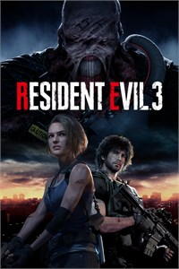

追踪者追着吉尔跑。
:::

:::card{title="生化危机 4" href="https://zh.wikipedia.org/wiki/生化危机4" score="5" label="游戏"}
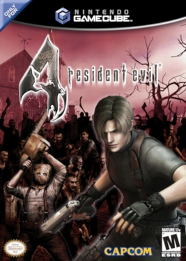

里昂去救总统女儿。
:::

:::card{title="生化危机 7" href="https://zh.wikipedia.org/wiki/生化危机7" score="4" label="游戏"}
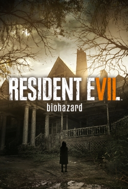

第一人称走进贝克家。恐怖从枪战改成屋子里的家人。
:::

:::card{title="极限竞速：地平线 4" href="https://zh.wikipedia.org/wiki/极限竞速_地平线4" score="4.5" label="游戏"}

英国地图的四季真好看啊。
:::

:::card{title="极限竞速：地平线 5" href="https://zh.wikipedia.org/wiki/极限竞速_地平线5" score="4.5" label="游戏"}
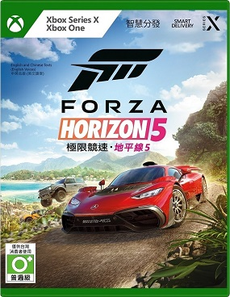

墨西哥地图更大了。
:::

:::card{title="双人成行" href="https://zh.wikipedia.org/wiki/双人成行" score="4" label="游戏"}
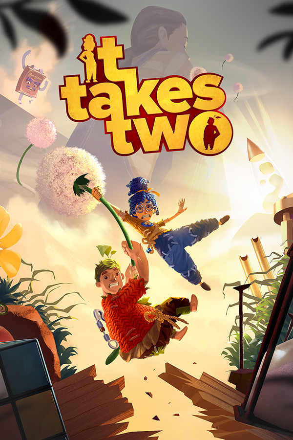

做的还是很有意思的。
:::

:::card{title="巫师3重制" href="https://zh.wikipedia.org/wiki/巫师3：狂猎" label="游戏"}
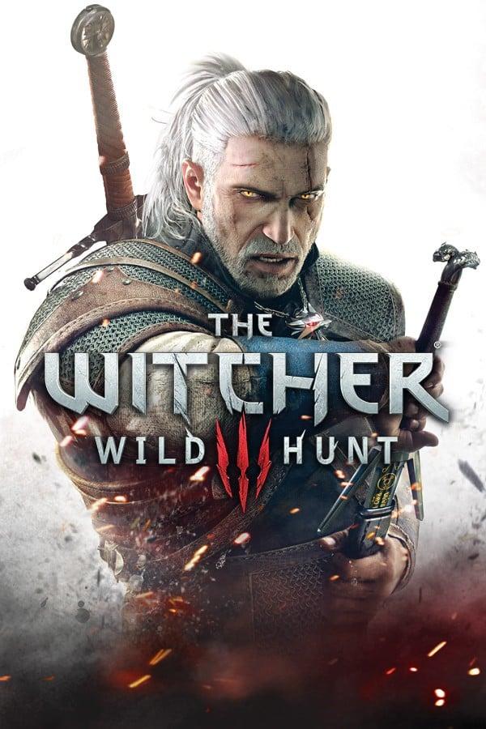

重制版。
:::
