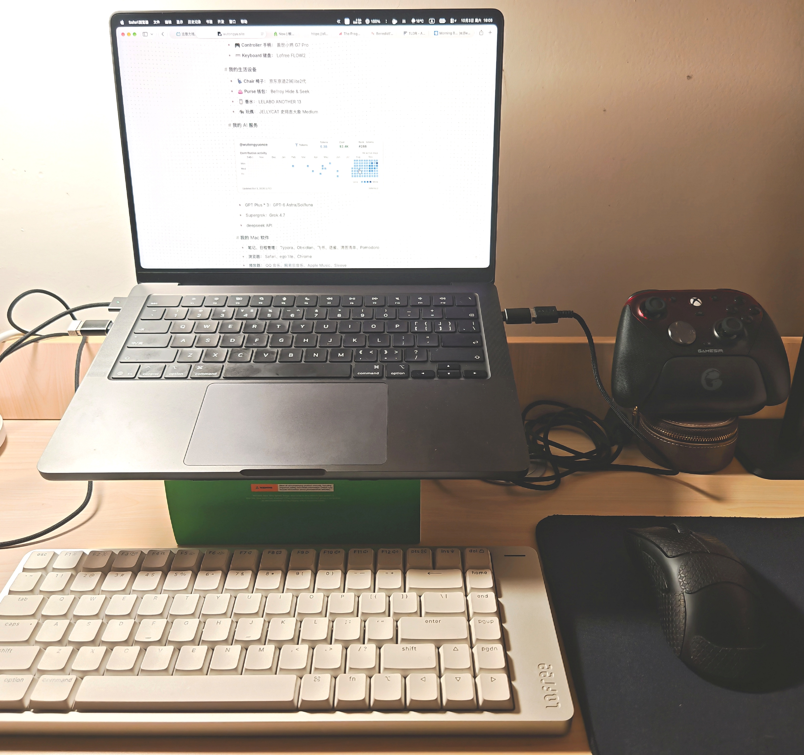

| 类型 | 名称 | 时间 | 价格 | 描述 |
| --- | --- | --- | --- | --- |
| 电脑 | Macbook Pro M5 24+512 午夜色，UKIY AR 屏，LALO 折叠支架 | 2026.1.10-至今 | 11500¥ + 116¥ + 50¥ | 涨价前买的，擦屏幕可用 3M 清洁布 |
| 电脑 | 天选4 r9 4070 16+1T，AX210 网卡 | 2023.6.12-至今 | 9499¥ + 116¥ | |
| 电脑 | Samsung T7 固态 1T | 2026.3.8-至今 | 900¥ | |
| 显示器 | SANC 盛色 S65 24.5 英寸 2K320Hz FastIPS | 2026.10.20-至今 | 800¥ | |
| 平板 | ipad mini 8 | 2026.11.3 | 4599¥ | 最好用的 ipad，但是 fk 60hz |
| 手机 | Honor Magic7 24+512 | 2024.12.2-至今 | 4250¥ | |
| 手机 | 小米金沙江磁吸充电宝 | 2026.5.7-至今 | 242¥ | |
| 耳机 | Airpods Pro 2 | 2025.8.10-至今 | 1180¥ | |
| 耳机 | ARPTICAL 拉斐尔 + EPZ TP35 Pro | 2026.8.25-至今 | 690¥ + 280¥ | |
| 音响 | Sony SRS-XB100 | 2026.5.2-至今 | 259¥ | 参加婚礼时抽到的 |
| 鼠标 | Razer V3pro | 2026.2.28-至今 | 380¥ | |
| 鼠标 | Logi M650 | 2024.12.24-至今 | 78¥ | |
| 鼠标垫 | D-GLOW【究】 | 2025.11.24-至今 | 144¥ | |
| 手柄 | 盖世小鸡 G7 Pro | 2026.9.7-至今 | 239¥ | |
| 键盘 | Lofree FLOW2 | 2025.10.4-至今 | 754¥ | |
| 路由器 | ZTE 中兴 AX3000 巡天 Pro+ | 2024.4.27-至今 | 279¥ | |

