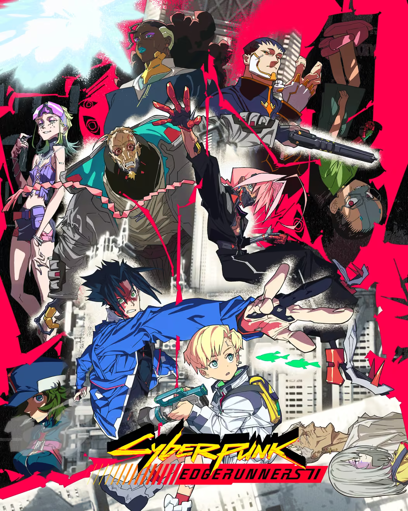
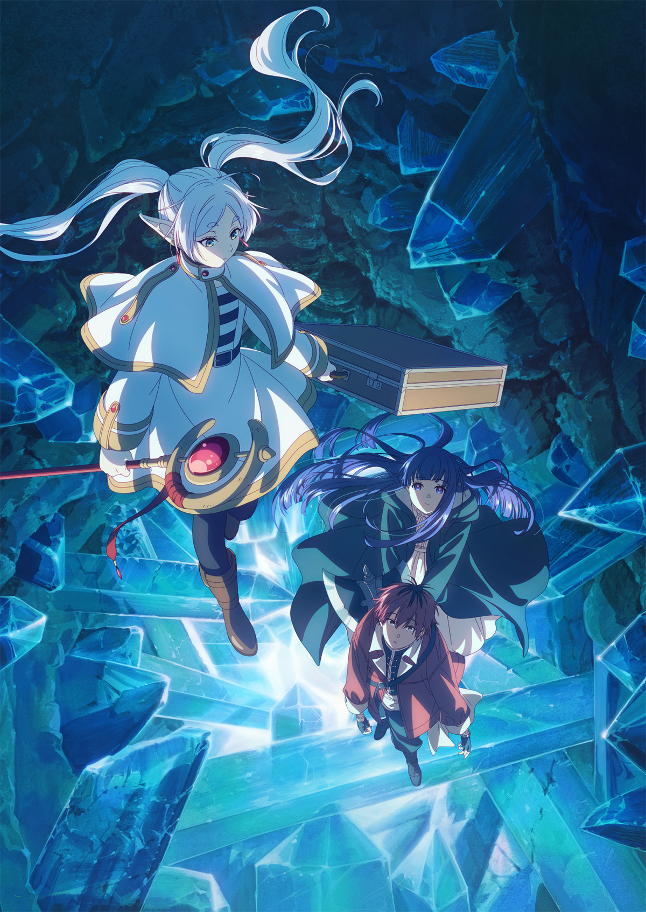
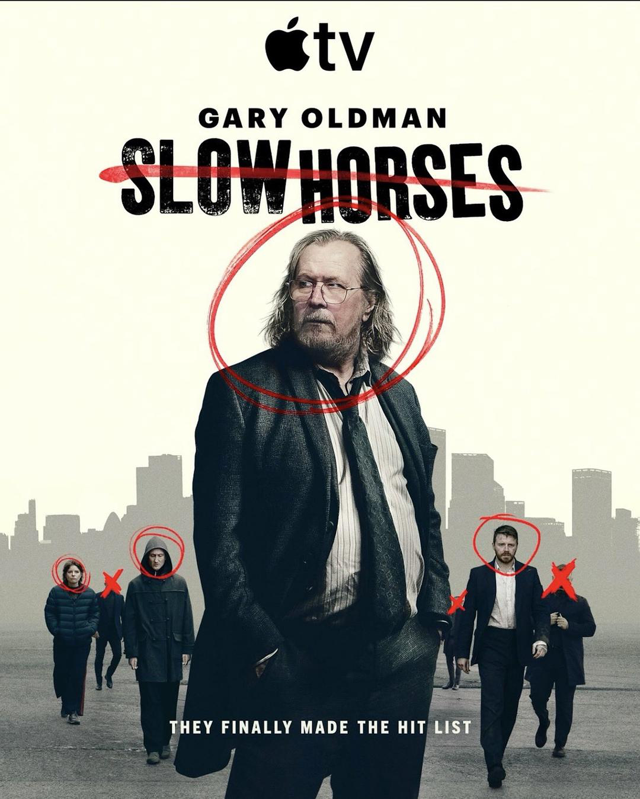

:::card{layout="portrait" title="赛博朋克边缘行者 2" href="https://zh.wikipedia.org/wiki/赛博浪客" meta="可惜了赛博朋克的设定和画面制作水平，第二季整个剧本混乱又缺乏张力，毫无内核。"}

:::

:::card{layout="portrait" title="葬送的芙莉莲 2" href="https://zh.wikipedia.org/wiki/葬送的芙莉莲" meta="作为过渡的一季，还是很好看"}

:::

:::card{layout="portrait" title="流人第六季" href="https://zh.wikipedia.org/wiki/流人" meta="看兰姆的刻薄与温情，边缘人办案、挣扎生存。"}

:::

:::card{layout="portrait" title="FX战士久留美" href="https://zh.wikipedia.org/wiki/FX战士久留美" meta="人-稿子-钻石。"}

:::

:::card{layout="portrait" title="牧神记" href="https://zh.moegirl.org.cn/牧神记" meta="陪秦牧斗神"}

:::
