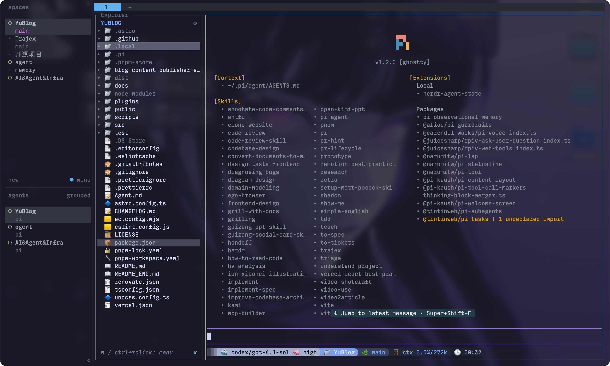

### 我的 Mac 软件

| 类型 | 软件 | 说明 |
| --- | --- | --- |
| AI&Agent | [ChatGPT](https://chatgpt.com/) | |
| AI&Agent | [Grok Bot](https://x.ai/news/introducing-grok-bot) | |
| AI&Agent | [Ghostty](https://ghostty.org/) + [herdr](https://github.com/herdrdev/herdr) + [pi](https://github.com/earendil-works/pi) | herdr 插件 [herdr-sidebar](https://github.com/alexarthurs/herdr-sidebar)；pi 插件 [我的 pi-extensions](https://github.com/wutongyuonce/pi-extensions) |
| AI&Agent | [Magpie](https://usemagpie.ai/) | 模型路由 |
| AI&Agent | [Nowdex](https://nowdex.app/) | token 额度统计 |
| AI&Agent | [Trajex](https://github.com/wutongyuonce/Trajex) | |
| AI&Agent | [cockpit tools](https://github.com/jlcodes99/cockpit-tools) | |
| 代码 | [Zed](https://zed.dev/) | 编辑器 |
| 代码 | [VS Code](https://code.visualstudio.com/) | 编辑器 |
| 代码 | [Navicat](https://www.navicat.com/) | 数据库 |
| 代码 | [DBX](https://dbxio.com/cn) | 数据库 |
| 代码 | [Tailscale](https://tailscale.com) |  |
| 代码 | [Xcode](https://developer.apple.com/xcode/) |  |
| 代码 | [Bruno](https://www.usebruno.com/) | |
| 代码 | [Apifox](https://apifox.com/) | |
| 代码 | [Postman](https://www.postman.com/) | |
| 代码 | [Docker](https://www.docker.com/) | |
| 代码 | [WhatThePort](https://whattheport.dev/) | 端口查看器 |
| 笔记、日程管理 | [Typora](https://typora.io/) | |
| 笔记、日程管理 | [飞书](https://www.feishu.cn/) | |
| 笔记、日程管理 | [语雀](https://www.yuque.com/) | |
| 笔记、日程管理 | [滴答清单](https://dida365.com/) | |
| 笔记、日程管理 | [Obsidian](https://obsidian.md/) | 插件：Git、Excalidraw、Advanced Tables、Adjustable Media |
| 浏览器 | [Safari](https://www.apple.com/safari/) | |
| 浏览器 | [ego lite](https://lite.ego.app/) | |
| 浏览器 | [Chrome](https://www.google.com/chrome/) | |
| 播放器 | [QQ 音乐](https://y.qq.com/) | |
| 播放器 | [网易云音乐](https://music.163.com/) | |
| 播放器 | [Apple Music](https://www.apple.com/apple-music/) + [Sleeve](https://replay.software/sleeve) | |
| 播放器 | [Spotify](https://open.spotify.com) | |
| 播放器 | [Lyrimuse](https://yudaotor.github.io/lyrimuse/zh/) | Mac 桌面歌词 |
| 社交工作 | [Telegram](https://telegram.org/) | |
| 社交工作 | [Discord](https://discord.com/) | |
| 社交工作 | [钉钉](https://www.dingtalk.com/) | |
| 社交工作 | [腾讯会议](https://meeting.tencent.com/) | |
| 邮箱 | [网易邮箱大师](https://dashi.163.com/) | |
| 媒体、信息 | [Folo](https://folo.is/) + [PaperRSS](https://github.com/ohmyangboy/PaperRss) | RSS 订阅器 |
| 媒体、信息 | [Readest](https://readest.com/) | 阅读器 |
| 媒体、信息 | [OBS](https://obsproject.com/) | |
| 媒体、信息 | [剪映专业版](https://www.capcut.cn/) | 剪辑 |
| 媒体、信息 | [ArcTime Pro](https://arctime.cn/arctime-pro.html) | 字幕 |
| 媒体、信息 | [IINA](https://iina.io/) | 视频播放器 |
| 媒体、信息 | [Downie4](https://software.charliemonroe.net/downie/) | 视频下载器 |
| 媒体、信息 | [小宇宙](https://www.xiaoyuzhoufm.com/) | 播客 |
| 媒体、信息 | [Cap](https://cap.so/) | 录屏剪辑 |
| 其他工具 | [RunCatNeo](https://github.com/runcat-dev/RunCatNeo) | Mac 监控 |
| 其他工具 | [Deck](https://deckclip.app/) | 最好用的 Mac 剪切板历史 |
| 其他工具 | [PixPin](https://pixpin.com/) | 截图 |
| 其他工具 | [Pearcleaner](https://github.com/alienator88/Pearcleaner) / [Tencent Lemon](https://lemon.qq.com/) / [mole](https://mole.fit/zh/) | 清理卸载 |
| 其他工具 | [Slidepad](https://slidepad.app/) | 右侧浏览器 |
| 其他工具 | [TopNotch](https://topnotch.app/) | 遮挡刘海 |
| 其他工具 | [FineTune](https://github.com/ronitsingh10/FineTune) | 音频控制 |
| 其他工具 | [超级右键](https://www.irightmouse.com/) | |
| 其他工具 | [CleanMyKeyboard](https://apps.apple.com/us/app/cleanmykeyboard/id6468120888) | |
| 其他工具 | [Mos](https://mos.caldis.me/) | 鼠标 |
| 其他工具 | [Bob](https://bobtranslate.com/) | 翻译 |
| 其他工具 | [Loop](https://github.com/mrkai77/Loop) | 最丝滑的分屏软件 |
| 游戏 | [Steam](https://store.steampowered.com/) | |
| 游戏 | [CrossOver](https://www.codeweavers.com/crossover) | |

:::gallery{layout="scroll"}

:::

### 我的手机软件

| 类型 | 软件 |
| --- | --- |
| | 微信、豆包输入法 |
| 社交媒体 | vx、qq、zfb、wb、X、ins、Github、telegram、discord、Twitch、Proton Authenticator（密钥） |
| 视频影视播客小说 | b站、youtube、dy、豆瓣、小宇宙、起点、番茄、LOFTER、POSTYPE、bilibili漫画、知乎、腾讯体育、咪咕、腾讯视频 |
| 浏览器 | Chrome、Edge |
| 音乐 | qq音乐、wyy、apple music、spotify |
| 邮箱 | qq邮箱、gmail、网易邮箱 |
| 游戏 | steam、小黑盒 |
| 梯子 | clash verge |
| 统计、日程管理 | 滴答清单、时间日志 |
| 支付金融 | 中国/建设/招商/鄞州银行、跨境购、数字人民币、云闪付、同花顺 |
| 运动健康 | Sigma、米家 |
| 交通 | 美团、哈啰、小遛、滴滴、曹操、高德地图、腾讯地图、googlemap、12306、12123 |
| 购物租房电话费快递买车 | 中国移动、贝壳、闲鱼、淘宝、京东、得物、淘宝闪购、大众点评、kfc、麦当劳、inm、货拉拉、pdd、转转、95分、顺丰、大麦、菜鸟、懂车帝、易车 |
| 旅行 | 携程、去哪儿、航旅纵横、爱彼迎、马蜂窝、Booking、华住会、圆周旅迹 |
| 学习工作 | 多邻国、不背单词、欧陆词典、沉浸式翻译、腾讯会议、Leetcode、指南者留学、百度网盘、飞书、语雀、学信网、扫描全能王 |
| 就业 | boss、offershow、牛牛、领英、智联招聘、脉脉、实习僧 |
| AI | Tailscale、grok bot、chatgpt、deepseek |
